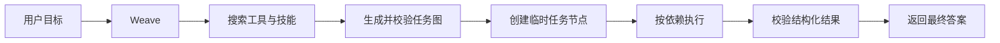

# Pleiad（昴）

Pleiad 是一个用于构建和运行 Agent 的框架；Pleiad Weave 是基于它提供的官方 Agent 应用，以 Web 工作区为主要交互入口。

名称取自昴星团。昴星团中的恒星彼此独立，又共同组成一个清晰可辨的星群；Pleiad 中的工具、技能和动态任务节点也以同样的方式协作。

> 当前版本处于早期开发阶段，接口和数据结构仍可能调整。
>
> 本项目按照 [MIT License](LICENSE) 发布，允许个人、组织和商业项目自由使用、修改、分发和再许可。分发本项目或其重要组成部分时，请保留版权声明和许可证文本。

## Web 工作区

在同一个主聊天中提出目标、补充要求和接收结果，打开工作区查看执行过程、产物与资源。以下截图使用本地演示数据展示当前 Web 界面。

### 主聊天

聊天入口显示独立聊天页；进入工作区后，同一份消息历史和草稿保留在左侧。


### 执行过程

最新步骤排在最上面，展开步骤查看实际动作与结果；补充工作通过主聊天提交。


### 资源详情

模型、工具、技能和环境均可查看完整信息；敏感凭据在服务端脱敏后展示和复制。


## 核心思想

Pleiad 保持最小的智能体模型：

```text
智能体 = 模型 + 提示词 + 工具
```

- Agent 显式绑定模型客户端；Weave 根据文本、视觉和语音等角色选择已配置的模型。
- 提示词定义稳定行为，当前目标和输入在每次请求时组装。
- 工具是执行动作、访问外部系统和获取事实的统一入口；不受信任的工作区工具通过 OCI 沙箱执行。
- 技能提供静态知识、方法和工作规范，正文按需读取；Skill 脚本通过已授权的 command 在沙箱中执行。

Agent 未指定工具时默认使用 `read_file`、`write_file` 和 `command` 引用，显式工具声明精确限定可用集合，所有工具由宿主绑定和授权。Weave 的工作区工具和技能根据节点声明的能力代码选择；工作区 Python、Bash 和 Skill 脚本交给显式配置的 OCI Sandbox 执行。

使用者维护工作区能力，Weave 的 Agent 提出并提交任务图，Pleiad 校验图结构、调度节点并检查结果契约。

## 运行流程



简单任务可以直接回答或调用内置工具。需要多步骤依赖、并行执行或结构化数据传递时，Weave 可以生成任务图。节点输出经过 Pleiad 结构校验后才能进入下游节点。

## 当前能力

- 动态工具库与技能库；
- SDK 内置文件读写和 OCI 命令执行工具；
- 动态任务图生成、校验、版本管理和并行调度；
- 多模型提供商适配与流式响应；
- 统一错误模型和终止性错误判断；
- 顺序产品事件、程序日志和显式 OpenTelemetry 接入；
- 命令行、终端界面、网页工作区和 HTTP 接口；
- 可复用空间、独立 Worker Execution、单主聊天与 Graph 执行可视化；
- 节点输入、输出和最终结果的结构校验。

Pleiad 框架本身不依赖 TUI、FastAPI、Typer、Uvicorn、Loguru 或具体应用配置。第三方可以只安装 `pleiad`，使用公开 Runner、Tool、Skill、Graph 和 Sandbox 契约开发自己的应用。

## 环境要求

- Python 3.12
- [uv](https://docs.astral.sh/uv/) 0.11.22（版本由 `.uv-version` 固定；SDK 与 App 各自维护锁文件）
- 一个受支持模型提供商的接口密钥
- Docker 或 Podman（执行工作区代码时需要）
- Node.js 22.12+ 与 npm（从源码构建网页时需要；发行包自带网页资源）

## 快速开始

默认工作区已预置数据工具、研究/旅游/写作等 Skill 与 MCP 连接，接入方式见
[Weave 默认能力](docs/weave-capabilities.md)。连接初始关闭，配置后进入现有资源目录。

```bash
# Run from the repository root after cloning the project.
uv sync --project apps/weave --locked --all-groups --all-extras
cp .env.example .env
```

编辑 `.env`，至少填写模型提供商、模型名称和接口密钥：

```dotenv
PLEIAD_LLM_PROTOCOL=openai
PLEIAD_LLM_PROVIDER=deepseek
PLEIAD_LLM_MODEL=deepseek-v4-flash
PLEIAD_LLM_API_KEY=your-api-key
```

工作区工具和 Skill 脚本需要本地已存在的 OCI 镜像。`PLEIAD_SANDBOX_IMAGE` 必须填写真实的 `name@sha256:<64 位十六进制 digest>`；SDK 对所有环境都要求固定 digest，不允许宿主执行回退。

构建并启动 Web 工作区：

```bash
npm --prefix apps/weave/web ci
npm --prefix apps/weave/web run build
uv run --project apps/weave --frozen pleiad serve
```

浏览器打开 **http://127.0.0.1:8000/**。HTTP 服务持有工作区拥有者锁，CLI、TUI 与网页连接同一拥有者。完整配置与操作见 [Weave 网页版启动与操作](docs/weave-web.md)。

需要从终端提交目标或查看工作时，在另一个终端连接已经运行的服务：

```bash
uv run --project apps/weave --frozen pleiad run "读取工作区中的资料并生成摘要"
uv run --project apps/weave --frozen pleiad tui
```

默认监听 `127.0.0.1:8000`，浏览器写请求校验 Host、Origin 与 `X-Weave-CSRF`。主要接口包括以下入口。

- `GET /healthz` 与 `GET /readyz`
- `GET /v1/snapshot` 与 `GET /v1/events?after_sequence=...`
- `GET/POST /v1/chat/messages`
- `GET /v1/spaces` 与 `GET/PATCH/DELETE /v1/spaces/{space_id}`
- `GET /v1/executions` 与 `GET /v1/executions/{execution_id}`
- `POST /v1/executions/{execution_id}/pause`、`/resume`、`/cancel`、`/retry`
- `GET /v1/attentions` 与 `POST /v1/attentions/{attention_id}/resolve`
- 附件、产物、GraphRun、节点尝试、SDK Run 和工具原文的有界读取

正式消息和产品事件由同一 SQLite 事务提交，全局事件序号支持重连回放。快照返回一致读取水位，客户端废弃旧读取代次。断开订阅后，Worker 继续由服务拥有。接口与读取契约见 [Web HTTP 契约](docs/weave-web.md#http-契约)。

## 能力配置

默认能力目录位于 [workspace/capabilities.yaml](workspace/capabilities.yaml)。配置只描述能力，不包含实现路径、连接地址或凭据：

```yaml
tools:
  - name: text_statistics
    code: example.tool.text_statistics
    description: 统计工作区文本文件的行数、非空行数、词数和字符数
skills:
  - name: task-analysis
    code: task-analysis
    description: 将复杂任务拆解为目标、约束和验收条件
```

每项能力只有 `name`、`code` 和 `description`。工作区 Tool 使用 JSON stdin/stdout Python 脚本，在 `tools/<name>.json` 声明脚本及输入/输出 Schema。Skill 包使用标准 frontmatter，目录名与 code 一致，脚本通过 SDK `command` 执行。

SDK 自动提供 `read_file`、`write_file` 和 `command`。能力搜索复用 SDK BM25 索引；Skill 正文通过 `read_file` 按需加载，不直接装入初始 Prompt。Weave 在 Execution、搜索和图绑定边界读取当前目录，新能力不需要重启。无效目录会明确报错。

### 开发自定义 Tool

能力组合的设计理念见 [Weave 架构设计](docs/weave-architecture.md#1-核心设计理念)。仓库提供 [text_statistics 脚本](workspace/tools/text_statistics.py) 和 [JSON 绑定](workspace/tools/text_statistics.json) 示例；也可让 Weave 使用 `tool-development` Skill 生成能力源码与绑定，由宿主审阅后放入能力目录。

### 任务图设计

[从目标到结果](docs/weave-architecture.md#5-从目标到结果) 说明能力选择、任务图规划、节点协作与产品结果之间的关系。

## 运行数据

新格式数据写入 `workspace/runtime-v2/`，版本不匹配的数据库会明确拒绝打开。工作文件按 Space 和 Execution 分目录管理。

```text
workspace/
├── runtime-v2/
│   ├── product.sqlite3     产品记录、责任处置、路由回执与全局事件
│   ├── sessions.sqlite3    SDK Session、输入、Run、ModelStep 与检查点
│   ├── content/            摘要寻址的附件与产物内容
│   ├── facts/              显式授权的 Space 与用户事实
│   └── logs/               按大小轮转的诊断日志
└── work/<space_id>/<execution_id>/   单个 Worker 的任务文件
```

Router 使用短只读 Run，固定输入批次与原子路由提交。每个 Worker Execution 拥有独立 Session，可在执行边界接受实时补充。SDK 输入消费与产品责任结算分别记录，正式结果经 Report 验证后唤醒 Router。

RunHandle 持有活跃执行，暂停保存 RunCheckpoint，继续沿原 run_id 恢复。独立子工作创建 child Execution，互斥预算预留由产品账本结算。Handoff 保留原 Run、Execution 和 Session。日志与 OpenTelemetry 诊断保持独立身份。

运行和恢复机制见 [Pleiad 架构](docs/pleiad-architecture.md) 与 [Weave 架构](docs/weave-architecture.md)。

## 项目结构

```text
packages/pleiad/src/  # 安装后的 Python 包名：pleiad
├── agent/           Agent 声明、提示词组装和策略提示
├── runtime/         Runner、运行策略、状态和事件
├── models/          provider-neutral 模型契约、协议和适配器
├── tools/           工具契约、注册、运行时和内置工具
├── skills/          Skill Package 与静态知识契约
├── messages/        完整消息与 ToolCall
├── events/          执行、消息、图和 Worker 事件
├── context/         上下文预算、选择、渲染和压缩
├── sessions/        输入、Run、ModelStep、检查点与双存储后端
├── orchestration/   Graph、Handoff 和作用域 SubagentGroup
├── sandbox/         Sandbox backend 契约与 OCI 参考实现
├── observability/   通用 Trace/Span/事件端口
├── logging/         日志上下文、过滤器和轮转 handler 构建
└── errors/          稳定错误码和基础异常

apps/weave/src/      # 安装后的 Python 包名：pleiad_weave
├── agent/           Router、Worker、GraphControls 和 Node runner
├── application/     API/TUI/CLI 共用的应用服务和 DTO
├── capabilities/    workspace catalog、热加载和快照
├── infrastructure/  配置、provider、存储、日志和沙箱准备
├── api/             FastAPI 入口
├── tui/             Textual 终端界面
├── web/             随 Python 包发行的网页构建资源
├── resources/       随应用发行的 Skill 和沙箱镜像定义
└── cli.py           pleiad 命令入口
```

源码直接位于两个成员的 `src/` 下，不再嵌套 `pleiad/` 或 `pleiad_weave/`。各成员通过 setuptools `package-dir` 映射为公开导入名；业务代码从 `pleiad` / `pleiad_weave` 的具体模块导入，不导入 `src`，也不通过 `PYTHONPATH` 注入源码。

## 开发与验证

SDK 与 App 是独立 Python 项目，各自在自己的目录维护依赖、锁文件和测试配置。App 开发环境通过本地路径使用 SDK；发行安装使用 `pleiad[mcp]==0.1.2`，包含节点上下文传递、会话记忆清理 API 和 MCP stdio 会话隔离。发布 Weave 前需先发布此 SDK 版本。

```bash
uv sync --project packages/pleiad --locked --all-groups --all-extras
uv run --directory packages/pleiad --frozen ruff format --check .
uv run --directory packages/pleiad --frozen ruff check .
uv run --directory packages/pleiad --frozen mypy
uv run --directory packages/pleiad --frozen pytest -q -m 'not oci and not provider_e2e'

uv sync --project apps/weave --locked --all-groups --all-extras
uv run --directory apps/weave --frozen ruff format --check .
uv run --directory apps/weave --frozen ruff check .
uv run --directory apps/weave --frozen mypy
uv run --directory apps/weave --frozen pytest -q -m 'not packaging and not oci and not provider_e2e'
uv run --project apps/weave --frozen lint-imports --config .importlinter

npm --prefix apps/weave/web run typecheck
npm --prefix apps/weave/web run format:check
npm --prefix apps/weave/web test
npm --prefix apps/weave/web run build
```

贡献代码前请阅读 [贡献指南](CONTRIBUTING.md)。[Pleiad 架构设计](docs/pleiad-architecture.md) 和 [Weave 架构设计](docs/weave-architecture.md) 通过 C4 视图说明核心理念、系统边界与组件协作；架构图使用内嵌 Mermaid。网页使用与配置见 [Web 启动文档](docs/weave-web.md)。

## 许可

Pleiad 采用 [MIT License](LICENSE)。该许可证允许商业使用、修改、分发、再许可和销售软件副本。分发时必须保留版权声明和许可证文本；软件不提供任何明示或默示担保。

MIT License 仅适用于 Pleiad 项目自身的代码。模型服务、Provider API、第三方依赖、工作区 Tool、Skill 和其他外部资源可能受各自许可证或服务条款约束，使用者必须分别审核这些条款。
