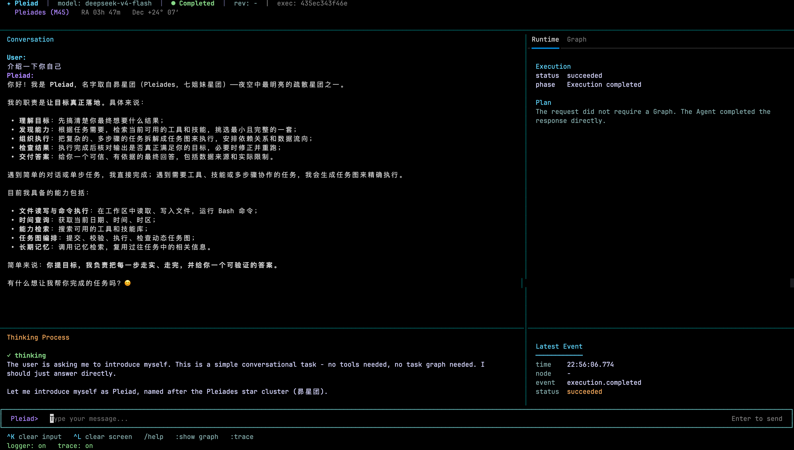

# Pleiad（昴）

Pleiad 是一个根据用户目标发现能力、生成任务节点、组织有向无环任务图并执行任务的智能体运行系统。

名称取自昴星团。昴星团中的恒星彼此独立，又共同组成一个清晰可辨的星群；Pleiad 中的工具、技能和动态任务节点也以同样的方式协作。

> 当前版本处于早期开发阶段，接口和数据结构仍可能调整。
>
> 本项目按照 [MIT License](LICENSE) 发布，允许个人、组织和商业项目自由使用、修改、分发和再许可。分发本项目或其重要组成部分时，请保留版权声明和许可证文本。



## 核心思想

Pleiad 保持最小的智能体模型：

```text
智能体 = 模型 + 提示词 + 工具
```

- 模型是全局能力，根据文本、视觉和语音等角色配置。
- 提示词定义稳定行为，当前目标和输入在每次请求时组装。
- 工具是执行动作、访问外部系统和获取事实的统一入口。
- 技能提供静态知识、方法和工作规范，通过提示词扩展智能体能力。

每个智能体默认拥有 `read`、`write`、`bash` 和 `get_datetime` 等内置工具。其他工具和技能根据节点声明的能力代码，在每次模型请求前动态加载。远程协议、插件或第三方服务进入 Pleiad 后，统一适配为普通工具。

使用者主要维护能力库，Pleiad 负责搜索能力、生成节点、建立依赖关系、调度执行并检查结果。

## 运行流程


简单任务可以直接回答或调用内置工具。需要外部能力、多步骤依赖、并行执行或结构化数据传递时，Pleiad 会生成任务图。节点输出经过结构校验后才能进入下游节点。

## 当前能力

- 动态工具库与技能库；
- 内置文件读写、受控命令执行和日期时间工具；
- 动态任务图生成、校验、版本管理和并行调度；
- 多模型提供商适配与流式响应；
- 统一错误模型和终止性错误判断；
- 运行事件、结构化日志和本地全链路追踪；
- 命令行、终端界面和 HTTP 接口；
- 节点输入、输出和最终结果的结构校验。

## 环境要求

- Python 3.12
- [uv](https://docs.astral.sh/uv/)
- 一个受支持模型提供商的接口密钥

## 快速开始

```bash
# Run these commands from the repository root after cloning the project.
cd g-agent
uv sync --locked --all-groups
cp .env.example .env
```

编辑 `.env`，至少填写模型提供商、模型名称和接口密钥：

```dotenv
PLEIAD_LLM_PROTOCOL=openai
PLEIAD_LLM_PROVIDER=deepseek
PLEIAD_LLM_MODEL=deepseek-v4-flash
PLEIAD_LLM_API_KEY=your-api-key
```

启动终端界面：

```bash
uv run pleiad tui
```

执行单个目标：

```bash
uv run pleiad run "读取工作区中的资料并生成摘要"
```

启动 HTTP 服务：

```bash
uv run pleiad serve
```

默认监听 `127.0.0.1:8000`。需要从其他设备访问时，可以显式传入 `--host 0.0.0.0`。接口包括：

- `GET /healthz`
- `POST /v1/executions`
- `GET /v1/executions/{execution_id}`
- `GET /v1/executions/{execution_id}/events`

## 能力配置

默认能力目录位于 [workspace/capabilities.yaml](workspace/capabilities.yaml)。配置只描述能力，不包含实现路径、连接地址或凭据：

```yaml
tools:
  - name: read
    code: pleiad.tool.read
    description: 读取工作区中的文件内容
  - name: get_datetime
    code: pleiad.tool.datetime
    description: 获取当前日期、时间、时区和时间戳

skills:
  - name: task-analysis
    code: pleiad.skill.task-analysis
    description: 将复杂任务拆解为目标、约束和验收条件
```

每项能力只有 `name`、`code` 和 `description`。其中 `code` 是稳定、不透明的加载标识。工具的地址、凭据和运行参数由工具实现管理；技能内容存放在 [workspace/skills](workspace/skills) 中，只提供静态指导。

主 Agent 的能力发现只检索这些 Descriptor 元数据。系统使用内存 BM25 索引对 `name`、`description` 和 `code` 排序，不加载未入选的工具实现或技能正文；Node Agent 进入执行后保持已选能力集合稳定，不在每次 ReAct loop 中重复检索。

### 开发自定义 Tool

使用者继承 `BaseTool` 的实现统一放在 [workspace/tools](workspace/tools) 中，并在固定入口 `workspace/tools/__init__.py` 注册 `code → ToolFactory`。随后只需在能力 YAML 中增加同一 `code` 的 `name`、`code` 和 `description`，Pleiad 就能搜索该能力。Runtime 会在每轮请求前检查变化并热加载最新的有效目录，不需要重启。

仓库提供了可直接运行的 `text_statistics` 示例。完整代码、注册方式、运行配置和故障排查见 [自定义 Tool 开发指南](docs/custom-tools.md)。

如果不想手写 Python Tool，可以直接让 Pleiad 使用内置的 `tool-development` Skill，通过对话完成实现、编译检查、注册和能力发布。

### 复杂任务图示例

[复杂任务图验证示例](docs/examples/complex-graph-task.md) 提供了一条可以直接粘贴到 TUI 的跨区域订单审计任务。预期结构是三个并行提取节点和一个汇总审计节点，可用于检查能力搜索、Graph 生成、节点调度、事件投影和 Trace。

## 运行数据

本地运行数据写入 `workspace/runtime/`：

```text
runtime/
├── logs/          按日期保存的日志（单文件 10 MB，最多 7 天）
├── traces/        全链路追踪
├── executions/    执行摘要
├── graphs/        任务图版本
├── graph-runs/    任务图运行记录
├── node-runs/     节点运行记录
├── artifacts/     节点结构化产物
└── memory/        主 Agent 的 JSONL 短期与长期记忆
```

### 上下文与记忆

主 Agent 负责持久化会话和个人记忆；Node Agent 只在单次执行中维护运行态消息。请求专用的上下文和 Prompt 仅在当前请求内有效，不进入持久化记忆。

上下文与记忆的详细持久化、检索和回退策略属于内部设计。对应环境变量见 `.env.example`，并由应用配置统一校验。

## 项目结构

```text
src/pleiad/
├── llm/             模型协议、提供商和标准响应
├── tools/           工具契约、加载器、能力库和运行时
├── skills/          技能契约、加载器和能力库
├── agent/           提示词、智能体定义和执行循环
├── graph/           任务图数据模型、校验和版本存储
├── runtime/         节点执行、图调度和系统控制工具
├── observability/   全链路追踪
├── storage/         执行记录和结构化产物
├── application/     应用服务
├── entrypoints/     HTTP 入口
└── tui/             终端界面
```

## 开发与验证

```bash
uv run ruff format --check
uv run ruff check src tests
uv run mypy src
uv run lint-imports
uv run pytest
```

贡献代码前请阅读 [贡献指南](CONTRIBUTING.md)。公开架构边界见 [Architecture Overview](docs/architecture-overview.md)，自定义能力接入见 [自定义 Tool 开发指南](docs/custom-tools.md)，真实任务图验证见 [复杂任务图示例](docs/examples/complex-graph-task.md)。

## 许可

Pleiad 采用 [MIT License](LICENSE)。该许可证允许商业使用、修改、分发、再许可和销售软件副本。分发时必须保留版权声明和许可证文本；软件不提供任何明示或默示担保。

MIT License 仅适用于 Pleiad 项目自身的代码。模型服务、Provider API、第三方依赖、工作区 Tool、Skill 和其他外部资源可能受各自许可证或服务条款约束，使用者必须分别审核这些条款。
