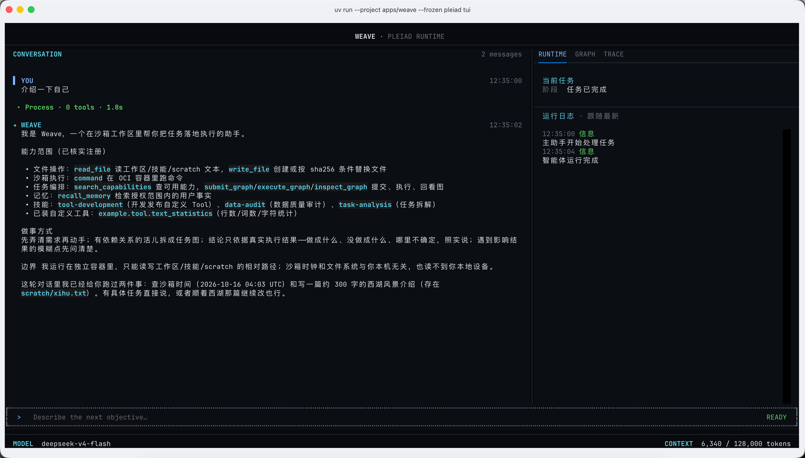
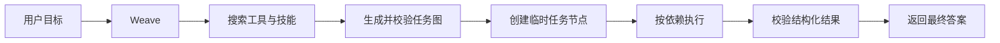

# Pleiad（昴）

Pleiad 是一个用于构建和运行 Agent 的框架；Pleiad Weave 是基于它提供的官方 Agent 应用。

名称取自昴星团。昴星团中的恒星彼此独立，又共同组成一个清晰可辨的星群；Pleiad 中的工具、技能和动态任务节点也以同样的方式协作。

> 当前版本处于早期开发阶段，接口和数据结构仍可能调整。
>
> 本项目按照 [MIT License](LICENSE) 发布，允许个人、组织和商业项目自由使用、修改、分发和再许可。分发本项目或其重要组成部分时，请保留版权声明和许可证文本。



## 核心思想

Pleiad 保持最小的智能体模型：

```text
智能体 = 模型 + 提示词 + 工具
```

- Agent 显式绑定模型客户端；Weave 根据文本、视觉和语音等角色选择已配置的模型。
- 提示词定义稳定行为，当前目标和输入在每次请求时组装。
- 工具是执行动作、访问外部系统和获取事实的统一入口；不受信任的工作区工具通过 OCI 沙箱执行。
- 技能提供静态知识、方法和工作规范，正文按需读取；Skill 脚本通过已授权的 command 在沙箱中执行。

Pleiad 为 Agent 自动加入 `read_file`、`write_file` 和 `command` 引用，由宿主绑定和授权。Weave 的工作区工具和技能根据节点声明的能力代码选择；工作区 Python、Bash 和 Skill 脚本交给显式配置的 OCI Sandbox 执行。

使用者维护工作区能力，Weave 的 Agent 提出并提交任务图，Pleiad 校验图结构、调度节点并检查结果契约。

## 运行流程



简单任务可以直接回答或调用内置工具。需要多步骤依赖、并行执行或结构化数据传递时，Weave 可以生成任务图。节点输出经过 Pleiad 结构校验后才能进入下游节点。

## 当前能力

- 动态工具库与技能库；
- SDK 内置文件读写和 OCI 命令执行工具；
- 动态任务图生成、校验、版本管理和并行调度；
- 多模型提供商适配与流式响应；
- 统一错误模型和终止性错误判断；
- 顺序产品事件、程序日志和显式 OpenTelemetry 接入；
- 命令行、终端界面和 HTTP 接口；
- 节点输入、输出和最终结果的结构校验。

Pleiad 框架本身不依赖 TUI、FastAPI、Typer、Uvicorn、Loguru 或具体应用配置。第三方可以只安装 `pleiad`，使用公开 Runner、Tool、Skill、Graph 和 Sandbox 契约开发自己的应用。

## 环境要求

- Python 3.12
- [uv](https://docs.astral.sh/uv/) 0.11.22（版本由 `.uv-version` 固定；SDK 与 App 各自维护锁文件）
- 一个受支持模型提供商的接口密钥
- Docker 或 Podman（执行工作区代码时需要）

## 快速开始

```bash
# Run from the repository root after cloning the project.
uv sync --project apps/weave --locked --all-groups --all-extras
cp .env.example .env
```

编辑 `.env`，至少填写模型提供商、模型名称和接口密钥：

```dotenv
PLEIAD_LLM_PROTOCOL=openai
PLEIAD_LLM_PROVIDER=deepseek
PLEIAD_LLM_MODEL=deepseek-v4-flash
PLEIAD_LLM_API_KEY=your-api-key
```

工作区工具和 Skill 脚本需要本地已存在的 OCI 镜像。`PLEIAD_SANDBOX_IMAGE` 必须填写真实的 `name@sha256:<64 位十六进制 digest>`；SDK 对所有环境都要求固定 digest，不允许宿主执行回退。

启动终端界面：

```bash
uv run --project apps/weave --frozen pleiad tui
```

执行单个目标：

```bash
uv run --project apps/weave --frozen pleiad run "读取工作区中的资料并生成摘要"
```

启动 HTTP 服务：

```bash
uv run --project apps/weave --frozen pleiad serve
```

默认监听 `127.0.0.1:8000`。需要从其他设备访问时，可以显式传入 `--host 0.0.0.0`。接口包括：

- `GET /healthz`
- `POST /v1/executions`
- `GET /v1/executions/{execution_id}`
- `POST /v1/executions/{execution_id}/cancel`
- `GET /v1/executions/{execution_id}/events`

事件回放支持 `?after_sequence=<integer>`，只返回序号更大的持久化事件。事件先写入 SQLite journal，再分发给在线监听者；模型文本增量只在线分发，不写入 journal，思维增量不进入事件流。单条持久化事件的序列化大小上限为 16 KiB。

## 能力配置

默认能力目录位于 [workspace/capabilities.yaml](workspace/capabilities.yaml)。配置只描述能力，不包含实现路径、连接地址或凭据：

```yaml
tools:
  - name: text_statistics
    code: example.tool.text_statistics
    description: 统计工作区文本文件的行数、非空行数、词数和字符数
skills:
  - name: task-analysis
    code: task-analysis
    description: 将复杂任务拆解为目标、约束和验收条件
```

每项能力只有 `name`、`code` 和 `description`。工作区 Tool 使用 JSON stdin/stdout Python 脚本，在 `tools/<name>.json` 声明脚本及输入/输出 Schema。Skill 包使用标准 frontmatter，目录名与 code 一致，脚本通过 SDK `command` 执行。

SDK 自动提供 `read_file`、`write_file` 和 `command`。能力搜索复用 SDK BM25 索引；Skill 正文通过 `read_file` 按需加载，不直接装入初始 Prompt。Weave 在 Execution、搜索和图绑定边界读取当前目录，新能力不需要重启。无效目录会明确报错。

### 开发自定义 Tool

能力组合的设计理念见 [Weave 架构设计](docs/weave-architecture.md#1-核心设计理念)。仓库提供 [text_statistics 脚本](workspace/tools/text_statistics.py) 和 [JSON 绑定](workspace/tools/text_statistics.json) 示例；也可让 Weave 使用 `tool-development` Skill 编写、校验和发布新能力。

### 任务图设计

[从目标到结果](docs/weave-architecture.md#5-从目标到结果) 说明能力选择、任务图规划、节点协作与产品结果之间的关系。

## 运行数据

本地运行数据写入 `workspace/runtime/`：

```text
runtime/
├── logs/          按大小轮转的程序日志（默认 30 MiB，7 份备份）
├── executions/    执行摘要
├── graphs/        任务图版本
├── graph-runs/    任务图运行记录
├── node-runs/     节点运行记录
├── artifacts/     节点结构化产物
├── scratch/       命令与 Skill 的临时产物
└── memory/        SDK ShortMemory SQLite 与产品授权事实 JSONL
```

### 上下文与记忆

主 Agent 使用 SDK SQLite ShortMemory 保存完整 Turn，Node Agent 使用 SDK 的单次节点记忆。同一会话的 Execution 串行执行；业务输入通过请求专用 ContextBlock 提供，不改写原始 User message。会话/用户事实的授权和存储属于 Weave。OpenTelemetry spans 由显式配置的 exporter 导出，不保存到第二套本地 TraceStore。

历史与上下文的设计理念见 [Pleiad 架构设计](docs/pleiad-architecture.md#1-核心设计理念)；执行身份与记忆的关系见 [Weave 架构设计](docs/weave-architecture.md#执行身份与记忆)。对应环境变量见 `.env.example`，由应用配置校验。

## 项目结构

```text
packages/pleiad/src/  # 安装后的 Python 包名：pleiad
├── agent/           Agent 声明、提示词组装和策略提示
├── runtime/         Runner、运行策略、状态和事件
├── models/          provider-neutral 模型契约、协议和适配器
├── tools/           工具契约、注册、运行时和内置工具
├── skills/          Skill Package 与静态知识契约
├── messages/        完整消息与 ToolCall
├── events/          执行、消息、图和 Worker 事件
├── context/         上下文预算、选择、渲染和压缩
├── memory/          ShortMemory、Turn、内存和 SQLite 后端
├── orchestration/   Graph、Handoff 和 Supervisor
├── sandbox/         Sandbox backend 契约与 OCI 参考实现
├── observability/   通用 Trace/Span/事件端口
├── logging/         日志上下文、过滤器和轮转 handler 构建
└── errors/          稳定错误码和基础异常

apps/weave/src/      # 安装后的 Python 包名：pleiad_weave
├── agent/           官方 Weave Agent 和 Node runner
├── application/     API/TUI/CLI 共用的应用服务和 DTO
├── capabilities/    workspace catalog、热加载和快照
├── infrastructure/  配置、provider、存储、日志和沙箱准备
├── api/             FastAPI 入口
├── tui/             Textual 终端界面
├── resources/       随应用发行的 Skill 和沙箱镜像定义
└── cli.py           pleiad 命令入口
```

源码直接位于两个成员的 `src/` 下，不再嵌套 `pleiad/` 或 `pleiad_weave/`。各成员通过 setuptools `package-dir` 映射为公开导入名；业务代码从 `pleiad` / `pleiad_weave` 的具体模块导入，不导入 `src`，也不通过 `PYTHONPATH` 注入源码。

## 开发与验证

SDK 与 App 是独立 Python 项目，各自在自己的目录维护依赖、锁文件和测试配置。App 开发环境通过本地路径使用 SDK；发行安装使用 `pleiad==0.1.0`。

```bash
uv sync --project packages/pleiad --locked --all-groups --all-extras
uv run --directory packages/pleiad --frozen ruff format --check .
uv run --directory packages/pleiad --frozen ruff check .
uv run --directory packages/pleiad --frozen mypy
uv run --directory packages/pleiad --frozen pytest -q -m 'not oci and not provider_e2e'

uv sync --project apps/weave --locked --all-groups --all-extras
uv run --directory apps/weave --frozen ruff format --check .
uv run --directory apps/weave --frozen ruff check .
uv run --directory apps/weave --frozen mypy
uv run --directory apps/weave --frozen pytest -q -m 'not packaging and not oci and not provider_e2e'
uv run --project apps/weave --frozen lint-imports --config .importlinter
```

贡献代码前请阅读 [贡献指南](CONTRIBUTING.md)。`docs/` 只保留 [Pleiad 架构设计](docs/pleiad-architecture.md) 和 [Weave 架构设计](docs/weave-architecture.md)，通过 C4 视图说明核心理念、系统边界与组件协作；架构图使用内嵌 Mermaid。

## 许可

Pleiad 采用 [MIT License](LICENSE)。该许可证允许商业使用、修改、分发、再许可和销售软件副本。分发时必须保留版权声明和许可证文本；软件不提供任何明示或默示担保。

MIT License 仅适用于 Pleiad 项目自身的代码。模型服务、Provider API、第三方依赖、工作区 Tool、Skill 和其他外部资源可能受各自许可证或服务条款约束，使用者必须分别审核这些条款。
