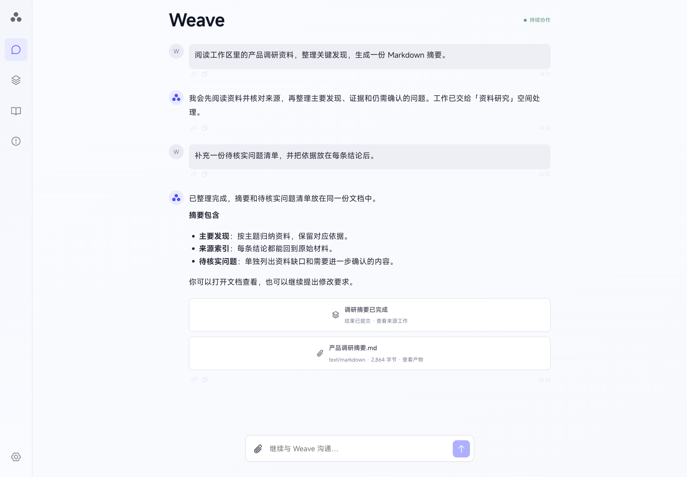
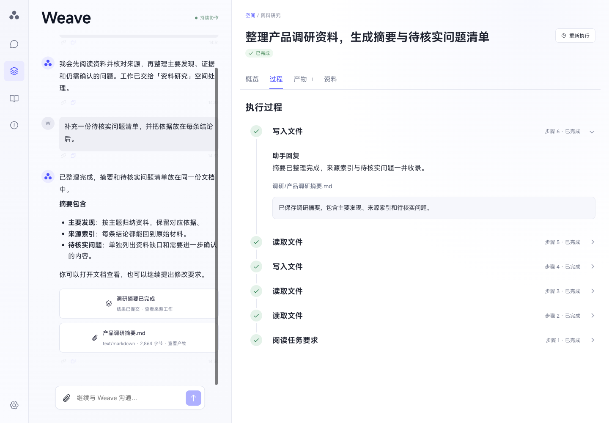
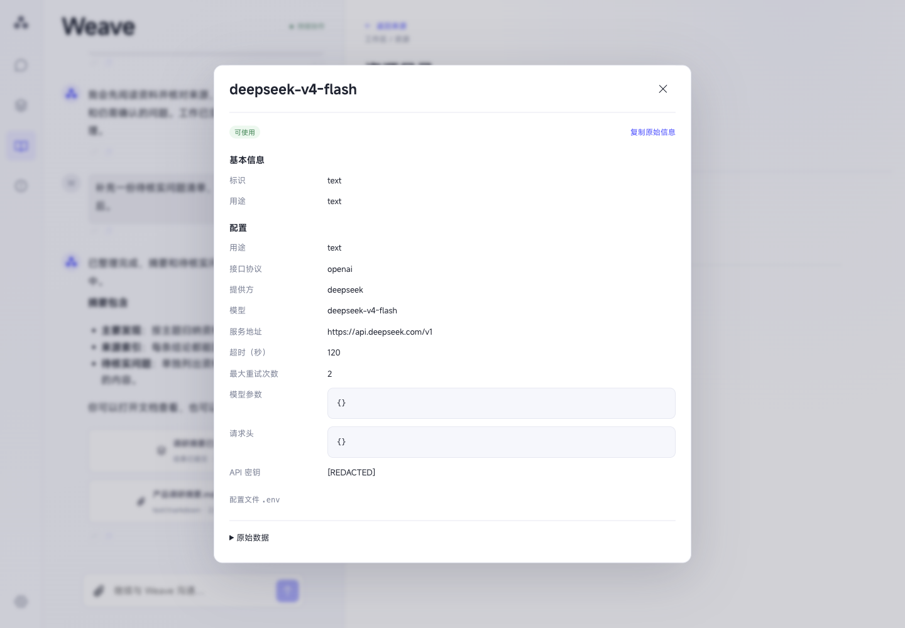

# Pleiad Weave

Weave is a local, single-owner Agent application centered on a Web workspace,
with one permanent main chat, configurable Spaces, and independently owned
Executions. It uses the public Pleiad Runner, Session, Graph, Subagent, Tool,
and Sandbox APIs. CLI and TUI remain clients of the same running service.

The flat `src/` layout installs as `pleiad_weave`. The SDK distribution in
`packages/pleiad` installs independently as `pleiad`.

## Web 界面

以下截图使用本地演示数据，展示当前 Web 界面。

主聊天独立显示；打开工作详情后，聊天和草稿继续保留在左侧。



执行过程按最新步骤优先展示，动作与结果在所属步骤内展开。



资源详情保留完整配置与原始信息，敏感凭据在服务端脱敏后展示和复制。



## Start the Web workspace

From the repository root, install the deployment's model extra and build the UI.

```bash
uv sync --project apps/weave --extra deepseek
npm --prefix apps/weave/web ci
npm --prefix apps/weave/web run build
uv run --project apps/weave --frozen pleiad serve --host 127.0.0.1 --port 8000
```

Configure model credentials and `PLEIAD_SANDBOX_IMAGE` in the host `.env`.
The image must use a real `name@sha256:<64 hex digits>` digest available in
Docker or Podman. Node.js 22.12+ is required for source frontend builds.

Open `http://127.0.0.1:8000/`. To use CLI or TUI, connect to the running HTTP
owner from another terminal.

```bash
pleiad run "Summarize the current work" --server http://127.0.0.1:8000
pleiad tui --server http://127.0.0.1:8000
pleiad execution list
pleiad attention list
pleiad attention answer ATTENTION_ID "My answer"
pleiad attention approve ATTENTION_ID
pleiad attention reject ATTENTION_ID
```

`--message-id` supplies a stable chat retry key. `--execution` assigns a message
to an existing Execution. `PLEIAD_SERVER_URL` sets the CLI/TUI server address.

## Product and runtime

`ExecutionService` owns the process lock, Router batches, Worker scheduling,
durable input delivery, recovery, and control settlement. `WeaveAgents` binds
read-only Router queries and Worker-local tools. `GraphControls` and
`NodeExecutor` save graph revisions and actual attempts around SDK execution.

`ProductStore` uses SQLite transactions for Messages, Spaces, Executions,
Inbox/Delivery, Reports, Attentions, budgets, revisions, request receipts, and
global events. `ProductContent` owns checked attachment/artifact bytes and
restartable deletion. `ProductDetails` owns graph, node, and raw result queries.

Default runtime data lives under `workspace/runtime-v2/`. Product records use
`product.sqlite3`, SDK Sessions use `sessions.sqlite3`, and content, logs,
scratch files, and local facts have separate directories beneath that root. Local fact revisions
use `runtime-v2/facts/`. Worker file and command tools use execution-local
`workspace/work/{space_id}/{execution_id}/` roots. Explicitly selected shared
workspace resources are read and materialized through `workspace_resource`.

The UI opens in a dedicated chat view. Opening work, resources, or content
switches to a split workspace while preserving the same chat and composer.
Returning to chat hides the workspace and retains its reading state.
Execution controls use server-derived action availability. Answering an
Attention atomically creates its user Message and decision. Approval is bound
to the current action digest. A paused Run resumes through the same SDK Session
and invocation checkpoint.

Hosts select approval-required tools with
`PLEIAD_APPROVAL_TOOL_CODES='["write_file","command"]'`. Workspace resource
choices select capabilities within host authorization. Installations and model
credentials are host configuration.

Default MCP presets and reviewed Skills are described in the
[capability guide](../../docs/weave-capabilities.md). Authorize an OAuth
connection with `pleiad mcp-login SERVER_CODE` in a terminal.

## Local facts and observations

Local fact revisions support Space and explicitly authorized user scopes.
Management commands initialize the fact store directly.

```bash
pleiad memory --workspace /absolute/workspace --space-id SPACE_ID list
pleiad memory --workspace /absolute/workspace --space-id SPACE_ID show FACT_ID --history
pleiad memory --workspace /absolute/workspace --space-id SPACE_ID update FACT_ID --content TEXT --expected-revision 1
```

User scope requires `PLEIAD_MEMORY_CROSS_SPACE=true` and uses the host's
`PLEIAD_MEMORY_USER_ID`. Fact mutation records local-user provenance.

`PLEIAD_OBSERVE_DIRECTORY` enables the optional read-only directory source.
The source endpoints expose configuration, health, paginated observations,
and an explicit idempotent observe operation. Limits apply to file count,
per-file bytes, and total bytes.

## Verification

Run the affected distribution's maintained gates from the repository root.

```bash
uv lock --project apps/weave --check
uv run --directory apps/weave --frozen ruff format --check .
uv run --directory apps/weave --frozen ruff check .
uv run --directory apps/weave --frozen mypy
uv run --directory apps/weave --frozen pytest -q -m 'not packaging and not oci and not provider_e2e'
uv run --project apps/weave --frozen lint-imports --config .importlinter
uv run --directory apps/weave --frozen pytest -q -m packaging
npm --prefix apps/weave/web run format:check
npm --prefix apps/weave/web run typecheck
npm --prefix apps/weave/web test
npm --prefix apps/weave/web run build
```

Deterministic tests use external model, network, and process boundaries.
Provider, OCI-daemon, packaging, browser interaction, and transport-only
acceptance are reported separately.

See the [architecture](../../docs/weave-architecture.md),
[Web guide](../../docs/weave-web.md), and [evaluation suite](../../evals/README.md)
for implementation boundaries and operation details.
