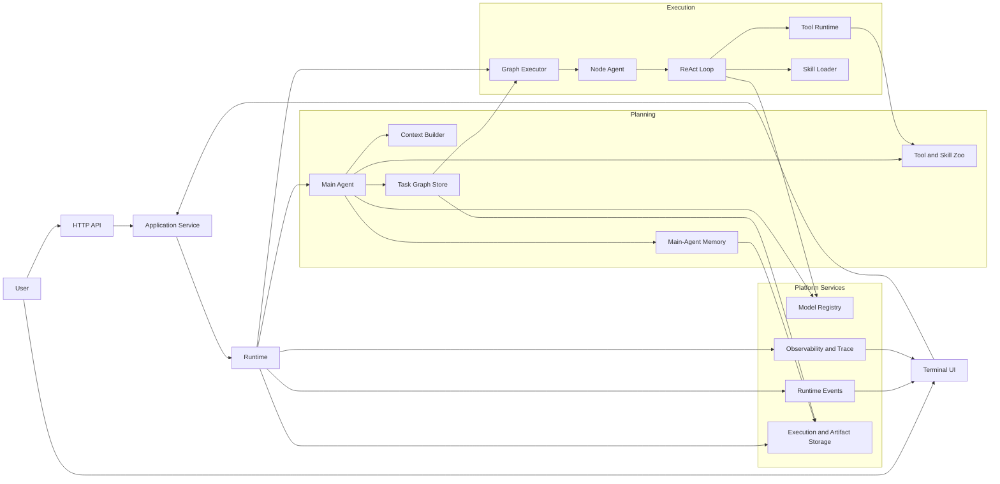
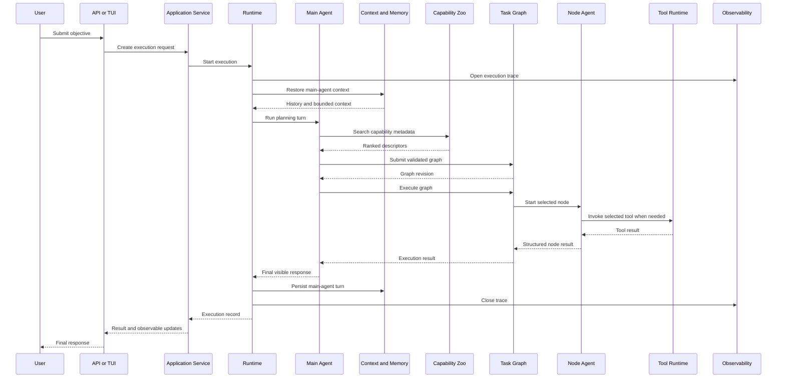

# Pleiad Architecture Overview

Pleiad is a runtime for turning a user objective into a bounded, observable,
and recoverable execution graph. The public architecture is intentionally
small: it describes the stable responsibilities and boundaries required to
understand the project without exposing internal design records.

## System Architecture

## Request Sequence

## Core Components

| Component | Responsibility | Boundary |
| --- | --- | --- |
| API / TUI | Accept objectives and present execution state | Does not implement planning or execution rules |
| Application Service | Own the application request and execution lifecycle | Coordinates external entrypoints with Runtime |
| Runtime | Drive planning, graph execution, state transitions, and recovery | Does not contain provider-specific model logic |
| Main Agent | Interpret the objective, search capabilities, build a graph, and coordinate execution | Owns planning decisions; does not directly implement external side effects |
| Context Builder | Assemble bounded request-local context | Does not persist prompt text or own memory policy |
| Main-Agent Memory | Persist and restore the main Agent's conversation and personal memory | Node Agents do not use persistent memory |
| Tool and Skill Zoo | Index capability metadata and resolve selected implementations | Exposes descriptors for discovery; loading remains lazy |
| Task Graph Store | Validate, version, and persist graph definitions | Stores graph structure, not Agent message history |
| Graph Executor | Schedule graph nodes and propagate structured results | Creates bounded Node execution scopes |
| Node Agent | Execute one selected node objective through a ReAct loop | Receives only its selected Tools and Skills |
| Tool Runtime | Validate and execute side-effecting capabilities | Centralizes execution policy, errors, and observability |
| Model Registry | Resolve configured model roles and providers | Keeps provider details outside orchestration code |
| Observability | Record traces, spans, metrics, and execution diagnostics | Trace persistence is independent from Runtime Events |
| Storage | Persist executions, graphs, artifacts, traces, and memory | Storage formats are implementation details behind ports |

## Logic Principles

1. The Main Agent plans; Node Agents execute.
2. Capability discovery searches only `name`, `description`, and `code` metadata.
3. Tool and Skill search uses an in-memory BM25 index. Selected capability codes
   remain stable throughout a Node Agent's ReAct loop.
4. Tools are the only execution capability exposed to an Agent. Skills provide
   static instructions and do not perform side effects.
5. The Main Agent owns persistent conversation and personal memory. A Node Agent
   keeps only run-local messages and does not write to persistent memory.
6. The raw user query is durable input. A request-specific composed prompt is
   temporary and is not written to memory.
7. Runtime Events support live progress delivery. Trace records provide durable
   execution observability; neither is the storage mechanism for the other.
8. Graph definitions, execution state, Agent messages, and artifacts have
   separate lifecycles and storage responsibilities.
9. Dynamic capability changes become effective at a safe request boundary. An
   invalid catalog does not replace the last valid catalog.
10. External entrypoints depend on application contracts rather than internal
    Agent, Graph, Tool, or storage implementations.

## Public Scope

This document covers stable project boundaries and user-visible execution
behavior. Detailed data models, persistence layouts, context policies, recovery
algorithms, and design history are maintained separately and are not part of
the public documentation set.

For public extension guidance, see [Custom Tool Development](custom-tools.md).
