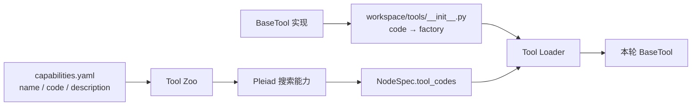
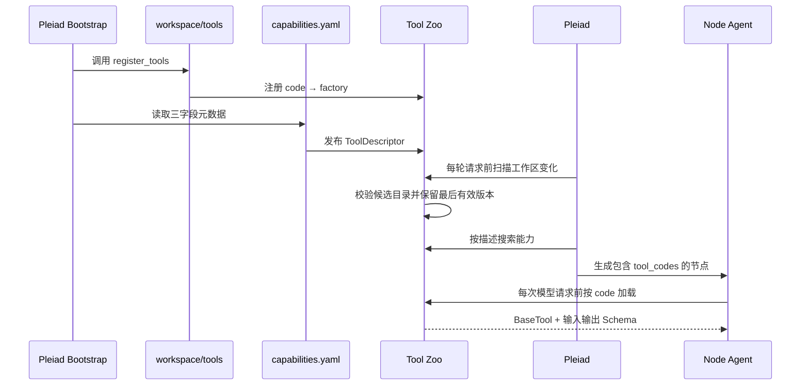

# 自定义 Tool 开发指南

本文说明使用者如何继承 `BaseTool`、把实现放入工作区、注册稳定 `code`，并通过能力 YAML 让 Pleiad 在生成动态 Agent Node 时发现和加载该能力。也可以直接让 Pleiad 使用内置 `tool-development` Skill 完成这套流程。

## 1. 三个文件分别负责什么

```text
workspace/
├── capabilities.yaml          # 发布 name、code、description
└── tools/
    ├── __init__.py            # 把 code 注册到 Tool 工厂
    └── text_statistics.py     # BaseTool 实现
```

三个位置的职责不能混合：

- `text_statistics.py` 定义输入、输出、安全边界和执行逻辑；
- `tools/__init__.py` 建立 `code → ToolFactory` 绑定；
- `capabilities.yaml` 只发布可搜索的语义元数据。

`code` 是三者之间唯一的连接点。它是稳定标识，不是 Python 模块路径。



## 2. 继承 BaseTool

仓库提供了可以直接运行的示例：[workspace/tools/text_statistics.py](../workspace/tools/text_statistics.py)。核心结构如下：

```python
from pathlib import Path

from pleiad.contracts import JsonObject, JsonSchema
from pleiad.tools import BaseTool, ToolContext, ToolDescriptor


class TextStatisticsTool(BaseTool):
    def __init__(self, descriptor: ToolDescriptor, workspace: Path) -> None:
        self._descriptor = descriptor
        self._workspace = workspace.resolve()

    @property
    def descriptor(self) -> ToolDescriptor:
        return self._descriptor

    @property
    def input_schema(self) -> JsonSchema:
        return {
            "type": "object",
            "properties": {"path": {"type": "string", "minLength": 1}},
            "required": ["path"],
            "additionalProperties": False,
        }

    @property
    def output_schema(self) -> JsonSchema:
        return {
            "type": "object",
            "properties": {
                "path": {"type": "string"},
                "lines": {"type": "integer", "minimum": 0},
            },
            "required": ["path", "lines"],
            "additionalProperties": False,
        }

    async def execute(
        self,
        context: ToolContext,
        arguments: JsonObject,
    ) -> JsonObject:
        path = (self._workspace / str(arguments["path"])).resolve()
        if path != self._workspace and self._workspace not in path.parents:
            raise PermissionError("path escapes the configured workspace")
        content = path.read_text(encoding="utf-8")
        return {
            "path": str(path.relative_to(self._workspace)),
            "lines": len(content.splitlines()),
        }
```

一个 Tool 至少实现：

- `descriptor`：直接使用 Loader 传入的 YAML 元数据；
- `input_schema`：模型可以提交的参数结构；
- `output_schema`：运行结果必须满足的结构；
- `execute`：真正执行能力，返回 JSON 对象。

涉及文件、命令、网络和数据库时，安全边界由 Tool 自己实现。示例 Tool 会把路径限制在当前工作区内。

Tool 接收的相对路径以 `PLEIAD_WORKSPACE` 为根，默认值是仓库中的 `workspace/`。例如参数 `{"path": "README.md"}` 实际读取 `workspace/README.md`。

## 3. 注册稳定 code

Runtime 会扫描固定入口 [workspace/tools/__init__.py](../workspace/tools/__init__.py)。在其中实现 `register_tools`：

```python
from pathlib import Path

from pleiad.tools import BaseTool, ToolDescriptor, ToolZoo

from .text_statistics import TextStatisticsTool


def register_tools(zoo: ToolZoo, workspace: Path) -> None:
    def create_text_statistics(descriptor: ToolDescriptor) -> BaseTool:
        return TextStatisticsTool(descriptor, workspace)

    zoo.register_factory(
        "example.tool.text_statistics",
        create_text_statistics,
    )
```

这里注册的是工厂，不会立即创建 Tool，也不会在搜索 Zoo 时建立外部连接。动态 Node 在每次请求模型前选择并加载相应 `code` 时，工厂才会创建 Tool。

新增多个 Tool 时，可以分别放在多个 `.py` 文件中，再由这个固定入口集中注册。

## 4. 发布 YAML 元数据

在 [workspace/capabilities.yaml](../workspace/capabilities.yaml) 的 `tools` 中增加：

```yaml
tools:
  - name: text_statistics
    code: example.tool.text_statistics
    description: 统计工作区文本文件的行数、非空行数、词数和字符数
```

YAML 继续只有 `name`、`code` 和 `description`。其中 `description` 应说明能力可以解决什么问题，便于 Pleiad 进行语义搜索。

注册入口中的 `code` 与 YAML 中的 `code` 必须完全一致。只有 Python 注册没有 YAML 条目时，能力不会进入 Zoo 的可搜索目录；只有 YAML 条目没有 Python 注册时，热加载会保留上一份有效能力目录并记录可恢复错误。

## 5. 运行配置和凭据

连接地址、令牌、超时和连接池属于 Tool 实现，不进入能力 YAML。工厂可以从环境变量、秘密存储或专用配置对象读取配置，再传入 Tool：

```python
import os
from pathlib import Path

from pleiad.tools import BaseTool, ToolDescriptor, ToolZoo

from .database_query import DatabaseQueryTool


def register_tools(zoo: ToolZoo, workspace: Path) -> None:
    database_url = os.environ["EXAMPLE_DATABASE_URL"]

    def create_database_query(descriptor: ToolDescriptor) -> BaseTool:
        return DatabaseQueryTool(descriptor, database_url)

    zoo.register_factory("example.database.query", create_database_query)
```

Runtime 在每次 LLM 请求前检查工作区变化。发现变化后会先构建候选能力目录，校验通过后再替换当前目录。Tool 的 `execute` 在实际调用时运行。

## 6. 热加载规则

Runtime 检查以下内容：

- `workspace/capabilities.yaml`；
- `workspace/tools/__init__.py` 和其他 Python 实现；
- `workspace/skills/` 下的 `SKILL.md`。

能力目录没有变化时不会重复加载。候选目录构建失败时，当前运行继续使用上一份有效目录，下一次文件变化后再次尝试。新增或修改的 Tool 会在下一次 Tool 加载时生效，正在执行的 Tool 实例保持当前版本。

建议先写入 Python 实现和注册入口，使用 `bash` 完成 `compileall` 与代码检查，最后写入 YAML 条目。这样 YAML 可以作为一次能力发布的最后一步。


## 7. 系统如何使用自定义 Tool



内置 Tool 仍会装配到所有 Agent。工作区 Tool 不是内置能力，只有动态节点选择了对应 `code` 才会加载。

## 8. 本地验证

先运行确定性测试，确认注册、搜索、加载、参数校验和执行链路：

```bash
uv run pytest tests/test_tools.py -q
```

再启动 TUI：

```bash
uv run pleiad tui
```

输入：

```text
请搜索可用能力，使用 text_statistics 统计 README.md，并说明统计结果。
```

该任务需要能力库中的非内置 Tool，因此 Pleiad 应生成任务图。Process 窗口会显示能力搜索、任务图提交、任务图执行和 `example.tool.text_statistics` 调用；Runtime 窗口会显示生成的节点及其状态。

## 9. 常见错误

| 现象 | 原因 | 处理方式 |
| --- | --- | --- |
| 启动时报 `No Tool implementation is registered` | YAML 中存在 `code`，注册入口没有同名工厂 | 检查两个位置的 `code` 是否完全一致 |
| 搜索不到 Tool | 只注册了工厂，没有 YAML 条目或描述不准确 | 增加三字段条目并改善 `description` |
| Tool 没有出现在简单任务中 | Pleiad 判断内置 Tool 已足够 | 明确任务需要该能力，或检查能力描述 |
| 参数校验失败 | 模型参数不符合 `input_schema` | 收紧描述并检查 Schema 的必填字段 |
| 结果校验失败 | `execute` 返回值不符合 `output_schema` | 让实现和输出 Schema 保持一致 |
| 修改实现后没有生效 | 候选目录校验失败，运行时继续使用上一版本 | 查看日志中的热加载错误，修复 Python、注册入口或 YAML 后再次触发运行 |

工作区 Tool 是本地可信代码，拥有当前 Python 进程的权限。引入第三方 Tool 前应审查其文件访问、网络访问、命令执行和凭据处理逻辑。
