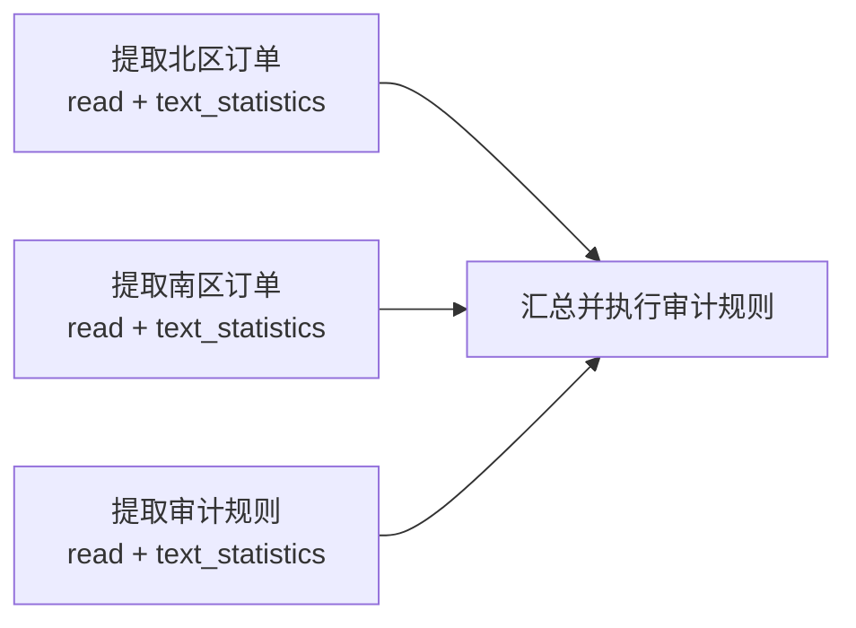

# 复杂任务图验证示例

这个示例用于验证 Pleiad 是否会在真实 TUI 中搜索能力、生成多节点任务图、并行执行独立节点，并把上游结构化结果交给汇总节点。

## 1. 前置条件

- 已按照根目录 `.env.example` 配置可调用的文本模型；
- 当前工作目录是项目根目录；
- `workspace/capabilities.yaml` 中包含 `example.tool.text_statistics`；
- `workspace/examples/complex-graph/` 中的两份订单数据和一份审计规则存在。

启动：

```bash
uv run pleiad tui
```

## 2. 输入任务

把下面整段内容作为一条消息输入 TUI：

```text
请完成一次复杂的跨区域订单数据审计。先搜索当前可用的工具和技能，然后生成并执行任务图，不要直接给出答案。

任务图需要包含三个可以并行执行的分析节点：
1. 读取 examples/complex-graph/north-orders.csv，提取全部订单为结构化记录，并使用 text_statistics 给出文件统计；
2. 读取 examples/complex-graph/south-orders.csv，提取全部订单为结构化记录，并使用 text_statistics 给出文件统计；
3. 读取 examples/complex-graph/audit-rules.md，提取全部审计规则为结构化记录，并使用 text_statistics 给出文件统计。

再建立一个依赖上述三个节点的汇总审计节点，按照规则检查两个区域的全部订单，输出：订单总数、合规订单数、每条违规记录及原因、跨文件重复订单，以及三个输入文件的统计数据。最终答案中请说明实际生成的节点数量和依赖关系。
```

## 3. 预期任务图

模型可以调整节点名称和具体字段，但执行结构应与下图等价：



前三个节点没有相互依赖，应位于同一个执行阶段；汇总节点接收三个上游节点的结构化输出后再运行。

## 4. TUI 验收点

运行过程中观察以下区域：

1. `Process`：出现 `pleiad_search_capabilities`、`pleiad_submit_graph` 和 `pleiad_execute_graph`；节点运行时出现 `read` 与 `example.tool.text_statistics`。
2. `Runtime`：Graph Revision 不再是 `-`，节点数量至少为 4；前三个分析节点先进入运行状态，汇总节点在它们完成后运行。
3. `Graph`：按 `g` 或输入 `:show graph`，可以看到三个分析节点都指向汇总节点。
4. `Latest Event`：持续显示当前节点和最新事件，不使用固定过程文案。
5. `Conversation`：执行结束后出现最终答案，并说明节点数量、依赖关系、订单审计结论和统计结果。
6. `Trace`：按 `t` 可以查看这次 Execution 的本地全链路记录。

## 5. 通过标准

- 任务图 revision 被接受；
- 至少生成四个节点和三条依赖边；
- 三个分析节点可以在同一阶段调度；
- 汇总节点只在三个上游节点完成后执行；
- 自定义 Tool 至少被真实调用三次；
- Graph 和所有节点最终为成功状态；
- 最终输出引用了真实订单、审计规则和 Tool 返回的统计结果；
- 结果至少识别负数金额、缺失金额、跨文件重复订单和非法状态四类问题。

节点名称、模型思考文本和最终措辞是动态的，不作为验收条件。结构、能力调用、状态迁移和结果来源才是验收对象。

## 6. 验证记录

本文档定义可复现的验收场景，不代表已经完成真实模型执行。实际运行该场景的
Issue 或 Pull Request 应记录模型配置、Graph Revision、节点数、边数、最终执行
状态，以及对应的 Trace 或截图证据。
