# Pleiad 持续协作型 Agent 组合运行模式架构设计方案书

| 文档属性 | 内容 |
| --- | --- |
| 文档编号 | PLEIAD-ARCH-COLLAB-001 |
| 版本 / 日期 | 1.2 实现对齐稿 / 2026-11-12，Asia/Shanghai |
| 状态 | SDK 已落地；未发布，Canvas 联调待完成 |
| 目标读者 | SDK 维护者、Canvas/Weave 架构与开发人员、测试人员 |
| 源码基线 | Pleiad 0.2.0；HEAD `2ef982d05b85167cad70758c8064ab03458a94f5` |
| 需求依据 | [持续协作任务书](pleiad-agent-collaboration-task.md)及本次架构讨论 |
| 交付边界 | SDK 实现、图源及离线阅读版；最终接口和验证见交付说明 |
| 架构定位 | 在 `orchestration` 层新增与 `SubagentGroup` 同级的组合运行模式 |
| Codex 研究基线 | `openai/codex@c0cc9fc820f62e4dbdde68214dd6d792d6c8a7ee`；[独立源码调研报告](pleiad-codex-subagent-source-research.md) |

1.1 根据 Codex V2 实际调用链修正活跃 followup 与最终消息边界，明确其 mailbox wait 与本项目持久 EventPage 的区别。后续用户已授权实施。1.2 对齐本地实现；精确签名、测试结果和部署限制见 [交付说明](pleiad-agent-collaboration-handoff.md)。

本文采用 arc42 的主要架构视图，结合 C4、UML 风格时序/状态/类图及 ER 图。C4 的容器表示进程、应用或数据存储，不表示一个 Python 类；Pleiad 仍是嵌入宿主进程的 SDK。本稿保留设计视图；概念图不等于逐文件或逐物理表实现。签名草案与落地接口的差异以第 11.5 节和交付说明为准。[arc42](https://arc42.org/overview/)、[C4](https://c4model.com/diagrams)

## 阅读导航与图目录

评审建议依次阅读：第 1 节目标 → 第 4 节核心决策 → 第 5 节代码与数据架构 → 第 6 节运行语义 → 第 8 节一致性/预算 → 第 11 节实施与风险。

| 图 | 类型 | 关注点 |
| --- | --- | --- |
| D01 | C4 系统上下文 | 用户、宿主、模型及工具服务边界 |
| D02 | C4 容器 | SDK 所在进程与三类持久存储 |
| D03 | C4 组件 | 新组合模式与现有 Runtime 的职责分工 |
| D04 | 模块依赖图 | Python 包归属及单向依赖 |
| D05 | 领域类图 | 定义、成员、工作、Run、消息的关系 |
| D06 | ER 图 | 关系、受理事实、投递、预算及游标 |
| D07 | 时序图 | 模型驱动 spawn、宿主授权与异步执行 |
| D08 | 时序图 | 活跃 followup、空闲新工作和结果回送 |
| D09 | 时序图 | 定向中断与下一轮任务竞争 |
| D10 | 状态图 | 协作作用域与成员的开放状态 |
| D11 | 状态图 | 单轮工作状态与 SDK Run 的映射 |
| D12 | 状态图 | 消息接收、投递、消费的独立事实 |
| D13 | 时序图 | 重启后的事实核对与恢复 |
| D14 | 部署图 | 单拥有者部署、独立数据库与恢复前提 |
| D15 | 预算流程图 | 预留、准入、确认用量及未知费用 |
| D16 | 质量属性树 | 质量目标与可验证约束 |

图源位于本文 Mermaid 代码块；[离线阅读版](assets/agent-collaboration/architecture.html)内嵌 SVG，无需网络或 Mermaid 插件。独立 SVG/Mermaid 文件位于同目录 `diagrams/`。

## 1. 背景、目标与范围

### 1.1 问题与目标

主模型应能在执行过程中判断分工，创建多个有稳定身份和独立上下文的协作成员。成员可以执行多步工具调用、接收补充信息、结束后继续接受任务，并将公开结果返回主模型。宿主控制能力、权限、预算、产品作业与资源生命周期。

现有 `SubagentGroup` 适合父 Run 范围内的委派；新模式的成员身份与 Session 跨工作轮次保留。两种模式分别实现各自职责，共享 Runtime 基础能力，不建立别名、转发适配或继承旧组来模拟新生命周期。

### 1.2 功能目标

| 编号 | 需求 |
| --- | --- |
| FR01 | 模型动态选择宿主允许的能力绑定和任务；同一绑定可创建多个成员 |
| FR02 | spawn 先返回真实持久受理回执，执行异步进行 |
| FR03 | 双向消息、结果摘要与引用；接收、投递、模型消费可分别查询 |
| FR04 | followup 保留成员和 Session；可接收输入的活跃 Run 内追加，空闲或已关闭输入边界时创建新工作与新 invocation/Run |
| FR05 | interrupt 精确作用于目标工作/Run，等待本地资源结算；close 独立管理成员/作用域 |
| FR06 | wait-any、有界等待、独立消费者游标、可重放事件和结果读取 |
| FR07 | 单 Session 单 writer、有限并发/队列/成员数、明确递归限制和失败隔离 |
| FR08 | 当前授权、多模态 Resolver、预算预留及累计结算始终生效 |
| FR09 | 重启恢复历史与回执；未知外部效果不自动重提 |
| FR10 | 提供 Python API、模型工具、行为测试、文档和本地联调契约 |

### 1.3 非目标与保留边界

- 本设计不实现另一套模型循环，不引入分布式任务框架、消息中间件或通用工作流引擎。
- 首次交付采用单个协作作用域一个执行拥有者；不承诺跨机器并行调度、热接管或自动主从切换。
- 不实现任意历史分叉、模型创建凭据/工具代码、无限制自治和自动重放未知收费操作。
- 不把 SDK 工作记录升级成第二种产品 Execution；业务状态、审批界面、资产版本和图片收费账本继续由宿主维护。
- 不改变旧 SubagentGroup 的公开语义；不要求旧调用方迁移。共享底层的新增能力必须有独立默认行为和回归证据。

### 1.4 参考机制与设计选择的界线

已阅读 Codex V2 的工具注册、spawn、控制器、线程创建、历史分叉、输入队列、模型采样、完成通知、容量/驻留及关闭路径，并核对相应测试源码。完整证据与 6 张机制图见 [源码调研报告](pleiad-codex-subagent-source-research.md)。该报告固定到公开仓库提交，不证明当前桌面二进制或托管后端使用相同实现。

采用 Codex 的核心交互语义：followup 在活跃输入边界内补充当前轮，空闲时触发新轮；普通消息和结果不自行唤醒空闲成员。Pleiad 仍自行提供持久回执、精确 Run 中断、wait 游标和预算恢复；这些是本项目契约，不是 Codex 的既有保证。完整父历史 fork 与 item 级流抢占不属于首版承诺。[Codex Subagents](https://learn.chatgpt.com/docs/agent-configuration/subagents)、[Responses Multi-agent](https://developers.openai.com/api/docs/guides/responses-multi-agent)

## 2. 约束与现状证据

### 2.1 硬约束

保留两个发行包和扁平源码布局：`packages/pleiad/src` 安装为 `pleiad`，`apps/weave/src` 安装为 `pleiad_weave`。Python 3.12、Ruff、strict mypy、空 `__init__.py`、直接从定义模块导入，不新增以下划线开头的普通符号。公共边界使用 Pydantic；内部已验证配置优先 frozen/slotted dataclass。

现有导入边界要求 `sessions`、`tools` 不导入 `orchestration/runtime/agent`；新组不能通过让 SessionStore 依赖协作模型来绕过该约束。默认实现优先标准库和现有依赖。

### 2.2 已核对的代码路径

下列结论来自基线源码，均不表示新模式已实现。

| 证据入口 | 当前事实 | 对本方案的影响 |
| --- | --- | --- |
| [`agent/agent.py`](../packages/pleiad/src/agent/agent.py) | Agent 是可复用声明，绑定模型、prompt、工具引用 | 成员实例需独立身份；不改变 Agent 的基本定义 |
| [`subagents/subagent.py`](../packages/pleiad/src/orchestration/subagents/subagent.py) | Session 按 delegation ID 创建 | 持续成员不能复用该身份模型 |
| [`subagents/group.py`](../packages/pleiad/src/orchestration/subagents/group.py) | 绑定单一 owner Run；TaskGroup；异常可向组传播；快照拒绝直接恢复 accepted/running | 新模式独立管理拥有关系、失败隔离和恢复 |
| [`runtime/runner.py`](../packages/pleiad/src/runtime/runner.py) | start 幂等；resume 验证原 fingerprint；同 Run 工具只能绑定一个共享 BudgetLedger | 新组必须与 Graph/其他工具共用实际账本，不能暗建第二份 |
| [`runtime/handle.py`](../packages/pleiad/src/runtime/handle.py) | handle 拥有任务；cancel 等待清理；events 观察者独立 | 直接复用执行与取消，不取消观察者来模拟中断 |
| [`sessions/store.py`](../packages/pleiad/src/sessions/store.py) | 原子输入准入、writer epoch/revision、live 消费、reconcile | 复用单 writer 和输入去重，不另写 Session 锁机制 |
| 同上 `descendant_session_ids` | 混有独立父 Run 的 Session 会被拒绝归入一次父 Run 的清理范围 | 新组按 scope/member 关系枚举长期 Session，不修改旧清理语义 |
| [`sessions/state.py`](../packages/pleiad/src/sessions/state.py) | 固定 Session journal，不含跨 Session 的成员/队列事实 | 需要独立协作存储；不能塞进历史消息或 metadata |
| [`sessions/backends/sqlite.py`](../packages/pleiad/src/sessions/backends/sqlite.py) | 单 Session 事务，独占 schema 校验 | 新协作数据库单独文件，不直接加表到现有 Session 数据库 |
| [`runtime/execution/loop.py`](../packages/pleiad/src/runtime/execution/loop.py) | live 在 begin_step 消费；无工具最终输出可直接结束 | “最后一次响应期间到达的消息”需明确最后消费边界 |
| [`budgets.py`](../packages/pleiad/src/budgets.py) | 内存账本、保守结算；checkpoint 面向安全暂停 | 需要活动预留的持久镜像契约，不假设现有 checkpoint 覆盖任意崩溃 |
| [`tools/base.py`](../packages/pleiad/src/tools/base.py) | ToolScope 提供 open/wait/close/checkpoint/restore | 复用作用域挂接；只补必要的通用安全边界回调 |
| [`messages/results.py`](../packages/pleiad/src/messages/results.py) | ResultReference 支持不可变引用和有界摘要 | 结果消息可复用；跨成员结果读取由新组授权 |
| [`apps/weave/src/agent/weave.py`](../apps/weave/src/agent/weave.py) | 旧组与 Graph 共享预算；产品另有 child Execution | 保持现有运行方式，新增接入显式选择 |

Canvas 当前 `apps/api/src/canvas/agent/tasks.py` 的 `ProjectSubagents` 继承旧组并覆写调用、创建产品记录。本方案给宿主提供明确准入回调与持久事件，后续新模式接入不再要求覆写 SDK 运行方法。该调用方只读调研，本次不改 Canvas 文件。

### 2.3 现有质量证据的限度

前一轮对本基线执行 `uv run --directory packages/pleiad --frozen pytest -q tests/orchestration tests/sessions tests/runtime -m 'not oci and not provider_e2e'`，结果 271 passed、1 条 DashScope 弃用警告。它说明相关现有基础通过聚焦回归，不构成新功能、完整门禁或供应商端到端验收。本轮仅设计，不重复运行无实现变更的测试。

## 3. 系统上下文与部署单元

### 3.1 D01：系统上下文

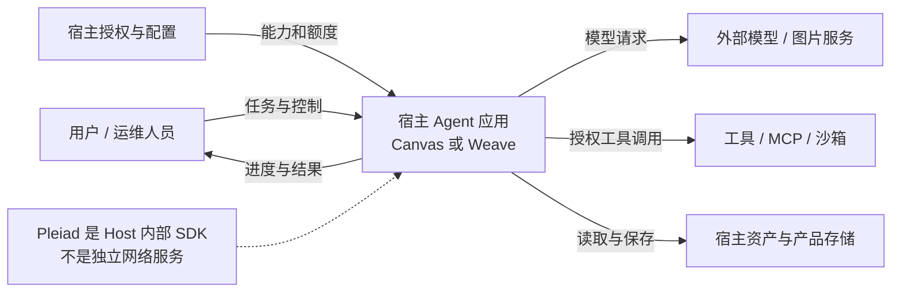

### 3.2 D02：容器视图

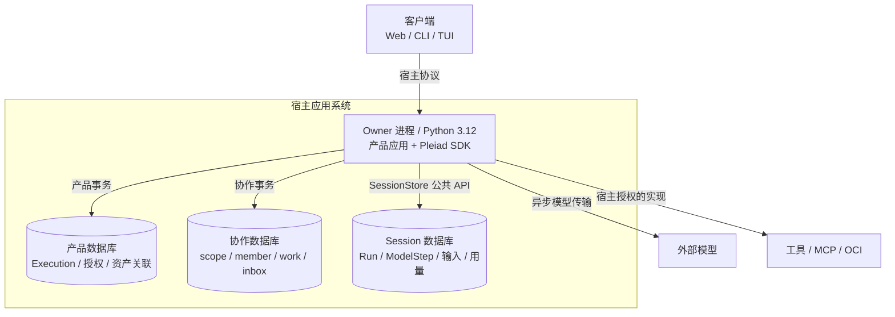

产品数据库、协作数据库、Session 数据库之间没有隐含的共同事务。设计显式使用持久意图、幂等写入和恢复核对。数据库可在同一机器，但“同一机器”不意味着跨文件写入原子。

## 4. 总体方案与核心不变量

### 4.1 新组合模式

建议公共名称为 `CollaborationGroup`，模块为 `pleiad.orchestration.collaboration`；名称可在评审时调整，但本稿内部使用一致名称。它与 SubagentGroup、Graph、Handoff 同属编排层，独立组合底层运行能力。

- 宿主通过异步上下文显式打开/关闭组；组持续时间可以覆盖多个主 Run。
- 常驻宿主使用 `CollaborationGroup(..., close_on_exit=False)`：普通部署退出停止准入、取消结算本地子工作并退出 TaskGroup，但保留 scope/member 身份供下一独占部署 `recover` 后复用。默认上下文退出及显式 `group.close()` 仍永久关闭成员；服务退出与工作 checkpoint 暂停是不同操作。
- 宿主注册一个根成员，绑定宿主主 Session；根 Session 是借用资源。
- 模型 spawn 创建新的成员、独立 Session 和初始 WorkRecord。一个能力 profile 可被重复实例化。
- 成员身份持续存在；followup 的路由在成员准入锁下确定。活跃追加保持原 work/Run；新轮才创建 work_id、invocation_id 和最终 Run。
- 成员记录描述协作关系；WorkRecord 描述 SDK 调度与调用事实。宿主 Execution 仍是唯一业务作业。
- 任务内容/任务说明进入不可变输入，不允许模型用它修改宿主工具、凭据或授权边界。

### 4.2 核心不变量

| 编号 | 不变量 |
| --- | --- |
| INV01 | 每个成员在 scope 内有唯一 ID，所属 Session 不被其他成员同时拥有 |
| INV02 | 一个 Session 最多一个 active/paused Run；暂停也占有 writer |
| INV03 | 一个 work_id 最多映射一个 invocation_id/Run；重新提交同请求不能生成新身份 |
| INV04 | Run 终态不可回退；followup 与 resume 是不同操作 |
| INV05 | 请求、消息、ModelStep、事件、费用分别使用独立顺序和幂等身份 |
| INV06 | 每轮授权/预算只属于该工作；延续上下文不延续已过期授权 |
| INV07 | 已受理的可执行工作有明确 owner Run 和预算来源；默认不脱离 owner 后台运行 |
| INV08 | 每个本地 task、模型流和工具操作都有关闭与结算责任人 |
| INV09 | 不将 observer 已读当成模型已消费，也不将 cancel_requested 当成 cancelled |
| INV10 | 跨库失败只能通过事实核对收敛；未知外部效果不靠自动重试消除 |
| INV11 | 共享 Runtime 不依赖 collaboration；宿主只调用 SDK 公共定义模块 |
| INV12 | 组关闭不删除历史；借用的根 Session 和共享客户端不随组关闭销毁 |

### 4.3 建议的运行策略

本稿给出可实施的推荐默认语义，不把尚未评审的选择描述为用户已批准。

| 问题 | 推荐决策 |
| --- | --- |
| 活跃成员的 followup | 输入边界仍开放时附着当前 work/Run；保留原授权和剩余预算；边界已关闭才形成新工作 |
| 主 Run 正常结束/取消 | 关闭该 Run 的准入，取消并结算其仍在途/排队的工作，保留成员 |
| 主 Run 安全暂停 | 关闭新准入；将其活跃子工作协作暂停至合法 checkpoint；超期按原期限取消结算 |
| 成员任务失败 | 保存自身失败并通知父成员；不取消无关兄弟 |
| 存储损坏、失去 owner、账本不一致 | 停止整个作用域新准入，清理全部拥有任务并暴露系统故障 |
| 结果通知 | 自动进入父成员的持久 inbox；空闲或已经输出 final 的父成员不因纯结果再开推理轮次 |
| 递归 | 机制支持有界树；宿主显式给出 max_depth 和每个成员 can_spawn，不写死一层 |
| 嵌套准入饱和 | 非根成员请求若无法立即启动新工作，明确拒绝；不排入会被祖先占槽阻塞的队列 |
| 多实例部署 | 一个 scope 一个 owner；其他实例只观察或转发控制 |

## 5. 代码架构、领域模型与存储

### 5.1 D03：组件视图

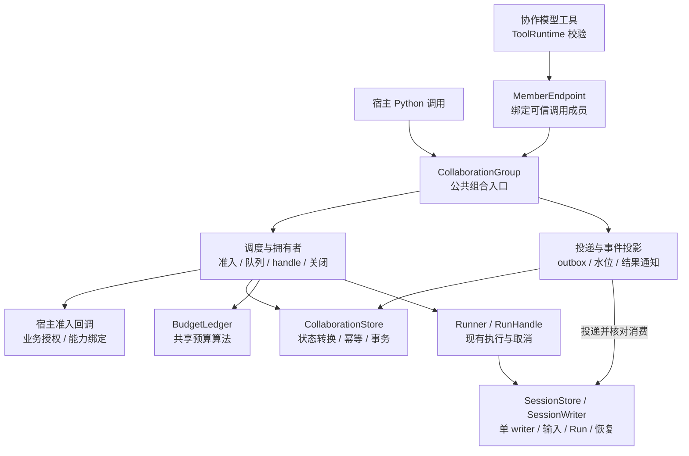

图中的“调度”“投递”是具体职责，不要求各自成为抽象接口或后台服务。首版使用少量具体模块和一个组拥有的 TaskGroup，避免每个成员启动一个常驻空转循环。

成员身份、活跃 RunHandle、常驻资源是不同事实。首版 idle 成员仅需持久 Member/Session 引用；共享模型客户端归宿主拥有，不为每个 idle 成员保留独立后台 task。Codex 的驻留线程淘汰机制说明这一分离的价值，但本 SDK 当前不需要新增 residency 缓存框架。

### 5.2 实际模块与职责

| 路径 | 职责与公开类型 |
| --- | --- |
| `orchestration/collaboration/group.py` | `CollaborationGroup`；准入、调度、投递、预算与恢复的单一拥有者 |
| `orchestration/collaboration/endpoint.py` | `MemberEndpoint`；可信调用者绑定、控制、只读观察和 ToolScope 生命周期 |
| `orchestration/collaboration/binding.py` | `CollaborationHost`、`WorkBinding`、`WorkAdmission`；实际宿主回调与借用资源 |
| `orchestration/collaboration/contracts.py` | 请求、回执、WorkPermit、配置、公开事件和游标 |
| `orchestration/collaboration/state.py` | 持久事实、恢复决定及集中状态转换 |
| `orchestration/collaboration/store.py` | 两个真实后端共用的 fenced journal 契约 |
| `orchestration/collaboration/backends/in_memory.py` | 临时存储；同样验证持久契约 |
| `orchestration/collaboration/backends/sqlite.py` | 独立数据库、schema 校验、原子快照、revision/epoch 检查 |
| `orchestration/collaboration/tools.py` | 九个模型工具；仅绑定 endpoint，不复制执行流程 |
| `budgets.py` | 既有账本增加完整活动预留镜像，保持唯一预算算法 |
| `tools/base.py`、`runtime/execution/control_state.py`、`runtime/execution/loop.py`、`runtime/operations.py` | 通用最终输入门及 live 输入可见性，无协作 DTO 反向依赖 |
| `sessions/input.py`、`sessions/session.py`、`sessions/store.py`、`sessions/state.py` | 目标 Run/未来 invocation 与实际消费分开，防止跨轮误领输入 |

所有 `__init__.py` 保持空文件，无聚合导出或兼容别名。调度与 outbox 目前属于 group 的同一事务拥有者，没有额外 scheduling/delivery 服务。事件 schema 只由新模式消费，定义在 contracts.py，未创建通用事件转发层。

### 5.3 D04：模块依赖

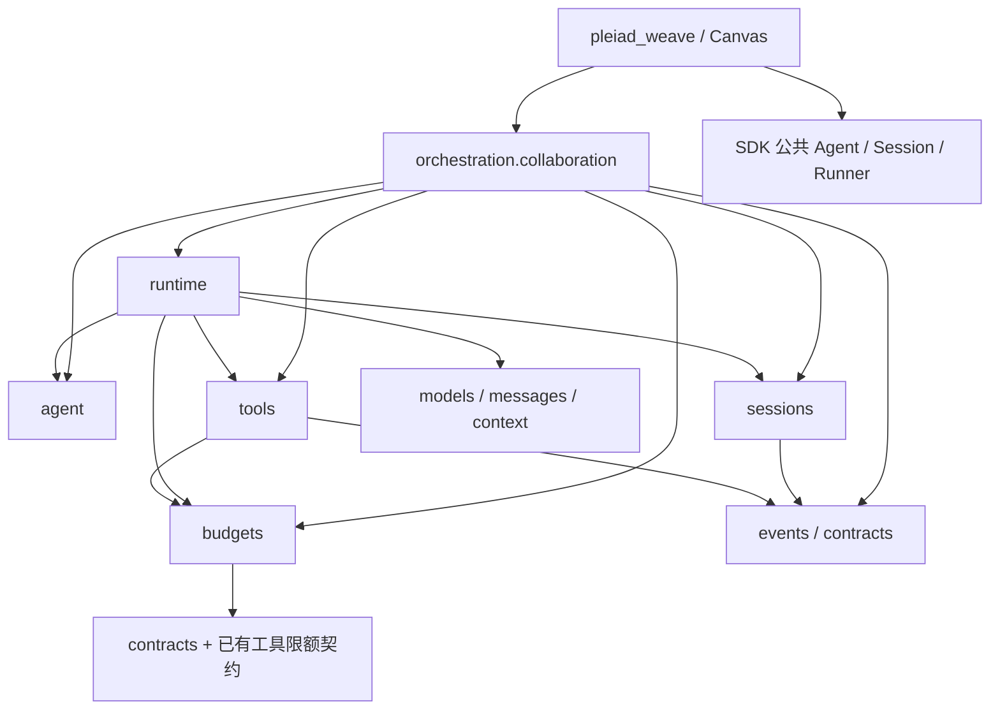

实线表示允许的静态依赖；运行时 callback 的调用不意味着反向 import。维持现有 import-linter，补充“runtime 不得导入 orchestration.collaboration”和“新模式不得依赖 subagents 实现”的约束。`budgets.py` 目前引用 `tools.contracts.ParentRunLimits`，本次不为图形整齐而进行无关拆包。

### 5.4 D05：领域类图

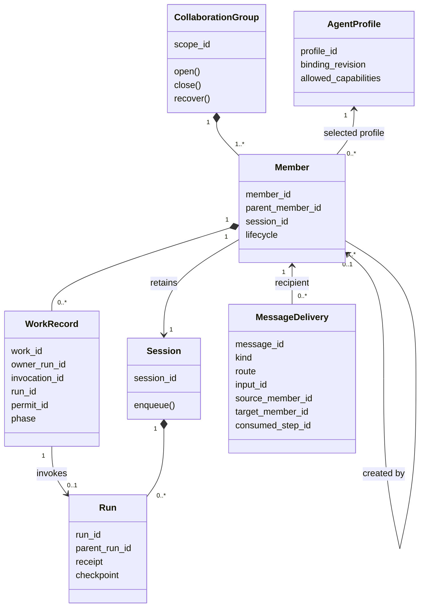

`parent_member_id` 是创建时的稳定树关系；`source_member_id/owner_run_id` 是一次请求的来源和授权归属，两者不能互相替代。成员后续工作可由新的根 Run 发起，但不改写其出生关系。

### 5.5 D06：数据关系

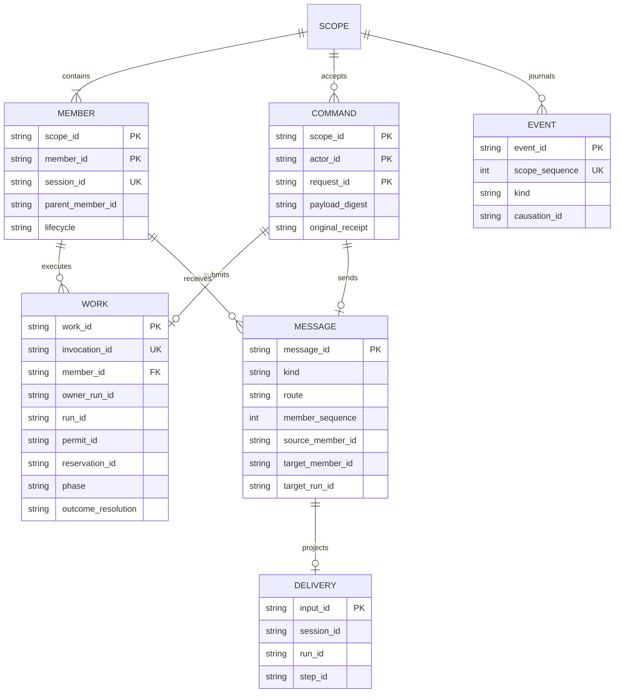

ER 图展示核心逻辑事实；预算、outbox 与投影水位辅助记录见下文物理表说明。实际 SQLite 表名统一带 `collaboration_` 前缀。跨数据库的 RUN_LINK 是经公共 API 核对的引用，不是 SQL 外键。`scope_sequence` 的唯一约束为 `(scope_id, scope_sequence)`，member_sequence 为 `(scope_id, target_member_id, member_sequence)`；图中的 UK 是简记。

D06 展示 scopes、members、commands、works、messages、deliveries、reservations、events、outbox、run_projections 的逻辑关系。落地采用与 SessionStore 一致的原子快照日志，物理表为 collaboration_journals(scope_id, revision, epoch, payload)；上述事实位于经过验证的 JSON 中。PermitSnapshot 嵌入 works 的已验证 JSON；RunLink 为 works 的 nullable 字段，不为了图中的每个逻辑对象建独立表。结果正文以原 Session RunReceipt 为权威，协作记录保存 digest/ref/有界摘要，不复制完整历史。

Message.kind 为 message/followup/result；route 为 active_run/new_work/inbox。followup 始终有 message_id，但只有 new_work 分支创建 Work。active_run 分支关联既有 Work/Run，不能因新增命令重复预留预算或创建产品 Execution。

### 5.6 存储事务与索引

- 每个 scope 有 revision、owner_epoch 和 lifecycle；本版使用宿主独占部署，不增加没有租约语义的 owner_id；每次写入检查当前 owner 代次与预期 revision。
- commands 对 `(scope_id, actor_id, request_id)` 唯一；摘要包含操作、目标、内容、期望 work/run 等完整用户载荷。重复请求原样返回原受理回执，不额外添加 duplicate 标志，不重新计算授权期限。
- works 对 invocation_id 唯一；每成员只允许一个 dispatching/running/paused/stopping 工作。暂停占用成员 writer，不能启动队列下一项。
- 事务一次提交业务事实、对应公开事件和待执行 outbox；通知仅在提交之后发出。
- 初版在 journal 内按接受顺序调度、按事件 sequence 查询；未来拆表时再按工作阶段、目标成员及事件序号建立物理索引。本次不承诺大规模历史检索性能。
- SQLite 写入通过 `asyncio.to_thread` 和已有 owned-completion 方式等待已准入事务完成，不能取消 await 就假定事务未提交。SQLite 单次只允许一个写事务，事务中不调用模型、宿主网络或异步授权。[SQLite transactions](https://www.sqlite.org/lang_transaction.html)
- 默认不做事件自动裁剪；提供队列和未消费消息背压，存储配额及历史保留策略由宿主负责。后续若增加保留期，游标失效必须显式返回 resync，不静默跳过历史。

## 6. 公共契约与运行视图

### 6.1 API 设计边界

以下为签名级契约草案，参数类型在实施前用公共 schema 固化。本节不是可执行示例；模型参数不得包含 WorkPermit、Runner、grants、凭据、任意 Session ID 或可信 actor 身份。

| 入口 | 参数与返回（提案） | 约束 |
| --- | --- | --- |
| `CollaborationGroup.open` | scope_id、Store、SessionStore、根 Session、配置、宿主绑定 → 异步拥有者 | 打开不自动启动遗留未知工作 |
| `group.endpoint(member_id)` | 已授权成员 → `MemberEndpoint` | 由宿主绑定；不作为模型任意切换身份的工具 |
| `endpoint.spawn(request, authority)` | request_id、profile_id、title、content、context_refs → WorkReceipt | 每次创建独立 member_id/session_id；受理不等于完成 |
| `endpoint.send_message(request, authority)` | request_id、target_member_id、content、可选 expected_run_id → MessageReceipt | 不开新 Run；明确是否投递本轮或等待下一轮 |
| `endpoint.followup(request, authority)` | request_id、target_member_id、content → FollowupReceipt | route=active_run 关联既有 work/run；route=new_work 返回新 WorkReceipt；路由一旦受理不可改变 |
| `endpoint.interrupt(request, authority)` | request_id、target_member_id、expected_work_id、expected_run_id → ControlReceipt | 目标精确匹配；等待本地结算或返回 still_settling |
| `endpoint.wait(request, authority)` | member_ids、after_cursor、timeout、limit → EventPage | wait-any；只读，不消费其他观察者的事件 |
| `endpoint.list/status` | 分页/目标身份 → MemberView / WorkView | 依据授权后的持久事实与本地拥有者投影 |
| `endpoint.read_result` | ResultReference、分页范围 → ResultPage | 根据 scope、成员和工作关系授权；不支持任意 URI 读取 |
| `endpoint.close_member` | request_id、member_id、expected_revision → CloseReceipt | 关闭成员及其后代；保留历史，拒绝新的 send/followup |
| `group.resume_work` | work_id、原 checkpoint、ResumeDecision、当前宿主授权 → WorkView | 宿主专用；沿原 Run 恢复；不等同 followup |
| `group.recover` | expected_owner_epoch、宿主独占部署前提 → RecoveryReport | 默认只核对，不自动重提外部动作 |
| `group.close` | reason → CloseReceipt | 幂等关闭所有拥有工作；不删除记录 |

`Authority` 是宿主/Runtime 生成的已验证内部值，包含 caller scope/member/run、调用 ID、当前 grants、父预算可见值和有效期。Python API 也必须走同样的准入校验，不能因为不是模型调用就绕过预算。直接 Python 使用时，宿主显式绑定实际 owner Run，并负责调用其生命周期结算入口；模型工具通过 ToolScope 自动完成相同绑定。

回执至少包含 request_id、accepted_at、duplicate、scope_id、关联 member/work/message/control 身份和 status；列表/等待包含读取水位与 next_cursor。受理回执是不可变记录，最新状态通过引用查询。

FollowupReceipt 是有 discriminator 的公共 schema：active_run 分支包含 message_id、既有 work_id/run_id；new_work 分支包含 message_id 与新 WorkReceipt。幂等重试返回同一分支，不能因重试时目标已完成而把原追加命令变为另一轮任务。

| 错误类别（建议代码前缀 `collaboration.`） | 对调用方的含义 |
| --- | --- |
| request_conflict / target_run_closed / target_changed | 请求或控制目标冲突；不隐式重定向 |
| run_paused / new_authorization_required | 暂停需显式恢复/取消；当前 Run 不能通过追加内容扩大授权或更换绑定 |
| forbidden / profile_unavailable / authority_expired | 当前授权不允许；不得替换客户端或模型继续 |
| capacity_exhausted / queue_full / depth_exceeded | 有界准入拒绝；没有创建可执行工作 |
| scope_closed / member_closed | 已停止新准入；仍可按授权查询原回执 |
| owner_lost / store_corrupted / budget_inconsistent | 系统故障；关闭准入并执行组级清理 |

普通状态变化返回类型化结果；校验冲突和无法处理的系统故障沿用 SDK BusinessError/SystemFault 分类。模型工具将可处理拒绝投影成正常失败观察，不能伪造成功或吞掉异常。

幂等查询首先限定为当前 scope 和宿主绑定的 actor，已受理请求可以在原 Run 结束后返回原回执；新命令才重新校验当前 Run 和授权，不凭重试创建新权限或副作用。调用来源由 endpoint + 当前 ToolContext + 持久 Run 关系交叉校验，不能相信模型提供的 source 字符串。

### 6.2 宿主扩展契约

只保留当前确有用途的两个函数式扩展点，不构造通用服务注册框架。

1. `admit_work(WorkProposal) -> WorkAdmission | WorkRejection`：宿主验证业务权限，幂等登记产品 Execution/预算，并返回不可变 PermitSnapshot 和当前 WorkBinding。work_id 由 SDK 在调用前确定并保存为准备事实；宿主按此 ID 去重。
2. `rebind_work(PermitSnapshot, MemberEndpoint) -> WorkBinding | WorkRejection`：排队启动/合法恢复前检查当前授权，重新获得 Agent、Runner、实际工具绑定、Resolver。必须与已接受的 binding revision/fingerprint 一致；权限允许收紧，配置变化不能悄悄替换已经受理的工作。

WorkBinding 为 frozen/slotted dataclass，持有实际 Agent、Runner、上下文引用、资源释放责任。PermitSnapshot 为可持久化 Pydantic 类型，只保存非密钥配置身份、授权版本、期限、限额、工具指纹和 opaque 宿主引用。SDK 不解析 execution_id 等产品字段。

admit_work 仅用于 spawn 或 followup 的 new_work 分支。active_run 分支校验可信发送权限、目标 PermitSnapshot 的有效性及原操作范围，保留目标 owner/预算/绑定，不调用新工作准入、不另建产品作业。活跃消息不能改变模型、grants、工具或期限；需要新的授权范围时返回 new_authorization_required，待原轮结算后提交新工作。

宿主回调可能跨库写入，因此准备记录与回调请求都需幂等。回调成功而 SDK 受理失败时，宿主记录保持“准入已准备，未执行”，由回放同 work_id 或核对结果收敛；未得到 SDK started/真实 Run 证据不能标记业务执行成功。这里只允许在已证明尚无 Run 的情况下重试准入回调。

### 6.3 D07：动态创建与并行执行

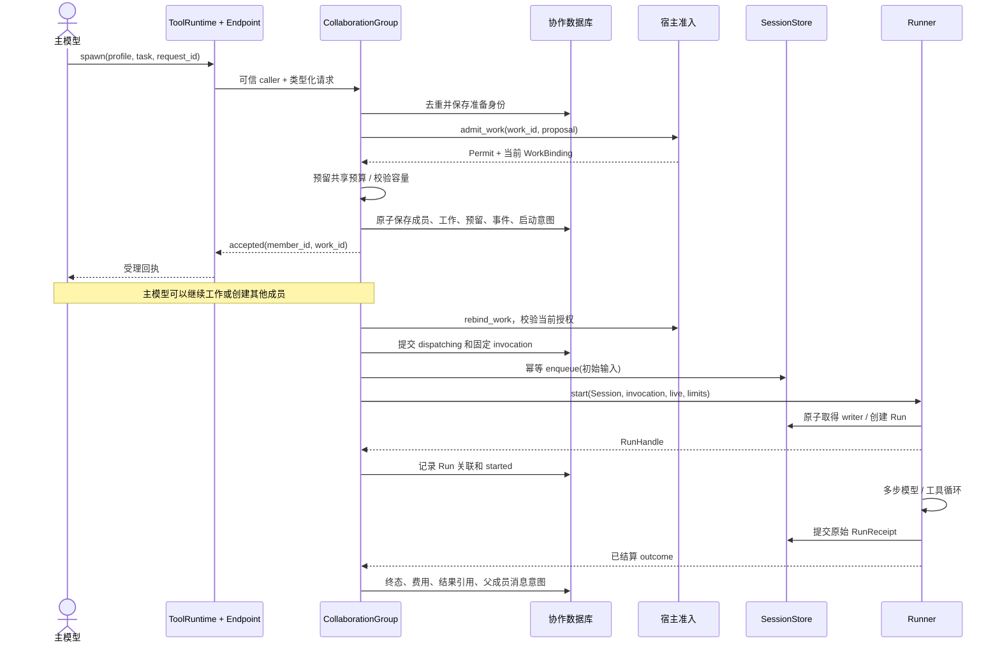

spawn 的返回时间不依赖子模型完成；若数据库或宿主准入仍未确认，不能提前返回 accepted。并发启动通过组内 TaskGroup 管理，启动器异常不得遗失已创建的 handle。

### 6.4 消息边界与所需 Runtime 扩展

**当前消息路径**：协作数据库先保存消息/outbox → 投递器幂等 `Session.enqueue(InputEnvelope)` → Runtime 在下一 `begin_step` 原子消费 → 投递器读 `InputRecord.step_id` 确认消费。消息状态不根据“回调被调用过”推断。

- content 沿用 `InputEnvelope` 的文本、ResultReference、TextBlock/ImageBlock。模型工具 schema 提供同等结构，宿主校验图片引用。
- 外部补充、子结果均作为有来源标识的输入观察；工具结果仍只对应原 tool_call_id，不能伪造 tool result 来投递跨 Agent 消息。
- followup 在成员准入锁下选择路由：活跃且输入闸门开放则生成指向既有 Run 的显式工作消息；否则创建新 Work。新 Work 的内容不提前进入旧 live Session，只有实际准入该工作时才 enqueue。
- 无 expected_run_id 的 send 发给长期成员；目标处于最终关闭输入边界后，消息保留在 inbox 等待下一轮。
- 带 expected_run_id 的 send 表示本轮定向补充；边界已关闭则返回 `target_run_closed`，不偷偷投到下一轮。未返回受理前可以拒绝；已返回 accepted 的消息必须保留原回执并可查最终去向。
- “已消费”严格指进入持久 ModelStep；不能声称模型必定理解、遵守或成功执行了内容。若该步随后中断，保留消费事实，禁止自动重复输入；历史只包含协议完整步骤时，应向下一轮提供明确的中断摘要和可读原引用。

模型响应和工具完整提交构成首版安全边界，不在未完成的工具调用或半条模型消息中插入内容。Codex 的 item 级采样抢占属于后续能力，不在现有 provider-neutral 流协议上假定已经支持。

为使显式工作输入与完成竞争可收敛，同时防止纯消息无限延长任务，本稿建议给现有 ToolScope 增加一个**可选、通用的最终输入边界回调**，而非向 Runner 添加 collaboration 参数：

| 设计项 | 契约 |
| --- | --- |
| 回调概念 | `before_finish(run_id) -> bool`；True 表示存在已受理的显式继续工作输入，需要再进入正常 ModelStep；不能仅凭普通消息/结果积压返回 True |
| 调用位置 | 一个无工具的模型响应已完整提交后、RunReceipt 提交前 |
| 组的实现 | 在成员准入锁下排空截至水位的显式工作输入投递意图；有未消费 followup 则返回 True；否则提交输入关闭水位，纯消息/结果留待下一轮并返回 False |
| Runtime 责任 | 通过现有 writer.begin、预算检查和原循环继续；不得在回调里调用另一个模型循环 |
| 条件 | 仅对显式绑定该回调的 live Run 启用；旧工具默认无回调 |
| 限额耗尽 | 不为消息额外制造额度；留下未消费消息和原结果/终止原因，后续需新授权 |
| 并发边界 | 成员关闭水位与 send 准入在同一个协作事务域内串行；事务外投递使用稳定 input_id 核对 |

回调返回 False 后，晚到的成员消息留在协作 inbox，不再直接 enqueue 给即将结束的 Run。回调不是允许无限延长执行的承诺；原期限和模型步数仍是硬限制。独立 Python 宿主绑定同一 scope hook，不能在产品层自行复制这个最终边界。

最终边界前已附着到本 Run 的 followup 必须在关闭判定中可见，不能先回 accepted 再丢给下一轮；已越过关闭水位的 followup 选择 new_work，旧 writer 释放后才能启动。若关闭/中断胜出，已附着消息保留原路由及未消费事实，不自动换 Run 重投。纯消息若已 enqueue 但未消费，按 6.8 的 InputRecord 归属规则保留，不能为延期而改写原 Run 身份。

消费事件由 `InputRecord`/ModelStep 事实恢复生成，event_id 从稳定 message/input/step 身份导出；即使模型完成事件投影丢失，也能重新构造相同通知。

### 6.5 D08：消息、followup 和结果回送

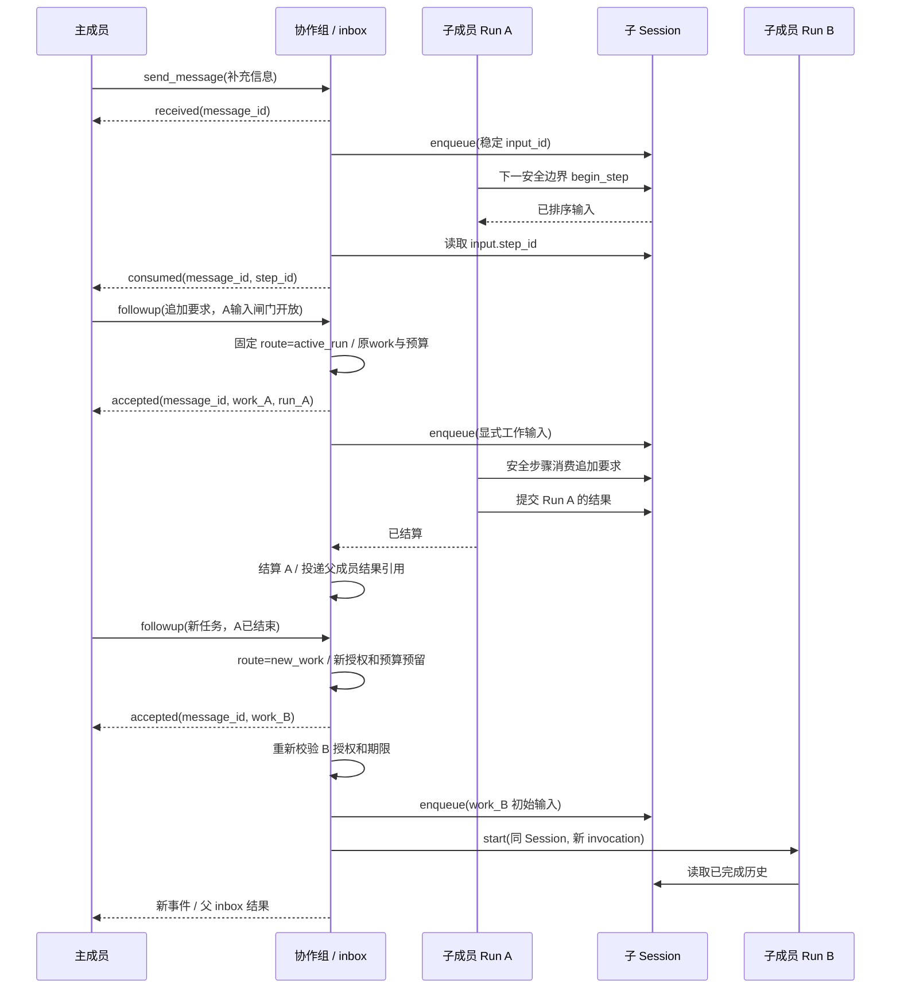

若 A 的 owner Run 已结束，属于该 owner 的排队 B 同样取消；队列不使旧授权获得无限寿命。下一主 Run 可以使用新的 request_id 和有效授权再次安排任务。

两个 followup 在同一成员锁下按接受顺序路由：若观察到 running/open，两条都附着该 Run；若第一次只完成了新工作受理、尚无开放的 live Run，第二条保持独立 new_work 并按队列策略处理。不能创建并发 writer，也不隐式合并两个已受理 Work 的费用和结果。

### 6.6 操作与状态矩阵

| 成员/工作状态 | send_message | followup | interrupt | close |
| --- | --- | --- | --- | --- |
| open + idle | 接收进 inbox，不启动 | 准入后启动或按容量排队 | 无目标匹配，返回 not_running | 关闭成员/后代 |
| running + 输入闸门开放 | 下一安全边界消费；final 后可延期 | route=active_run，当前 Run 消费；不新增预算 | 针对 expected work/run 请求停止 | 关闭准入，取消全部工作 |
| running + 闸门已关闭 | inbox 留下一轮；定向旧 Run 拒绝 | route=new_work，旧 writer 释放后启动 | 只控制精确匹配的旧 Run | 取消全部工作 |
| queued / dispatching | inbox 保存 | 独立 new_work，按容量/队列策略受理 | 控制已存在的精确工作；无 Run 不伪造 run_id | 清理已受理工作 |
| paused | 接收保存，不自行恢复 | 返回 run_paused；需显式 resume 或 interrupt | 通过原 checkpoint 取消 | 取消原 checkpoint 并清队列 |
| stopping | 成员消息保留；定向旧 Run 拒绝 | 可受理排队，仍受 owner 有效性约束 | 相同 ID 返回原控制回执 | 合并关闭意图并等待清理 |
| work terminal + member open | 接收进 inbox | 新 work、新 Run | 返回已提交终态，不改写 | 关闭成员 |
| closing / closed | 新请求拒绝；原重复请求仍可查回执 | 拒绝 | 只读原控制结果 | 幂等返回原关闭状态 |

表中排队行为适用于根成员/宿主。非根成员的 active_run 追加不取得新槽；new_work 若无法立即启动，则按 8.1 返回 capacity_exhausted，不接受会被祖先阻塞的队列项。followup 不能以根成员为目标；向根报告使用 send_message 或自动结果消息。

interrupt 仅停止指定工作，**不等同清空后续工作队列**；取消当前工作的后代工作也属于其所有权结算。用户要停止成员全部工作时使用 close。SDK 控制字段要求 expected_work_id/expected_run_id，模型可从 status 获取；不提供“随便停止当前最新任务”的竞态语义。

### 6.7 D09：中断与后续工作竞争

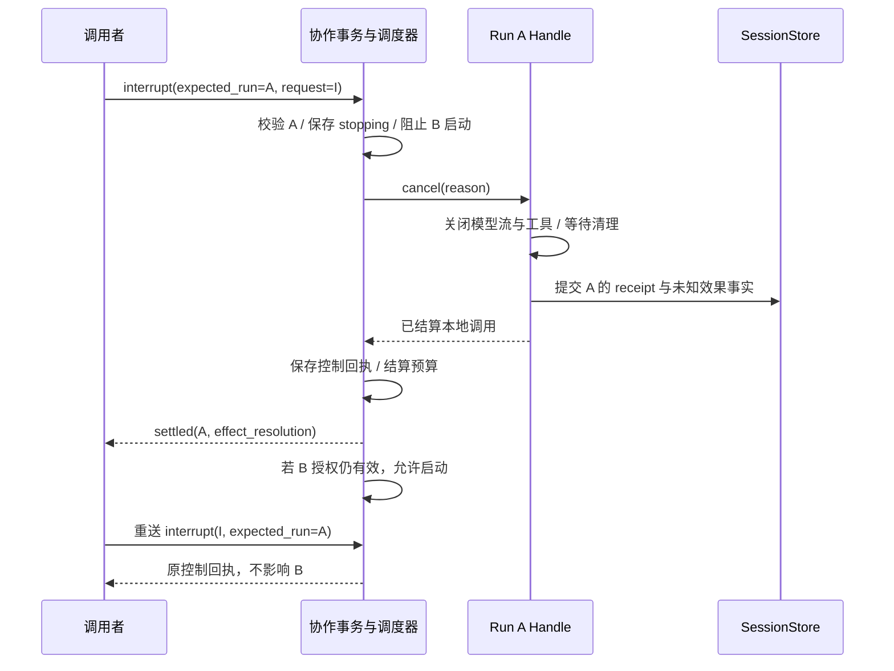

本地 Run 已取消不代表外部收费操作被供应商撤销。ControlReceipt 同时包含 `local_settlement` 与 `unsettled_actions`。如果清理尚未完成，有界调用返回 `still_settling` 并可查询；关闭流程继续由组拥有，不能把超时写成成功。

### 6.8 状态模型

D10：作用域与成员生命周期。成员执行状态由当前工作投影，不再保存一套相互竞争的 running/failed 状态机。

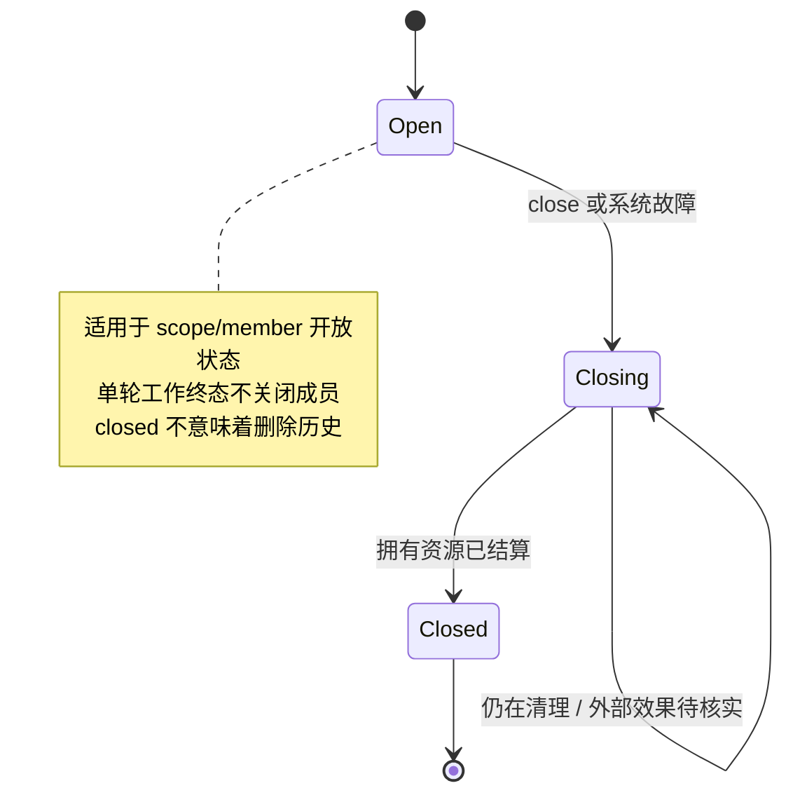

`Closed` 要求本地任务、流和工具清理完成；外部不可确认效果可以仍为 unknown，必须留在可查询记录中，不伪造已撤销。图中的 Closing 自环表示尚未完成本地结算时保持此状态。

D11：单轮工作状态。`phase` 描述调度阶段；结果核实状态 `clear/unknown` 为独立字段。

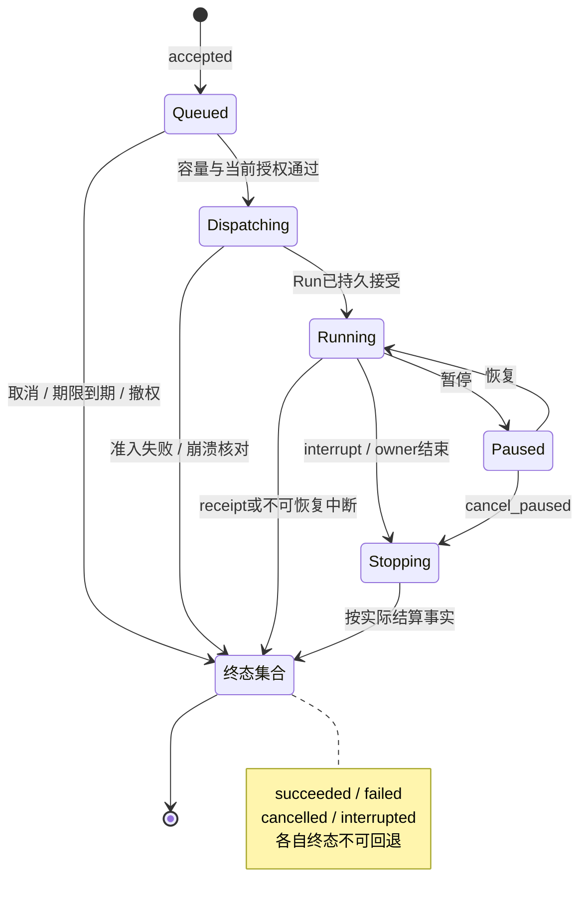

图中“终态集合”是四种终态的图示分组，不新增一个业务状态。停止请求与成功提交竞争时保留实际成功结果，不能为了匹配取消意图改写 receipt。queued/dispatching 没有 SDK 终态可用时，由协作层记录明确的准入失败原因；Run 一旦存在，以其实际 receipt 为权威。terminal 工作不会被 resume；恢复到 paused 只发生在原调用确有合法 checkpoint 时。

D12：消息投递状态。close 前未投递的消息显式撤销；已投递输入的原始事实不可删除。

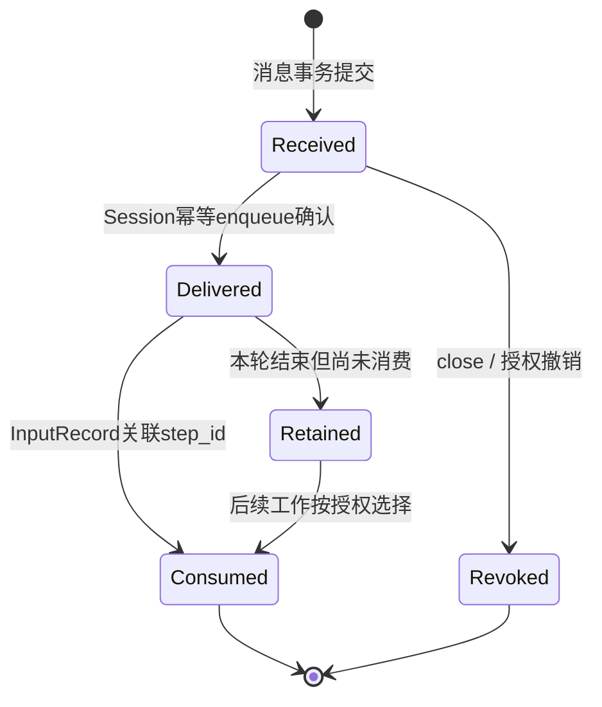

Retained→Consumed 只适用于尚未被旧 Run 认领、且在后续轮次重新授权选中的输入。若输入已被旧 Run 认领但在消费前中断，保留原 InputRecord 的 run_id；禁止重新归属或改写它。宿主核对后可在一个明确的新工作中提供未完成输入的引用/摘要，使用新 input_id 并保留原 message_id 作为 causation，而非静默重投。

Delivered/Retained 不能假定仍可无条件消费：组关闭后不再由该组启动 Session，后续成员工作仍须重新授权。图片历史每次模型请求重新通过 Resolver；已提交文本历史的存在与当前操作权限是不同问题。

### 6.9 wait、结果与公开事件

本节是任务书要求的持久观察契约。Codex V2 的 wait_agent 只等待调用者邮箱/输入活动，参数不含成员集合或游标；两者不能声称是同一 API。共同原则是等待只读，结果数据另经 inbox 进入模型。

事件包含：schema_version、event_id、scope_id、scope_sequence、kind、source_member_id、target_member_id、work_id、run_id、causation_id、timestamp、经过筛选的 payload。并非每类事件都有 Run；spawn 受理早于 Run 创建，不能伪造 run_id。

最低事件集：member.created、work.accepted/queued/started/paused/settled、message.received/delivered/consumed、output.published、tool.activity、interrupt.requested/settled、member.closed、scope.closed、recovery.required。失败用 work.settled 的具体结果和原因表达；暂停不是完成。

- 游标为 `(scope_id, scope_sequence)`，只读 exclusive cursor；不能把多个 Run 的 sequence 混成一条顺序。
- wait 在任何匹配的新事件提交后返回；先读取持久事件，再以条件变量/通知版本等待，醒来重新查事实，避免读后等待期间丢唤醒。
- 空目标集合、重复目标、跨 scope、未来游标、负超时明确验证；超时返回空事件页与当前水位，不变更任何工作。
- UI、模型与其他观察者独立保存游标。wait 返回状态/结果引用，不自动把全文再次作为输入写入 Session。
- 结果自动投递与模型消费按稳定 message/input ID 去重。重复读取可能再次看见同一事实，但不能再次注入同一结果消息或重复记账。
- Run 事件通过 `(session_id, run_id, source_event_id)` 唯一投影；公开文本增量可合并成有界片段，保留源区间。终态与最终结果不依赖增量是否完整投影。
- 默认只投影公开文本、工具名称/状态、结果引用；不直接透传工具参数、raw reasoning、临时签名 URL 或完整模型原始事件。

## 7. 部署与恢复视图

### 7.1 D13：进程重启恢复

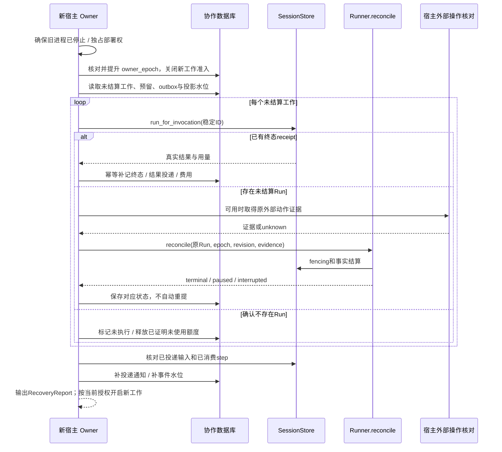

恢复顺序必须处理后代工作，再结算父工作/父预算，避免父账本先释放而子调用仍有未知费用。prepared 回调记录和待执行工作不消失：若原 owner Run 已结束，取消其排队工作；若宿主明确恢复原 owner，仍需当前授权和原期限有效。

### 7.2 恢复边界

| 观察到的事实 | 行为 |
| --- | --- |
| 有稳定 work/invocation，SessionStore 中无 Run | 在独占部署权和原子 start 契约下确认未执行；不自动改成成功 |
| 有 RunReceipt | 以 receipt 结算；协作结果重复投影不收费 |
| 有合法 checkpoint，model/tool 边界满足 Runner 恢复要求 | 保存 paused，等待宿主明确 resume；保留原 Run/费用/期限 |
| 有旧 checkpoint，但之后已有未完成模型准入或未知工具 | 按 reconcile 结果 interrupted/unknown，不退回旧点重放 |
| 回执丢失但供应商可能已受理 | 留下 unknown；只有原请求证据可核对，不更换请求重新提交 |
| Session 已记录输入但投递回执丢失 | 相同 input_id 重试，核对原 payload_digest |
| 消费事实存在但事件未写 | 从 InputRecord/ModelStep 重建相同 event_id |
| 授权已撤销或模型/工具绑定指纹改变 | 拒绝原工作恢复；保留记录，必要时宿主明确发起新工作 |

owner_epoch 只能阻止旧本地记录写入，不能撤销已经发往外部服务的请求。恢复前必须由宿主持有独占部署权；不支持仅凭“心跳过期”自动接管仍可能活着的进程。这与当前 Runner.reconcile 的宿主前提保持一致。

### 7.3 D14：部署图

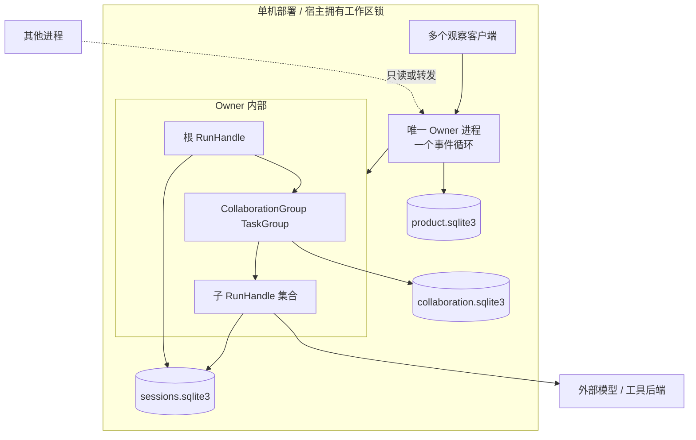

SQLite 是建议默认后端，不引入独立服务。内存后端适用于确定性测试；两后端运行相同契约测试。数据库路径由宿主提供，禁止复用 SessionStore 的独占 schema 文件。组退出仅关闭自身连接、task 和拥有的 handle；客户端与 SessionStore 的共享生命周期仍属于宿主。

## 8. 横切设计

### 8.1 准入、排队与递归

`CollaborationLimits` 至少包含：max_active_runs、max_queued_work、max_members、max_depth、max_pending_messages、max_message_bytes、max_event_page_size。宿主显式提供运行上限，SDK 负责验证合法区间；Canvas 的“3 并发”“一层”不作为 SDK 常量。

- active slot 统计本组未结束的 dispatching/running/stopping 工作；paused 释放执行槽但保留成员 writer 和预算。根 Run 由宿主拥有，不占子工作槽。
- 正在 wait 工具内等待的子 Run 仍算 active，不假装已经释放资源。为避免递归死锁，非根成员的新工作必须取得立即启动的容量，否则返回 capacity_exhausted；不能占着父槽再把子任务排进无可用槽的队列。
- 根成员可以提交有界新工作队列；active_run 追加按消息顺序进入当前 Run。new_work 按接受顺序调度，从可运行成员中选最早项，跳过已有 active 的成员以避免队头阻塞；paused followup 直接拒绝。
- 嵌套工作只允许绑定自己的后代；不能为自己/祖先启动新工作或阻塞等待祖先。wait 的可阻塞目标限后代；同级交流可按授权 send，避免形成循环等待图。
- 路径深度由持久 parent_member_id 推导；不能信任模型填写的路径。全树共享一个容量/预算拥有者，禁止嵌套创建互不知情的组逃逸限制。
- 限制成员总数和消息积压，因为仅限制运行数无法阻止模型无限创建 idle 成员。

上述策略选择了容易验证的活跃 Run 上限，不引入可挂起任意工具栈的调度器。饱和时模型应先完成自身工作或交还主成员调度；未来若需要等待时释放槽，须另行设计运行许可与恢复协议。

### 8.2 预算算法与持久镜像

预算算法继续由现有 BudgetLedger 负责。组和同一 Run 中的 Graph/旧委派工具必须使用同一实际实例；新组不复制余额计算。新增协作记录保存预算请求、预留身份和累计结算事实，用于重启核对。

D15：预算路径。

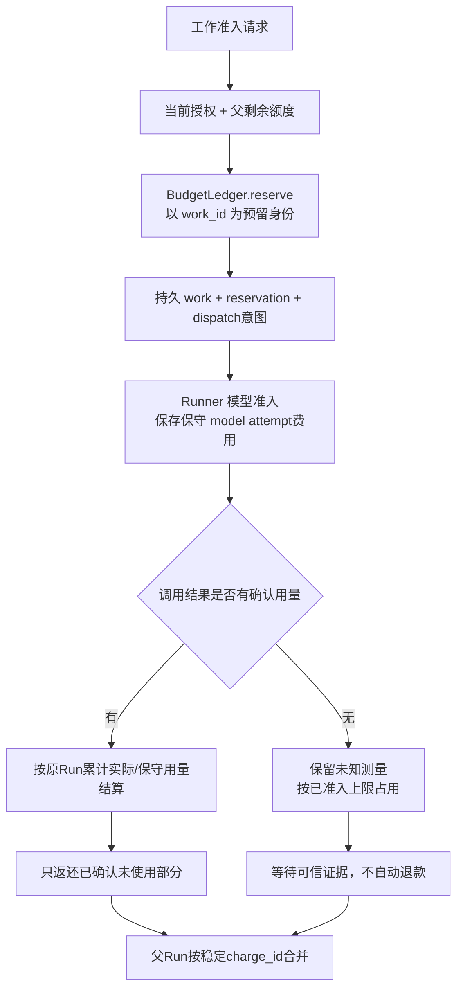

需在 `budgets.py` 定点增加“活动预留可序列化事实”及恢复/核对能力；不把 active 预留伪装成现有 paused checkpoint。新的快照包含父池身份、父自身消费基线、每个 reservation 的额度/阶段和累计 charge。现有安全暂停 checkpoint 保持原含义。

单拥有者内 reserve 同步更新共享账本，随后持久接受记录；在持久化确认前不调用 Runner、不返回 accepted。若持久化异常，先核对提交是否发生；无法确认时关闭新准入并保守保留额度，不能直接回滚内存然后继续工作。重启从 Session 的模型准入事实及协作预留事实核对并重建账本，不能仅加载旧余额。

每项工作接受时预留预算，队列中的预留也占余额；调度时再次检查权限/期限。原 owner 结束，排队且已证明无 Run 的工作可以返还全部预留。在途用量缺失则按已有保守结算。父模型与所有子工作使用同一额度来源，子结果注入、重复 wait、重复事件投影都不是新的 charge。

active_run followup 是已有工作新增输入，不新建 reservation，也不改变 charge_id/owner。它可能增加该 Run 的实际 token 用量，但仍在原剩余上限与期限内；不足时按原 Run 的限额结束，不能自动拆成新工作继续扣费。

混用 Graph、旧 SubagentGroup 与新组时，协作数据库只对本模式的预留负责，不得宣称能独立恢复整个共享账本。恢复旧父 Run 必须取得其所有 scope 的合法快照和原 Session 用量证据；任一部分无法核对，禁止重新启用该父池，按 Runner 的 interrupted/unknown 语义结算并保留保守费用。新工作通过新的 owner Run 获得新授权，不能把不完整旧余额搬入新池。

图片生成/编辑仍由宿主持久 operation 账本管理；文本 token 账本不推导图片金额，也不宣称终止本地 await 已撤销供应商收费。

### 8.3 跨库写入与 outbox

采用事务内保存状态和投递意图、事务外执行幂等操作的 outbox 思路。此模式解决的是双写失败窗口，仍要求消费者去重；本项目不因此引入消息队列服务。[Transactional outbox](https://docs.aws.amazon.com/prescriptive-guidance/latest/cloud-design-patterns/transactional-outbox.html)

| 故障窗口 | 权威事实与恢复动作 |
| --- | --- |
| 准备命令已存，宿主授权回执未存 | 用相同 work_id 查询/重试宿主幂等准入；不启动模型 |
| 受理事务已存，通知/进程任务未创建 | 扫描 outbox；核对 owner/授权；允许恢复本地调度意图，不自动重放未知 Run |
| 输入 enqueue 成功，投递状态未存 | 同 input_id 查询/重试；异载荷冲突必须暴露 |
| Runner.start 成功，work.run_id 未存 | 通过原 invocation_id 查回；禁止生成新 invocation |
| RunReceipt 已存，协作终态未存 | 原 receipt 补结算，原 work_id 去重 |
| 协作终态已存，父 inbox 未投递 | 重放消息 outbox，不重新执行子工作 |
| 预算结算内存完成，持久确认不明 | 停止准入，读取原 charge 和 Run 事实核对，禁止释放后继续花费 |

不承诺外部副作用 exactly-once；承诺稳定请求身份、幂等本地受理、可核对结果和 at-least-once 通知。所有恢复必须保留原异常/原因和原外部操作身份。

### 8.4 结构化并发、取消和故障域

组的 TaskGroup 持有工作启动/等待和投递观察任务；RunHandle 持有真正模型执行任务，OperationScope 持有工具后台任务。组对它启动的 handle 显式负责 cancel/aclose，不依赖 GC，也不通过取消事件订阅者来停止执行。

Python TaskGroup 中未处理的普通异常会取消兄弟任务，因此成员边界必须将**已分类、可处理的成员失败**转为该工作失败记录；不能把所有异常吞掉。权限拒绝、业务工具错误、模型调用明确失败是成员事实；账本损坏、存储失败、失去 owner 等系统故障升级到组清理。CancelledError 清理后继续传播，不作为普通失败捕获。[Python 3.12 TaskGroup](https://docs.python.org/3.12/library/asyncio-task.html#task-groups)

父 Run close hook 首先原子关闭该 owner 的工作准入，再结算其 work_id 集合及后代。正常结束不等待模型无限自发继续；主模型若需要成果，应在最终回复前 wait。安全暂停使用原期限请求子工作到达合法暂停点；无法达到则按超期取消，不能生成虚假 checkpoint。组持久记录保存树状态，父 checkpoint 仅引用 scope/owner/恢复水位及原共享账本，不复制全部成员历史。

### 8.5 权限、多模态与上下文

- 宿主负责模型配置、工具集、能力模板、业务授权和工作区隔离；模型只选择允许的 profile 和任务参数。
- 根可控制授权子树；子成员默认只查看自身、创建自己的后代、向父成员发送消息。查看同级和向同级发送消息须宿主显式允许，范围仍限当前 scope。
- spawn 默认使用任务选择的不可变 ContextBlock/图片引用；不复制可变父消息列表。可选父上下文快照必须记录来源 Session、截止 ModelStep/消息水位及授权；首版不提供任意历史分叉。
- 绑定指纹保留模型、prompt、工具、Skill 和授权版本的非密钥信息。新一轮允许宿主明确选新绑定；同一暂停 Run 恢复不能悄悄改绑定。
- 每次模型请求仍经过 ImageReadScope(session_id, run_id) 和当前 Resolver；消息内图片引用不是永久通行证。权限撤销应在实际读取边界拒绝，而非只在 spawn 时检查。
- Session 上下文隔离不等于文件系统隔离。若多个成员共享工作区，读写冲突、路径权限及资产版本仍需宿主工具约束。SDK 不自动创建 git worktree 或复制用户目录。
- 日志和事件不记录密钥、临时签名 URL、原始推理或未经筛选的工具参数。错误码对外稳定，详细异常保留在宿主授权诊断渠道。

### 8.6 可观测性

沿用现有 OTel/日志机制；新增 span 属性 scope_id、member_id、work_id、invocation_id、run_id、owner_run_id，trace_id 独立保留。高基数字段可用于 trace/log，不作为无限基数的 metric label。

建议指标：准入拒绝数及原因、active/queued/member 数、排队时长、消息 received→delivered→consumed 延迟、取消结算耗时、outbox 最老积压、恢复中 unknown 工作数、已预留与保守费用。采集均来自真实状态转换，不能依赖模型自述。

## 9. 架构决策记录

以下为本稿推荐决策，状态均为“待评审”；设计评审通过后再转为 accepted。

| ADR | 决策 | 理由 / 代价 / 未采用方案 |
| --- | --- | --- |
| ADR01 | 独立 CollaborationGroup，与 SubagentGroup 同级 | 生命周期不同；不继承旧组、不建立兼容层；代价是新增协作状态组件 |
| ADR02 | 成员长存、每轮新 Run | 复用 Session 上下文并保持终态不可变；不复活已完成 Run |
| ADR03 | followup 活跃时追加、空闲/关闭边界后新工作 | 对齐 Codex V2 核心交互；route 固定在回执，活跃追加沿用原授权/预算，代价是输入闸门与完成竞态必须原子化 |
| ADR04 | 结果自动投递，wait 独立观察 | 主模型获得反馈且 UI 不抢消费；需要 outbox 和模型消费事实 |
| ADR05 | 新协作 SQLite 文件 + 现有 SessionStore | 现有 journal 无跨 Session 协作事实且有独占 schema；代价是跨库核对 |
| ADR06 | 单拥有者，显式恢复 | 贴合当前 Runner/Weave 前提；不引入租约自动接管和分布式调度 |
| ADR07 | 有界树，嵌套无空槽即拒绝 | 不改造 Runtime 的可抢占执行许可；牺牲饱和时的嵌套排队以避免死锁 |
| ADR08 | 复用 BudgetLedger + 活动事实持久镜像 | 保持唯一预算算法；须处理内存/数据库提交不明窗口 |
| ADR09 | ToolScope 增加通用最终输入边界 | 显式 followup 可继续当前 Run，纯消息/结果不使 final 无限续跑；共享 Runtime 改动必须回归旧路径 |
| ADR10 | 宿主回调准入 + 公开持久事件 | 产品先登记作业再允许外部工作；不用覆写 SDK 的运行流程 |
| ADR11 | 关闭保留历史；资源按拥有者清理 | 长期 Session 和共享客户端不会被误删/误关；删除需宿主单独操作 |

## 10. 质量目标与验收设计

### 10.1 D16：质量属性树

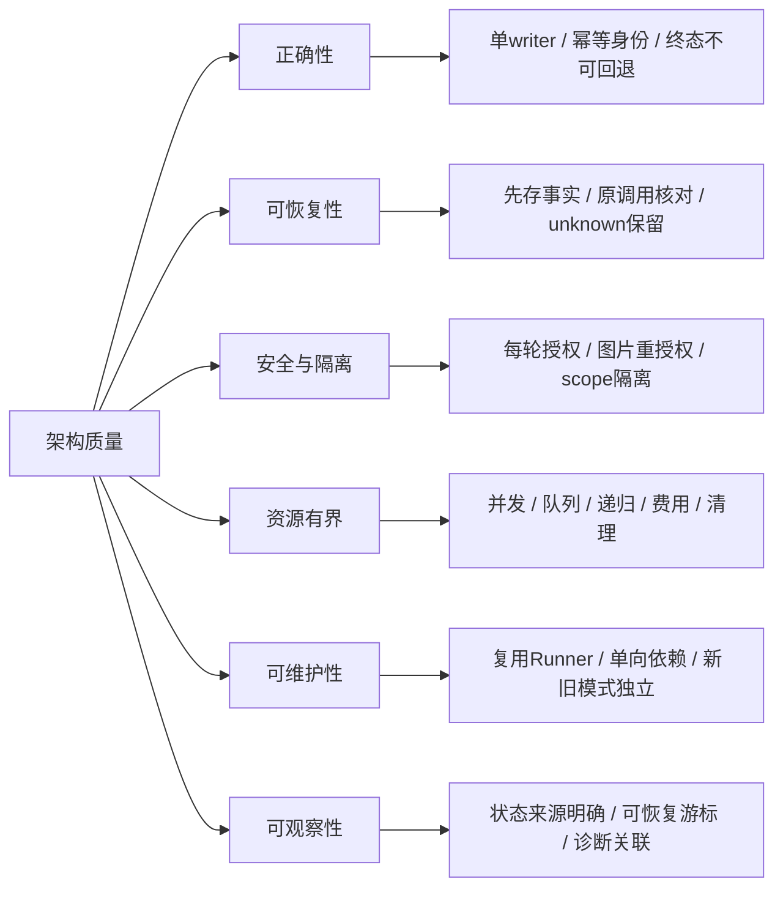

### 10.2 可验证质量场景

不在未测量前承诺毫秒级性能。以下为验收约束或拟测指标，不是当前测试结果。

| 场景 | 刺激 | 期望响应 / 度量 |
| --- | --- | --- |
| 重复提交 | 同请求 ID 重送，包括回执丢失 | 仅一个 member/work/invocation；原回执时间不变 |
| 请求冲突 | 同 ID 修改目标、图片或正文 | 明确冲突；零新增外部调用 |
| 并发 followup | 两个调用同时提交同成员 | route 与接受顺序稳定；开放 Run 追加两条，否则新工作串行；最多一个 writer |
| live 消息 | 模型流或工具执行中收到消息 | 下一个安全边界消费一次；未生效时明确显示待消费 |
| 结束竞态 | send 与最终边界同时到达 | 本轮消费或留 inbox/返回定向冲突，不能无记录丢失 |
| 容量 | 在边界及边界外提交 | 活跃数不超 N；排队数不超 Q；嵌套饱和可终止返回 |
| 取消 | 中断目标，同时其他成员工作 | 目标清理结算；兄弟继续；未知外部效果不伪装撤销 |
| 重启 | 在每个持久化间隙终止进程 | 原身份/费用/输入事实收敛；不自动重发未知操作 |
| 撤权 | 后续轮次撤销图片或工具授权 | 在实际使用前拒绝；不因历史消息绕过 |
| 观察 | UI 与模型同时 wait、断线重连 | 各自游标互不影响；无重复计费或结果消息注入 |
| 关闭 | 根正常结束、根取消、组关闭 | 所有相关本地 task/流/操作收敛；共享资源仍可用 |

### 10.3 需求到验收的追踪矩阵

以下测试名称为**计划用例**，尚未编写/运行；并发通过屏障、事件和故障注入验证，不使用固定 sleep。外部模型/网络/时钟为替身，SDK 组件使用真实实现。

| 任务书场景 | 计划用例与关键证据 |
| --- | --- |
| 1 旧机制回归 | 现有 `test_subagents.py`、Graph/Handoff 与预算回归不变；不删除/弱化断言 |
| 2 动态创建并行 | `test_model_spawns_two_members_from_one_profile`；真实工具调用、不同 Session、屏障证明重叠 |
| 3 多步与图片 | `test_member_tools_and_images_reach_model_transport`；图片实际字节通过 Resolver 到模型传输边界 |
| 4 活跃补充 | `test_live_message_records_acceptance_and_step_consumption`；received/delivered/consumed 各自事实 |
| 5 完成后追加 | `test_followup_keeps_session_and_creates_new_run`；新授权、新 Run、旧结果可查 |
| 6 中断后继续 | `test_interrupt_settles_target_and_followup_continues`；资源释放后才能取得新 writer |
| 7 请求幂等 | `test_duplicate_command_returns_original_receipt`；`test_changed_payload_conflicts_without_dispatch` |
| 8 控制竞争 | `test_interrupt_retry_does_not_cancel_next_run`；`test_close_rejects_new_work_and_settles_queue` |
| 9 wait-any | `test_waiters_have_independent_cursors_and_timeout_is_read_only` |
| 10 失败与容量 | `test_member_failure_preserves_sibling_work`；`test_nested_capacity_rejection_prevents_deadlock`；预算边界 |
| 11 重启 | `test_recovery_reconciles_each_dispatch_window`；子进程故障注入 + SQLite 重开 |
| 12 授权 | `test_cross_scope_control_is_denied`；`test_followup_rechecks_revoked_image_access` |
| 13 清理 | `test_group_close_releases_owned_resources_and_preserves_borrowed_clients` |
| 新增：父模型反馈 | `test_child_result_is_consumed_by_parent_model_once`；UI 先读取事件后仍能消费 |
| 新增：跨主 Run | `test_member_survives_owner_run_and_uses_new_authorization` |
| 新增：活跃追加 | `test_active_followup_keeps_run_and_budget_reservation`；追加不创建新 Execution/Run |
| 新增：路由重试 | `test_followup_retry_keeps_original_route_after_run_finishes` |
| 新增：新工作隔离 | `test_new_work_after_input_seal_waits_for_previous_writer` |
| 新增：final 纯消息 | `test_queue_only_result_does_not_extend_final_run` |
| 新增：显式工作竞争 | `test_followup_racing_final_gate_continues_or_starts_once` |
| 新增：创建清理 | `test_cancelled_spawn_settles_handle_after_start_before_receipt` |
| 新增：晚到消息 | `test_message_racing_final_boundary_is_never_lost` |
| 新增：暂停 | `test_paused_member_requires_original_resume_or_cancel` |
| 新增：费用不明 | `test_unknown_attempt_keeps_conservative_reservation_after_restart` |
| 新增：导入与发行 | import-linter + 新包干净 wheel 安装，直接 import 定义模块 |

必须分别覆盖 InMemory/SQLite 存储契约、调度行为和真实模型工具闭环。存储断言验证持久语义，不通过“源码里出现字符串”“某个 mock 被调用”来替代行为验收。

### 10.4 实施后的质量门禁

命令从仓库根执行，依现有 README 和 pre-commit；本轮设计没有执行这些实现验收命令。

```bash
uv run --directory packages/pleiad --frozen ruff format --check .
uv run --directory packages/pleiad --frozen ruff check .
uv run --directory packages/pleiad --frozen mypy
uv run --directory packages/pleiad --frozen pytest -q -m 'not oci and not provider_e2e'
uv run --directory apps/weave --frozen ruff format --check .
uv run --directory apps/weave --frozen ruff check .
uv run --directory apps/weave --frozen mypy
uv run --directory apps/weave --frozen pytest -q -m 'not packaging and not oci and not provider_e2e'
uv run --project apps/weave --frozen lint-imports --config .importlinter
```

打包检查按仓库已有 packaging 测试执行，并以新 wheel 在干净环境确认 import 和最小示例。真实 provider_e2e、OCI、模型传输边界测试、Canvas 前后端联调分别报告；不能互相替代。没有实际供应商凭据/授权时不运行收费调用，也不把跳过计为通过。

## 11. 实施路径、风险与评审议题

### 11.1 分阶段交付

| 阶段 | 代码范围与交付 | 退出条件 |
| --- | --- | --- |
| P0 架构评审 | 确认本文 ADR、API schema、状态转换和拥有关系 | 关键契约无冲突；用户另行授权实施 |
| P1 事实与存储 | contracts/state、双后端、幂等、成员/工作/消息/事件与 outbox | 存储契约及所有崩溃窗口有可测入口 |
| P2 执行与预算 | group/scheduling、RunHandle 集成、活动预留事实、取消/暂停/恢复 | 单 writer、真实并行、同级隔离、队列和全树限额通过 |
| P3 模型协作闭环 | endpoints/tools、双向消息、最终输入边界、结果投递 | 主模型动态创建→消息→等待→汇总→followup 完整闭环 |
| P4 完整回归与文档 | 旧模式、Graph/Handoff、Weave、边界、发行内容 | 门禁通过；handoff 文档记录实际结果和限制 |
| P5 Canvas 本地联调 | 本地源码依赖、产品准入映射、图片 Resolver 与 UI 事件 | 核实实际 import 路径和版本；真实看图/生图/编辑分别验收 |
| P6 统一发行 | 确定新版本、消费者依赖和锁文件、wheel 干净安装 | 联合验收与明确发布授权；不覆盖 0.2.0 |

各阶段用于降低风险，不把仅内存 happy path 作为最终交付。完成任务书需要 P1–P4 的完整 SDK 切片；P5/P6 按原任务书由宿主联调和统一发布负责。

### 11.2 改动边界与宿主接入

- 新增主要集中于 `orchestration/collaboration`，事件定义在其 contracts.py。
- 共享底层只扩展活动预算事实和必要输入结束边界；不重写 Runner，不改旧模式的所有权与等待语义。
- SessionStore 继续保存 Run、输入、ModelStep；新组通过公开方法查询，绝不直接访问其 SQLite 表。
- Weave 现有旧组使用者无需改动；后续启用新模式时显式创建 CollaborationGroup，并接入产品准入与 Execution 关联。
- Canvas 新模式接入应把长期成员与一次 Execution 分离，使用准入回调先登记、事件投影后更新；不再通过覆写 `invoke_subagent` 控制 SDK 生命周期。
- 产品清理以 scope/member 的 Session 清单和宿主所有权校验为依据；`descendant_sessions(parent_run_ids)` 保持现有定义。根借用 Session 不在组可删除清单中。
- 现有 Session 格式不需要数据迁移；新增数据库从空 schema 初始化。旧在途 checkpoint 用原版本结算，不能为了发布强行改写历史。

### 11.3 风险清单

| 风险 | 影响 | 控制与评审重点 |
| --- | --- | --- |
| 双写与准入回执丢失 | 重复执行或产品记录缺失 | 稳定 work/invocation、持久准备/outbox、宿主幂等回调、故障注入 |
| 最终消息边界影响 Runtime | 旧调用行为回归、无限继续 | 仅显式 hook + live 启用、原预算期限、旧路径回归 |
| 活动预算持久镜像 | 恢复后虚增余额 | 同账本算法、源事实核对、不明费用保守占用 |
| 暂停树与期限 | 子资源悬挂、假恢复 | 精确 checkpoint、原期限、反向结算、恢复不自动重放 |
| 递归槽位 | 祖先与后代互等 | 非根立即准入或拒绝、等待只允许后代、容量边界测试 |
| 共享客户端/工作区 | 误关闭、写冲突 | 显式 owned/borrowed、宿主资源授权与冲突策略 |
| 长会话与图片 | 成本/上下文膨胀 | 有界摘要、结果引用、已有 Context 预算；不承诺图片历史透明压缩 |
| 长期事件积累 | SQLite 和读放大 | 分页索引、存储配额和背压；首版不静默删除历史 |
| 模型行为差异 | 不会委派或过度委派 | 真实工具闭环测试 + 实际目标模型小规模验证，不保证任意模型同等效果 |

### 11.4 本稿建议重点评审的五个决策

1. 是否采用经 Codex 源码校准的 followup 双路由：活跃追加沿用原授权/预算，空闲或关闭边界后新工作；回执固定 route，暂停需显式恢复/取消。
2. 是否接受自动结果 inbox + 独立 wait 游标，以及只对显式协作 Run 启用最终输入边界。
3. 是否接受单 scope 单 owner 的首次部署边界；未来多进程支持需要单独架构升级。
4. 是否接受有界递归与“嵌套饱和即拒绝”的取舍；它避免新增可抢占调度框架。
5. 是否接受独立协作数据库和宿主准入回调；它决定 Execution 先登记、SDK 后执行的集成方式。

以上是架构评审议题，不是本轮索取代码改造或发布授权。名称和模块颗粒度可在不改变契约的前提下调整。

### 11.5 实现对齐决策与 SDK 交付边界

本次完成 P1–P4 的 SDK 实现。P5 Canvas 联调与 P6 统一发行未执行。交付说明列出实际测试证据，避免把概念设计或离线示例当成供应商联调结果。

- `CollaborationGroup(...)` 通过 async context 取得生命周期，不新增 open 工厂；`MemberEndpoint` 单独定义在 endpoint.py。
- WorkPermit 对应设计中的 PermitSnapshot；四类命令回执合并为带 route 的 CommandReceipt。概念名不保留为兼容别名。
- host 回调接收 WorkProposal、MemberEndpoint；rebind 还接收 WorkPermit。WorkBinding 不持有资源销毁回调，SDK 借用的 Runner、模型及客户端由宿主显式拥有和关闭。
- 核心状态使用一次 scope journal 提交；作用域临界区串行化命令、结束门和预算事实。宿主回调不得回入 group，慢回调会影响其他控制操作；本版没有经过尾延迟或规模压测。
- 活跃追加使用 Session 的 target_run_id；未启动工作的输入绑定 invocation_id。两者都不等同实际 Run/ModelStep 消费。Runtime 原有 operations.ready_inputs 会处理 live 外部输入，因此实现同时增加 final gate 的显式输入选择，保留无钩子旧模式的行为。
- `endpoint.resume_work` 在父 Run 暂停时保存恢复决定。父 Runner 先恢复原账本，ToolScope.open 再调度子 Run，避免预算快照发生时间顺序冲突。
- recovery 对账默认不再执行旧任务；仅原收据、原 checkpoint、未开始证明和 unknown 分类。准备命令缺少回执时固定为 recovery_interrupted，防止同 ID 重试重新准入。
- wait 是只读的非空严格后代集合查询；不提供 still_settling 伪终态。interrupt 返回前等待已拥有句柄结算。关闭不删除数据，也不关闭借用资源。
- 列表和结果查询采用 scope 成员/Work 的直接读取，尚无历史分页、配额、自动裁剪、分布式租约及新增指标导出器。部署必须单拥有者；规模能力另行压测。

实际导入、签名、示例、安装方式及命令结果以 [SDK 交付说明](pleiad-agent-collaboration-handoff.md) 为准。第 6 节保留架构评审时的概念契约表，不能复制其中的草案类型名作为实际代码。

## 12. 术语与依据

### 12.1 术语

| 术语 | 本文含义 |
| --- | --- |
| Agent / profile | 可复用的能力定义与宿主绑定；不是活跃线程 |
| member / 协作成员 | 长期身份、树关系及独立 Session |
| work / 工作请求 | 一次受理、排队及 SDK 调用的协调事实；不是产品 Execution |
| followup / 追加指令 | 一条有唤醒意图的工作消息；可附着已有 work，不必等于新 work |
| invocation | 宿主稳定请求身份，Runner 幂等准入键 |
| Run | 一次 SDK 执行；暂停可恢复原 Run，完成后不能复活 |
| owner Run | 本轮工作授权、预算和取消责任的来源 |
| parent member | 成员创建时的父子关系，不随 followup 改写 |
| inbox / outbox | 已受理消息事实 / 待执行可靠投递意图 |
| consumed | 输入已进入持久 ModelStep；不等于语义上完成 |
| recovery / resume | 重启事实核对 / 沿合法 checkpoint 继续原调用 |
| unknown | 外部结果或费用缺乏确认；不等于失败或免费 |

### 12.2 外部一手依据

检索/核对日期：2026-11-12。技术选择以当前项目 Python 3.12 和源码基线为准，不因外部文档更新而自动升级依赖。

| 来源 | 本文使用范围 |
| --- | --- |
| [arc42 overview](https://arc42.org/overview/) | 目标、约束、构建块、运行、部署、横切、ADR、质量与风险的文档结构 |
| [C4 diagrams](https://c4model.com/diagrams) | 系统/容器/组件层次及部署补充视图 |
| [Codex Subagents](https://learn.chatgpt.com/docs/agent-configuration/subagents) | 动态委派、独立线程、后续控制等产品行为参考 |
| [Codex V2 固定版本源码调研](pleiad-codex-subagent-source-research.md) | 创建调用链、full fork、邮箱边界、followup、wait、驻留、权限及源码测试证据 |
| [Responses Multi-agent](https://developers.openai.com/api/docs/guides/responses-multi-agent) | 协作动作语义参考；与本 SDK 本地实现保持区分 |
| [Python 3.12 asyncio](https://docs.python.org/3.12/library/asyncio-task.html) | TaskGroup 异常传播、取消清理与结构化并发 |
| [SQLite transactions](https://www.sqlite.org/lang_transaction.html) | 本地事务与单写者约束 |
| [AWS transactional outbox](https://docs.aws.amazon.com/prescriptive-guidance/latest/cloud-design-patterns/transactional-outbox.html) | 双写失败与幂等投递思路，不采用其云部署组件 |
| [Mermaid usage](https://mermaid.js.org/config/usage.html) | 图源与静态 SVG 渲染方式 |

### 12.3 本地依据与文档优先级

事实优先级：实际源码/配置 → 当前用户确认的边界 → 本设计的评审决策 → 任务书中的待定描述。本文不覆盖用户尚未批准的产品决定。

本地依据包括 [AGENTS.md](../AGENTS.md)、[SDK 架构](pleiad-architecture.md)、[Weave 架构](weave-architecture.md)、[任务书](pleiad-agent-collaboration-task.md)、[导入规则](../.importlinter)、[SDK 包元数据](../packages/pleiad/pyproject.toml)及第 2 节所列源码。Canvas 调研入口为 `/Users/w/Documents/Projects/pleiad-canvas/apps/api/src/canvas/agent/tasks.py` 与 `docs/pleiad-canvas/04-codex-multi-agent-research-20261112.md`。

本轮只交付方案书与图，不修改任务书、生产代码、测试、依赖或锁文件，不提交、不推送、不发布。架构中的新接口、状态和测试名称全部是提案；实际实施结果应另写任务书要求的 `pleiad-agent-collaboration-handoff.md`，本方案不代替实现交付回执。
