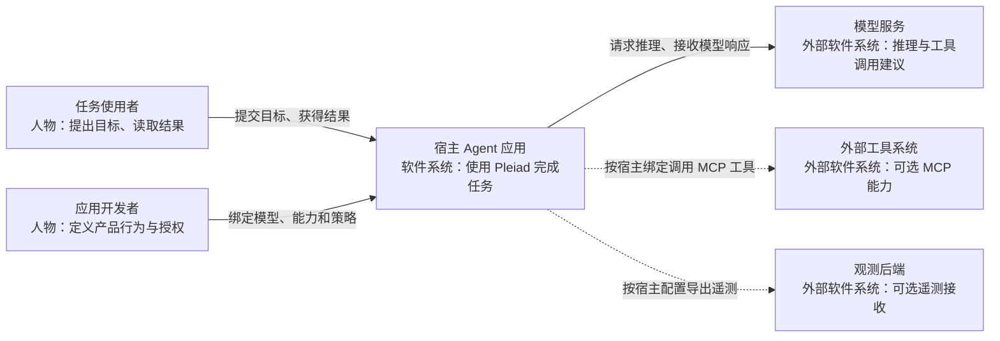
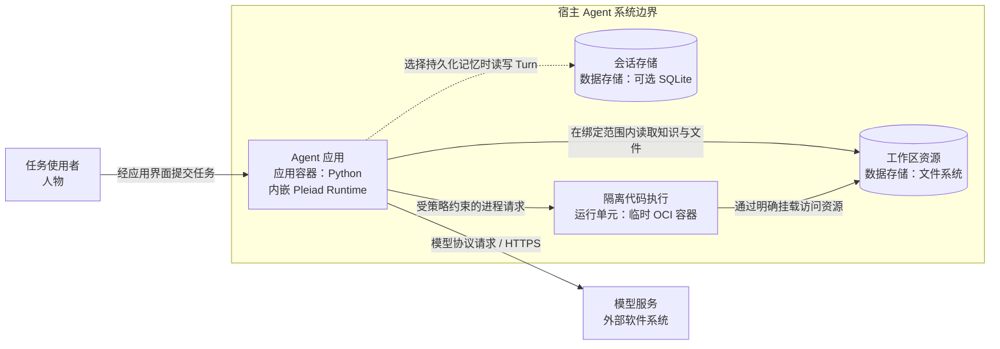
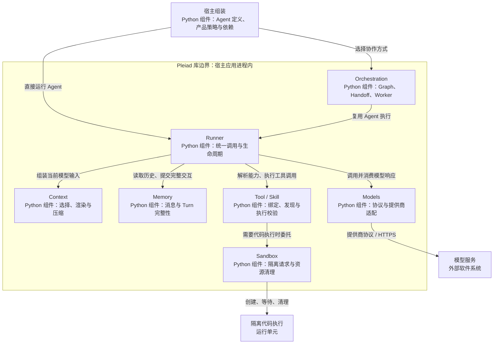

# Pleiad 架构设计

Pleiad 提供可复用的 Agent 运行机制。应用声明 Agent 的模型、指令和能力，Pleiad 负责完成模型调用、工具执行、上下文管理与编排。Weave 是使用这些机制构建的一个产品，二者的边界见 [Weave 架构设计](weave-architecture.md)。

本文采用 [C4](https://c4model.com/diagrams) 的系统上下文、容器和组件视图，解释主要职责、协作关系及其设计原因。Pleiad 是嵌入宿主应用的 Python 库，其 C1、C2 视图从使用该库的宿主系统观察，C3 再展开库内的核心组件。

## 1. 核心设计理念

### 定义 Agent，统一管理执行

Agent 描述模型、指令和可用能力。运行时状态由 Runner 管理，包括一次调用的消息、权限、预算、工具结果以及结束和取消。这个划分让同一份 Agent 定义可以用于直接调用、图节点或委派任务，而执行规则始终由同一套 Runtime 实施。

应用因此可以专注于“这个 Agent 要完成什么任务”。工具调用是否合法、资源如何限制、并发任务如何清理等规则由框架集中处理，产品不需要再实现一套 Agent 循环。

### 通过 Tool 和 Skill 组合能力

Tool 表达可以执行的动作，例如读取文件、运行程序或调用外部服务；Skill 表达方法和领域知识。Agent 通过能力引用选择所需内容，宿主绑定实际实现并授予权限。

Skill 元数据先用于发现，正文按需进入模型上下文。知识内容不会自动授予执行权限。这样既能扩展领域能力，也能保留清楚的执行边界。

### 分开保存历史与构造上下文

Memory 保存已经发生的交互，Context 为当前模型请求选择和组织信息。用户输入、模型回复和工具结果构成历史事实；检索资料和业务输入可以进入当前请求，而不改写原始历史。

这个划分让上下文选择和压缩可以独立演进，同时保持消息顺序与工具调用配对的完整性。会话归属和跨会话访问仍由应用决定。

### 编排复用 Runtime

Handoff 在同一 Run 内切换 Agent，Worker 建立独立子调用，Graph 用依赖关系组织节点。三者表达不同协作方式，Agent 执行都复用 Runner；Graph 也允许直接执行普通异步函数。

Pleiad 的 Run 表示一次框架调用。用户作业的持久化身份、排队和产品终态由宿主维护，使框架能够服务于不同应用，而不绑定某种产品任务模型。

## 2. 系统上下文视图（C1）

关注使用 Pleiad 的应用对谁提供价值、与哪些外部系统交互。用户面对宿主应用；应用开发者负责产品行为和部署选择，模型服务提供推理，外部工具系统提供扩展能力。

实线表示主要交互，虚线表示可选集成。Pleiad 提供交互所需的运行机制；具体模型、密钥、外部工具及观测后端由宿主显式选择。

## 3. 容器视图（C2）

本层说明运行和数据边界。C4 的 Container 表示应用或数据存储。Pleiad 自身不形成独立服务，随宿主 Python 应用运行；需要执行工作区代码时，由应用通过 Pleiad 管理隔离执行单元。

会话存储是宿主选择的后端，Pleiad 也支持进程内记忆。隔离执行单元按请求创建和清理，执行用户代码时不继承宿主的任意权限。模型服务与代码执行分别处于外部服务边界和本地隔离边界，失败由相应拥有者处理。

## 4. 组件视图（C3）

展开宿主 Python 应用中的 Pleiad 库。图中组件按责任划分，表示逻辑模块，均在宿主进程内运行；Sandbox 组件控制的代码执行发生在上一层的隔离单元中。

| 组件 | 主要责任 | 设计目的 |
| --- | --- | --- |
| Runner | 管理调用状态、授权、额度、流和取消 | 所有 Agent 调用遵守统一规则 |
| Models | 保留协议差异并适配提供商 | 模型服务变化集中在接入边界 |
| Context / Memory | 分别构造请求视图、维护交互事实 | 上下文优化不破坏原始历史 |
| Tool / Skill | 将执行能力和领域知识绑定给 Agent | 新能力通过组合接入现有 Runtime |
| Orchestration | 管理依赖、控制权移交和子调用 | 协作方式变化不复制执行机制 |
| Sandbox | 限制用户代码执行并清理资源 | 代码能力与宿主权限形成明确边界 |

事件、日志与 OpenTelemetry 贯穿真实执行边界，供宿主理解运行过程。它们不承担另一套任务调度或产品状态存储。

## 5. 一次调用如何协作

宿主提供 Agent 定义、能力绑定、记忆和策略后，Runner 建立本次 Run。它从历史和请求资料构造 Context，向模型发送输入，再将模型提出的工具调用交给 ToolRuntime 校验和执行。工具结果按调用身份写入 Memory，并成为后续推理的依据。

当任务需要协作时，编排组件管理节点依赖、委派或移交，Agent 执行仍进入相同的 Runner。调用结束、超时或取消时，拥有者处理自己的子任务、模型流和隔离资源，然后向宿主返回结果或传播故障。

这条执行链把模型决策与受控执行连接起来：模型输出可以变化，授权、消息完整性和资源生命周期由明确规则约束。

## 6. 边界与设计取舍

| 选择 | 获得的能力 | 承担的约束 |
| --- | --- | --- |
| 以库嵌入宿主 | 相同 Runtime 可用于不同产品与界面 | 宿主需要明确组装依赖与拥有资源 |
| Agent 定义与调用状态分开 | 定义可复用，编排共享执行路径 | Run 不能代替产品持久化作业 |
| 能力引用与实际授权分开 | 能力扩展仍受宿主策略控制 | 发现某个 Tool 不代表可以执行它 |
| 历史与上下文分开 | 保留事实，同时支持选择与压缩 | 产品负责资料来源及会话授权 |
| 系统故障明确传播 | 应用能判断真实失败并处理终态 | 框架不通过替换模型或空结果掩盖故障 |

代码归属可从 [Agent](../packages/pleiad/src/agent/agent.py)、[Runner](../packages/pleiad/src/runtime/execution/runner.py) 和 [GraphExecutor](../packages/pleiad/src/orchestration/graph/executor.py) 继续追踪。产品持久化、能力策略及界面协作在 [Weave 文档](weave-architecture.md) 中说明。
