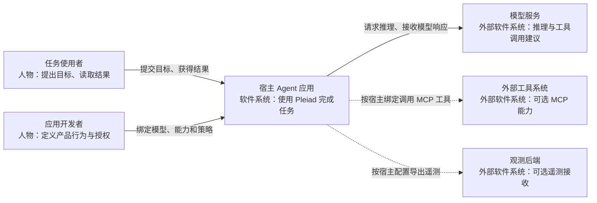
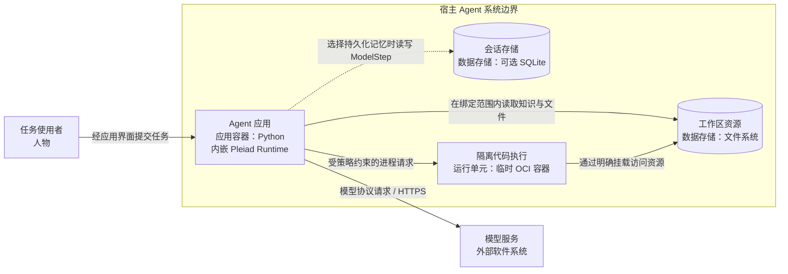
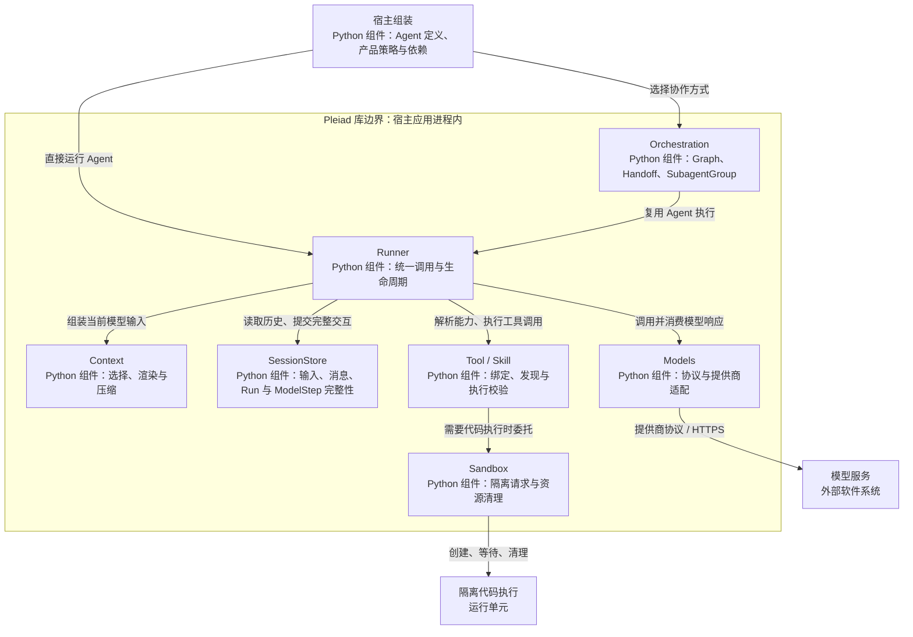

# Pleiad 架构设计

Pleiad 提供可复用的 Agent 运行机制。应用声明 Agent 的模型、指令和能力，Pleiad 负责完成模型调用、工具执行、上下文管理与编排。Weave 是使用这些机制构建的一个产品，二者的边界见 [Weave 架构设计](weave-architecture.md)。

本文采用 [C4](https://c4model.com/diagrams) 的系统上下文、容器和组件视图，解释主要职责、协作关系及其设计原因。Pleiad 是嵌入宿主应用的 Python 库，其 C1、C2 视图从使用该库的宿主系统观察，C3 再展开库内的核心组件。

## 1. 核心设计理念

SDK 以 `Session` 保存交互身份与输入队列，以 `Runner.start/resume` 建立和恢复 Run，由 `RunHandle` 拥有执行与资源清理。一次 Assistant 响应和有序工具结果构成 `ModelStep`，公开字段使用 `step_id`、`max_model_steps`、`remaining_model_steps`。终态返回 `RunResult`，安全暂停返回 `RunSuspension` 与 version 1 检查点。公开 API 用法见 [SDK 使用指南](../packages/pleiad/README.md)。

### 定义 Agent，统一管理执行

Agent 描述模型、指令和可用能力。运行时状态由 Runner 管理，包括一次调用的消息、权限、预算、工具结果以及结束和取消。这个划分让同一份 Agent 定义可以用于直接调用、图节点或委派任务，而执行规则始终由同一套 Runtime 实施。

应用因此可以专注于“这个 Agent 要完成什么任务”。工具调用是否合法、资源如何限制、并发任务如何清理等规则由框架集中处理，产品不需要再实现一套 Agent 循环。

### 通过 Tool 和 Skill 组合能力

Tool 表达可以执行的动作，例如读取文件、运行程序或调用外部服务；Skill 表达方法和领域知识。Agent 通过能力引用选择所需内容，宿主绑定实际实现并授予权限。

Skill 元数据先用于发现，正文按需进入模型上下文。知识内容不会自动授予执行权限。这样既能扩展领域能力，也能保留清楚的执行边界。

MCP 使用 `McpServer` 保存未连接的客户端原型，`discover_tools` 与 `McpTool` 分别拥有本次发现或工具调用的连接。`IsolatedStdioTransport` 为每次连接创建独立子进程，在连接退出时清理，避免完成或取消一个调用时关闭并发调用的进程。stdio 服务的进程内状态不会跨工具调用保留；浏览器等需要连续状态的服务，应由宿主另行提供并验证持久服务的状态契约。服务地址、凭据、启用策略和工具白名单由宿主配置，SDK 不读取产品配置文件。

### 分开保存历史与构造上下文

SessionStore 保存已经发生的交互，Context 为当前模型请求选择和组织信息。用户输入、模型回复和工具结果构成历史事实；检索资料和业务输入可以进入当前请求，而不改写原始历史。

这个划分让上下文选择和压缩可以独立演进，同时保持消息顺序与工具调用配对的完整性。会话归属和跨会话访问仍由应用决定。

动态 ContextBlock 在每次模型请求中渲染，检查点保存已接受的引用快照。SessionStore 保存原始消息与完整工具观察，Context 的选择、压缩只影响请求视图。Runtime 为当前 Session writer 绑定 `read_tool_result`，模型按 message_id 分页读取原 ToolMessage，按 operation_id 分页读取持久 OperationRecord 的最终结果。两种事实保留各自身份，完整观察不因输入或请求视图的大小限制而丢失。读取范围与授权由宿主绑定的 Session 决定，包括该 Session 的历史 Run。

请求视图先裁剪旧的完整 ModelStep，再裁剪仍无法容纳的可选 ContextBlock，保留能够放入窗口的当前批次上下文。结果引用替换只记录真实原文引用，未使用摘要器时 CompactionState.summary 为 null。宿主提供过真实滚动摘要后，新历史继续并入该摘要需要显式更新器。

宿主先用 `Session.enqueue(InputEnvelope)` 持久接受输入，再将明确的 `input_ids` 和 `invocation_id` 交给 Runner。相同输入或调用身份可查询原收据，内容冲突明确拒绝。live Run 在安全边界接收新增输入，batch Run 只消费本批输入。输入顺序、ModelStep 顺序和工具结果配对分别校验。

`Session.clear()` 仅在 writer 生命周期已结束后删除该 Session。删除产品记录和取消运行由宿主协调。

### 编排复用 Runtime

Handoff 在同一 Run 内切换 Agent，SubagentGroup 建立父 Run 范围内的独立子调用，Graph 用依赖关系组织节点。三者表达不同协作方式，Agent 执行都复用 Runner；Graph 也允许直接执行普通异步函数。

Pleiad 的 Run 表示一次框架调用。用户作业的持久化身份、排队和产品终态由宿主维护，使框架能够服务于不同应用，而不绑定某种产品任务模型。

## 2. 系统上下文视图（C1）

关注使用 Pleiad 的应用对谁提供价值、与哪些外部系统交互。用户面对宿主应用；应用开发者负责产品行为和部署选择，模型服务提供推理，外部工具系统提供扩展能力。

实线表示主要交互，虚线表示可选集成。Pleiad 提供交互所需的运行机制；具体模型、密钥、外部工具及观测后端由宿主显式选择。

## 3. 容器视图（C2）

本层说明运行和数据边界。C4 的 Container 表示应用或数据存储。Pleiad 自身不形成独立服务，随宿主 Python 应用运行；需要执行工作区代码时，由应用通过 Pleiad 管理隔离执行单元。

会话存储是宿主选择的后端，Pleiad 也支持进程内记忆。隔离执行单元按请求创建和清理，执行用户代码时不继承宿主的任意权限。模型服务与代码执行分别处于外部服务边界和本地隔离边界，失败由相应拥有者处理。

## 4. 组件视图（C3）

展开宿主 Python 应用中的 Pleiad 库。图中组件按责任划分，表示逻辑模块，均在宿主进程内运行；Sandbox 组件控制的代码执行发生在上一层的隔离单元中。

| 组件 | 主要责任 | 设计目的 |
| --- | --- | --- |
| Runner | 管理调用状态、授权、额度、流和取消 | 所有 Agent 调用遵守统一规则 |
| Models | 保留协议差异并适配提供商 | 模型服务变化集中在接入边界 |
| Context / SessionStore | 分别构造请求视图、维护交互事实 | 上下文优化不破坏原始历史 |
| Tool / Skill | 将执行能力和领域知识绑定给 Agent | 新能力通过组合接入现有 Runtime |
| Orchestration | 管理依赖、控制权移交和子调用 | 协作方式变化不复制执行机制 |
| Sandbox | 限制用户代码执行并清理资源 | 代码能力与宿主权限形成明确边界 |

事件、日志与 OpenTelemetry 贯穿真实执行边界，供宿主理解运行过程。它们不承担另一套任务调度或产品状态存储。

## 5. 一次调用如何协作

宿主提供 Agent 定义、能力绑定、Session 和策略后，Runner 建立本次 Run。它从历史和请求资料构造 Context，向模型发送输入，再将模型提出的工具调用交给 ToolRuntime 校验和执行。工具结果按调用身份写入 SessionStore，并成为后续推理的依据。

当任务需要协作时，编排组件管理节点依赖、委派或移交，Agent 执行仍进入相同的 Runner。调用结束、超时或取消时，拥有者处理自己的子任务、模型流和隔离资源，然后向宿主返回结果或传播故障。

RunHandle 在 start 接受调用后拥有执行任务。宿主退出 handle 上下文会取消活跃执行并等待清理；单个 events 订阅者退出只分离观察。事件来自 Session 的持久化有序日志，RunEvent 包含 sequence 和序列化 event。等待 result 的调用者取消继续向调用者传播，底层任务由 handle 继续拥有。

Runner 先保存 ToolCall intent，再允许外部动作。Tool 的 authorize hook 可以在后端接收之前请求宿主授权，SDK 将待决事实标记为 authorization phase。宿主批准后，同一 Run 的 OperationScope 持有实际后台动作。原生工具待决使用 execution phase，并由工具恢复自身执行。

background Tool 必须实现具体接受契约，先通过 BackgroundAdmission.prepare 保存带稳定 operation_id 与解析后请求摘要的 ToolSubmission，再调用 accept 提交匹配该摘要的 ToolAcceptance。实际后端接收并持久化后，原工具调用完成一条 started 配对结果，最终完成另行提交 operation_result 输入。该输入由 OperationResultReference 投影为有界 ResultReference，包含完整结果哈希、预览和读取参数，原始结果保留在 OperationRecord。操作目录使用 kind=operation 与 after_operation_id 游标。Command 将该身份交给 SandboxRequest，OCI create 确认实际容器身份后提交接受回执，再执行 start。query 按稳定身份验证所有者与动作标签，stop 校验原 SandboxReceipt 后确认容器移除。每次创建的独立 admission token 阻止冲突请求清理另一次已接受的动作。

TaskGroup 拥有后台任务、并发资源和取消清理。取消先保存 cancel_requested，再依据真实后端确认保存 cancelled 或 unknown。查询缺失保留 unknown。接收后、回执保存前崩溃时，宿主可以将查询取得的 ToolAcceptance 随 ActionEvidence 提交，恢复原动作接收事实。恢复证据必须匹配原请求摘要。OperationRecord 描述 SDK 工具结算，Command 的工具成功表示已取得进程退出事实，exit_code 与 timed_out 保存进程结果，SandboxObservation 表达实际后端进程状态，交付检查按声明的退出状态要求判定。实际接受、活动动作数、终态与耗时均经过宿主显式配置的 OpenTelemetry MeterProvider 记录。输入消费延迟从 accepted_at 测量到 begin_step 的真实提交确认，每个已消费输入计量一次。

模型请求进入提供商前，SessionStore 原子保存 ModelAttemptRecord 和一次调用的保守费用。记录包含请求摘要、实际输出上限、绝对期限与原用量基线。取消、断流或失去拥有者后，未完成请求的测量保持 null，预算继续按实际准入上限占用。完整结果的测量与该次费用结算在同一事务中保存，重复提交不会重复计费。已过期授权不会创建已准入请求。reconcile 仅在当前步骤与保存检查点一致且全部模型请求已经完成时恢复 paused，未完成请求结算为 interrupted 并保留已提交费用。

Handoff 若收紧目标 Agent 的期限，会同步收紧实际计时器。SubagentGroup 与 Graph 通过 `pleiad.budgets.BudgetLedger` 共用父模型准入与子调用预留。RunUsage 的 input/output/model_calls 保留本次 Run 自身测量，child_model_calls 与 child_budget_output_tokens 保存子调用保守费用，budget_output_tokens 为包含后代的累计总费用。嵌套 Graph 接收 ToolContext，将父授权、绝对期限、并发和剩余额度传给 Agent Node。兄弟节点使用不重叠额度，父模型也受未结算预留约束，确认未使用的部分才退款。ToolRuntime 通过绑定工具的实际 budget_ledger 附加 typed UsageCharge，按原预留身份合并累计费用，部分恢复和重复等待均只收新增部分。

Agent Node 使用 session_store 和 RunLimits，通过 Runner.start/resume 执行。暂停节点保存原始 Run 检查点、输入、累计用量和预算预留。恢复 GraphState 后由 NodeResume 提供明确决定，已完成兄弟节点不会重放。GraphExecutor.cancel_paused 统一取消暂停子调用并结算原预留，重复调用保留已提交的取消事实。资源撤销后可使用保存的 GraphState、实际 Runner 与原 SessionStore 取消，流程无需重新绑定 Agent 模型。Subagent 工具的 ToolScope 由 Runner 统一打开和结算，异步提交后未调用 wait 也必须在父收据提交前完成子作用域结算。暂停检查点同时保存整个共享账本、逐身份费用和实际作用域快照。

Node 的 unknown 外部效果保留 NodeStatus.UNKNOWN，Graph 返回 failed 与 orchestration.graph.recovery_unknown，宿主对账后才能重放。确认取消使用 CANCELLED 终态。child_usage 单独保存测量，未知值为 null，预算检查点分别保存已结算额度和活跃预留。

宿主文件工具通过目录描述符逐级打开路径并拒绝符号链接，读取普通文件时执行字节上限；Linux 和 macOS 上的 SDK 写入通过目录锁协调，暂存后在锁内重验摘要并安装。该协作锁不承诺与未遵守锁的外部编辑器实现原子比较交换。

这条执行链把模型决策与受控执行连接起来：模型输出可以变化，授权、消息完整性和资源生命周期由明确规则约束。

## 6. 边界与设计取舍

| 选择 | 获得的能力 | 承担的约束 |
| --- | --- | --- |
| 以库嵌入宿主 | 相同 Runtime 可用于不同产品与界面 | 宿主需要明确组装依赖与拥有资源 |
| Agent 定义与调用状态分开 | 定义可复用，编排共享执行路径 | Run 不能代替产品持久化作业 |
| 能力引用与实际授权分开 | 能力扩展仍受宿主策略控制 | 发现某个 Tool 不代表可以执行它 |
| 历史与上下文分开 | 保留事实，同时支持选择与压缩 | 产品负责资料来源及会话授权 |
| 系统故障明确传播 | 应用能判断真实失败并处理终态 | 框架不通过替换模型或空结果掩盖故障 |

代码归属可从 [Agent](../packages/pleiad/src/agent/agent.py)、[Runner](../packages/pleiad/src/runtime/runner.py) 和 [GraphExecutor](../packages/pleiad/src/orchestration/graph/executor.py) 继续追踪。产品持久化、能力策略及界面协作在 [Weave 文档](weave-architecture.md) 中说明。

RunSnapshot 持久 parent_run_id。宿主可以用 SessionStore.descendant_sessions(parent_run_ids) 查回完整递归子 Session，随后对已经结算的 Session 调用 clear。默认两种后端以一致快照解析拥有关系，包含独立父 Run 的复用 Session 会明确拒绝归入清理范围。产品的清理代次、文件与 tombstone 仍由 Weave 管理。
