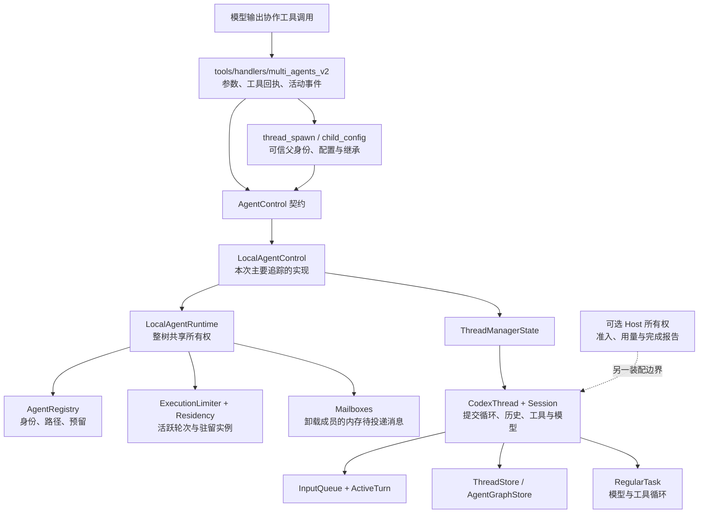
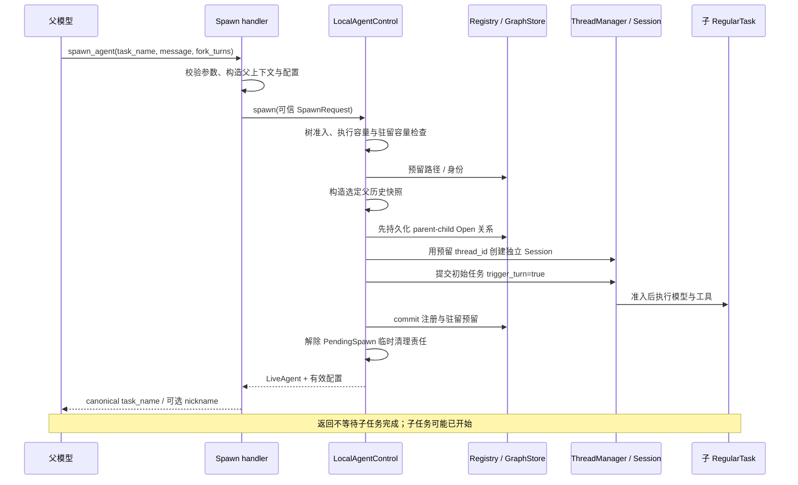
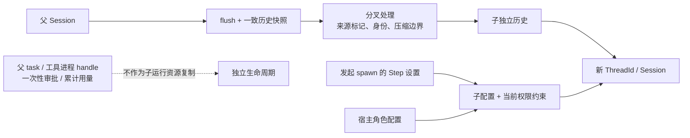
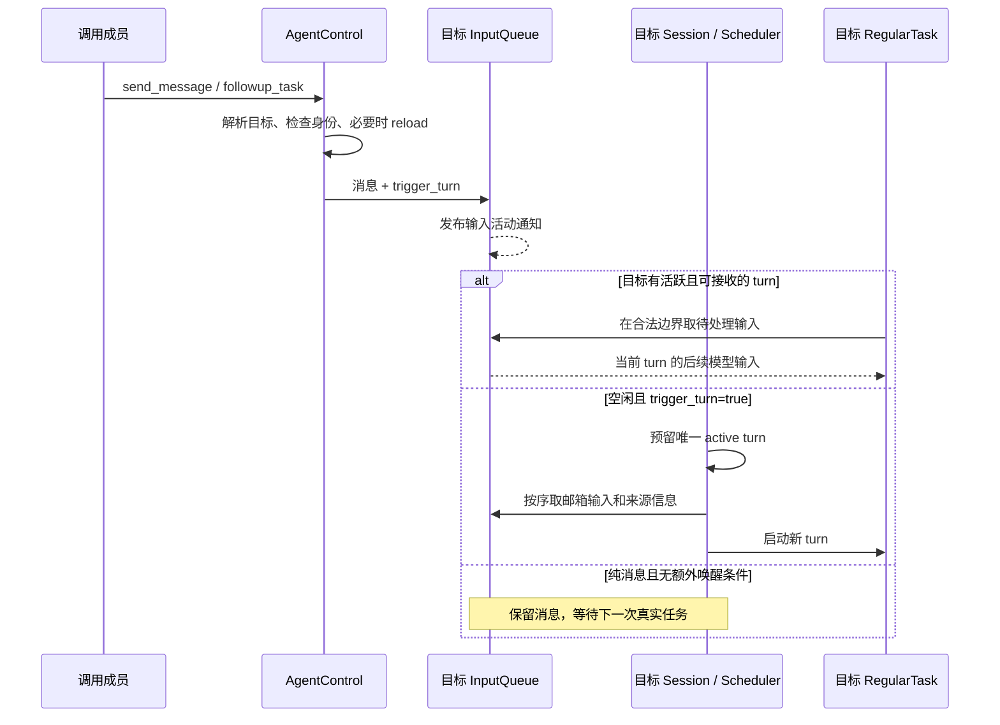
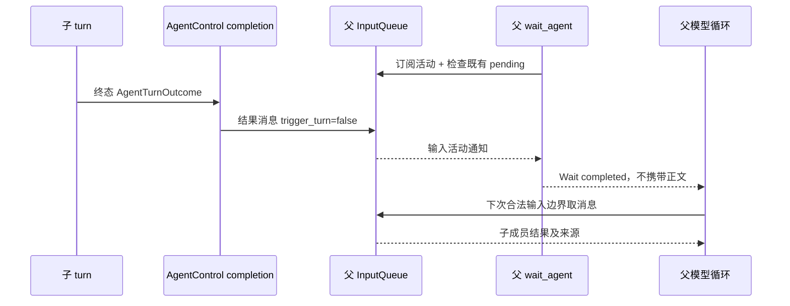
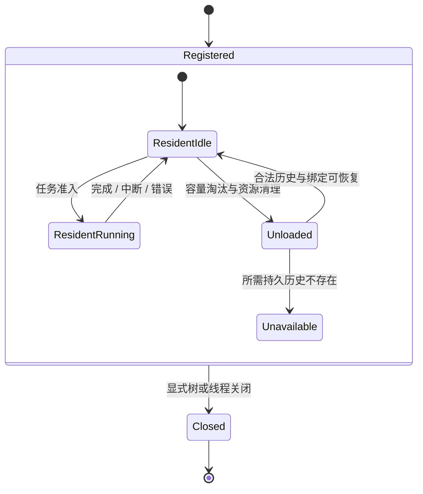

# Codex 动态子智能体源码调研与 Pleiad 架构校准

| 属性 | 内容 |
| --- | --- |
| 文档编号 / 版本 | PLEIAD-RESEARCH-CODEX-001 / 1.0 |
| 调研日期 | 2026-11-12，Asia/Shanghai |
| 对象 | OpenAI 官方 `openai/codex` 仓库，Rust Core 的本地 MultiAgent V2 路径 |
| 固定提交 | `c0cc9fc820f62e4dbdde68214dd6d792d6c8a7ee`，提交时间 2026-11-12 05:21:30 UTC |
| Pleiad 基线 | 0.2.0，`2ef982d05b85167cad70758c8064ab03458a94f5` |
| 方法 | 官方文档检索 → 固定源码版本 → 追踪调用者与被调用者 → 阅读相应测试 → 与本仓库实现对照 |
| 验证边界 | 源码与测试源码审阅；未编译或运行 Codex，未调用真实模型验证，未证明当前桌面安装包使用该提交 |
| 关联交付 | [架构设计方案书 1.1](pleiad-agent-collaboration-architecture.md)、[离线研究阅读版](assets/codex-subagent-research/research.html) |

本文的“源码事实”限于上述提交和注明的配置分支；“Pleiad 决策”是待评审提案。公开源码不能证明 ChatGPT 托管运行时或 Responses Multi-agent 后端的内部实现。下文链接均固定到提交和行号，缓存文件的内容摘要见 [源码清单](assets/codex-subagent-research/source-manifest.json)。

## 1. 结论与前稿修正

**可以实现。Codex 的动态子智能体是一套由模型工具驱动、宿主拥有的多会话运行机制：模型决定分工，运行时创建独立会话、启动轮次、路由消息并管理资源。** 它不要求动态生成 Agent 类或训练新的模型；多个子成员可以使用相同模型和角色配置，分别拥有线程身份、历史与当前轮次。[工具入口][C01]、[创建路径][C02]、[运行时创建][C05]

对 Pleiad 的直接结论仍是：新增与 `SubagentGroup` 同级的 `CollaborationGroup`，复用 Agent、Runner、Session 和 ToolRuntime。新增的是成员关系、调度所有权、邮箱、事件与持久协调状态；不要继承旧组来改变旧委派语义。

源码核对后，前一版方案有三项需要修正，另有六项必须明确为 Pleiad 的自主设计：

| 议题 | 固定版本 Codex 的事实 | Pleiad 方案处理 |
| --- | --- | --- |
| 忙碌时 followup | `trigger_turn=true`；忙碌时投递当前轮，空闲才启动轮次 | **修正**“每次 followup 必建 Work/Run”；按活跃输入准入边界选择当前 Run 或新工作 |
| 最终回答后的纯消息 | 默认延迟至下一轮，不因邮箱非空反复推理 | **修正**最终边界回调；区分纯消息/结果与显式工作输入 |
| 等待 | `wait_agent` 只等调用者输入活动，不按目标逐一等待，也不返回结果正文 | **澄清**：Pleiad 的指定成员 + 游标 EventPage 是任务书要求的扩展 |
| 默认生命周期 | 整树由 Runtime 拥有；单次 turn 完成与树 shutdown 是不同路径 | 保留任务书的 owner Run 结束即结算所拥有工作；不宣称照搬 Codex |
| 中断 | 接受 target，返回中断前状态；不提供 expected_run_id 契约 | 保留精确 Run/Work 控制回执和清理结算 |
| 恢复与消息可靠性 | 图关系和历史可持久化；本地邮箱是内存结构，完成通知为 best effort | 保留持久 inbox/outbox、幂等请求和未知效果核对 |
| 递归 | V2 工具路径不应用 V1 的 max_depth；有专门测试 | Pleiad 显式提供全树 max_depth/can_spawn |
| 调度限制 | 运行轮次与驻留线程分别计数，根线程不计入子槽 | Pleiad 分离成员数、活跃 Run 数；首版不引入复杂线程缓存淘汰 |
| 上下文继承 | 默认 full history，且有专门清洗/分叉逻辑 | 任务书首版仍采用选择性上下文；完整 fork 单列能力，不用文本拼接假冒 |

证据分别见第 4～11 节。**“体验参考 Codex”不能替代每条 API 的可验证契约。**

## 2. 调研对象、版本与证据边界

### 2.1 三种容易混淆的表面

| 对象 | 本次能确认什么 | 不能推断什么 |
| --- | --- | --- |
| Codex 官方用户文档 | 产品如何触发子智能体、配置模型、查看子线程 | 后端每个锁、队列和持久化细节 |
| `openai/codex` 本地 Rust Core | 工具、控制器、线程、输入与任务循环的具体实现 | 当前桌面二进制的确切版本、灰度设置和服务端插件 |
| Responses Multi-agent | API 的托管协作行为与动作契约 | 托管后端必然运行相同 Rust 调度器 |

本次主要依据第二项。[官方 Subagents 文档](https://learn.chatgpt.com/docs/agent-configuration/subagents)用于核对产品表面；[Responses Multi-agent 文档](https://developers.openai.com/api/docs/guides/responses-multi-agent)仅作边界对照。

### 2.2 不混用 V1 与 V2

V1 的 `send_input / wait / close_agent / resume_agent` 与 V2 的 `send_message / followup_task / wait_agent / interrupt_agent / list_agents` 不是同一套控制契约。V2 工具由 `tools/spec_plan.rs` 根据 turn 的版本、模型能力和配置注册，描述及命名空间还可由模型目录覆盖。[注册条件][C01]、[工具覆盖机制][C30]

`features/src/lib.rs` 中 V2 是 Stable，但原始 feature 的 `default_enabled=false`；官方文档说当前产品默认支持子智能体。这两个陈述属于不同层次：不能从原始 feature 默认值推断产品实际启用状态。后端版本、模型目录、配置和宿主装配都参与结果。[Feature 声明][C31]

本次研究只借鉴 V2 的最终机制，不将它的 V1 别名、历史配置兼容分支带入 Pleiad。

## 3. 静态架构：模型工具之下有独立控制层

R01：源码组件与职责，箭头表示主要调用关系。



`LocalAgentRuntime` 共享注册表、执行限制器、驻留管理、邮箱、rollout budget、关闭 token 和成员追踪器。`LocalAgentControl` 通过弱引用访问 ThreadManager，避免控制器与线程管理器互相强持有。`CodexThread` 是会话控制对象，创建链最终进入 `Session::spawn`；session submission loop 通过 Tokio task 运行。**创建子智能体不等于新建一个操作系统进程**；具体工具仍可能自行启动 shell 或其他进程。[共享 Runtime][C03]、[Session 启动][C05]、[提交循环启动][C06]

Host 装配可以把 turn 准入、用量和观察职责交给宿主；选择 Host ownership 后必须提供 `AgentTurnAdmission`，失败不会回落到 Local。这个扩展证明“模型执行引擎”与“多 Agent 资源所有者”可以分开，但 Pleiad 当前只有一个实现需求，不必照搬整套 Rust trait/扩展注册框架。[Host ownership][C25]

## 4. 动态创建的实际调用链

### 4.1 正常路径

可直接沿以下符号追踪：

```text
SpawnAgentHandlerV2.handle
  → handle_spawn_agent
  → thread_spawn::spawn / prepare
  → prepare_agent_spawn_config
  → AgentControl::spawn
  → LocalAgentControl::spawn_agent_internal
  → ThreadManagerState::spawn_child_thread
  → ThreadManagerState::spawn_thread
  → Session::spawn
  → 提交 trigger_turn=true 的初始 InterAgentCommunication
  → InputQueue / pending-work scheduler / RegularTask
```

模型给出 `task_name`、任务说明、可选角色/模型配置和 fork 模式；可信父 thread、turn、root_turn、环境选择等由当前执行上下文补入。规范路径由父 `AgentPath.join(task_name)` 得到，模型不能自行声明父身份。[Handler][C02]、[可信创建参数][C04]

R02：一次创建包含“临时拥有 → 可返回结果”的明确边界。



`PendingSpawn` 持有启动中的 child、树 membership 和 graph edge 写入任务。若创建被取消，Drop 安排清理：移除已加载 child、关闭会话、丢弃未成功交付的启动持久状态，等待 Open 写入结束后才写 Closed。最终 registry commit、residency commit 和 disarm 之间不再 await，减少“已创建但调用方未拿到”的无主窗口。[创建实现][C07]、[临时拥有与清理][C08]

这里仍需区分两个边界：源码只保证 **backend spawn 返回前** 的临时所有权；工具结果向父模型发布在它之后。不能据此声称“网络丢回执后重试 spawn 一定去重”。Handler 未提供 Pleiad 任务书要求的外部 request_id 幂等协议。

### 4.2 对 Pleiad 的启示

1. 协作组拥有 child 的创建全过程；在 `Runner.start` 已成功但协作关联写入未完成时，仍有人负责核对或清理。
2. member/work/invocation 身份必须在副作用前固定；持久接受与启动 intent 分开。
3. 受理、已启动、已完成是三件事。Pleiad 可在持久受理后更早返回，但必须显示 accepted/queued，不能假称 Codex 的成功回执也只表示“写入队列”。
4. 新成员的模型、工具、grants 只能来自宿主允许的绑定。所谓动态创建是组合经过授权的运行实例。

## 5. 身份、上下文继承与权限

### 5.1 身份不能压成一个 task_id

| Codex 概念 | 事实用途 | Pleiad 对应设计 |
| --- | --- | --- |
| AgentPath，如 `/root/research/parser` | 树内规范名称和相对引用 | member path，可选易读寻址；member_id 仍是主键 |
| ThreadId | 稳定子会话身份、查找已加载线程及历史 | member_id + 独立 session_id，保持明确关系 |
| turn_id | 一次活跃任务轮次 | work_id / invocation_id / run_id，分别保留 |
| parent_thread_id | 创建时父子关系 | parent_member_id |
| parent_turn_id、root_turn_id、initiating_agent_path | 请求来源、根因与 UI 归因 | owner_run_id、source_member_id、causation_id |
| AgentStatus | 从线程事件推导的当前状态视图 | MemberView；不能覆盖历史 Run 的终态 |

上表是语义映射，不宣称 Codex `SessionId` 与 Pleiad `Session` 同义。源码专门区分 registry identity、LiveAgent 和 SpawnAgentOptions，终态事件映射也独立于注册关系。[类型定义][C09]、[状态推导][C20]

### 5.2 fork 是模型上下文快照，不是复制运行资源

Handler 默认 `fork_turns=all`，`none` 创建新上下文；当前解析器还接收旧的正整数值，但统一作为 FullHistory，**并不按数字裁剪历史**。这属于 Codex 的历史兼容，Pleiad 不应复制。[参数解析][C02]

完整分叉有专门 `prepare_forked_history`，不是把父消息列表赋给 child：

1. 先 materialize/flush 父历史，再从 ThreadStore 读取模型上下文。
2. 按历史模式、压缩 checkpoint 和 `preserve_fork_prefix` 选择保留或重建前缀；旧式无 replacement history 的压缩会走重建分支。
3. 对继承消息标记来源，清理父侧 user ordering/授权归属元数据；不继承父累计 TokenUsageRecord。
4. 前缀保留分支追加“现在是新子成员”的身份说明；非保留分支过滤旧角色提示、审批提示、工具调用等不适合继承的内容。
5. 中途分叉写入中断边界以表示截取点；不复制父活跃 task、工具 session 或进程 handle。[历史分叉][C10]、[快照边界][C11]

R03：继承对象和非继承对象。



配置继承与历史继承是两条路径：child_config 从捕获的 step/turn 设置构造配置，应用角色和模型选择后重新施加当前父权限、审批策略和 cwd；恢复路径也核对权限及环境绑定。历史里的“批准过”不等于新 child 获得同一行动授权。[配置构造][C12]、[恢复权限核对][C23]

还有一个审计上值得保留的区别：模型可见提示写着 full-history fork 不应覆盖模型/推理强度，但该提交的底层 `prepare_agent_spawn_config` 仍调用模型覆盖处理，V2 也允许明确的 role 覆盖。**提示要求不等于后端拒绝条件**；Pleiad 如果要硬限制，必须在自己的 schema/准入层执行，不可只写 prompt。[模型提示][C35]、[配置代码][C12]、[V2 role 测试][T01]

Pleiad 首版选择性上下文满足任务书，但必须承认它不等于 Codex 的默认完整分叉。以后实现 full fork 时，需新增不可变模型上下文快照契约，保留工具 call/result 成对关系、多模态引用来源和授权边界；不能复制 Session journal 中的 writer、Run 状态或费用记录。

## 6. 消息与 followup：同一邮箱，两种唤醒意图

`send_message` 和 `followup_task` 共用 `handle_message_string_tool`；区别是 `MessageDeliveryMode::QueueOnly` 与 `TriggerTurn`。后者转成 `InterAgentCommunication.trigger_turn=true`。目标路径解析、发件人身份、冷加载和实际投递由控制器完成。[共享工具路径][C13]、[控制器发送][C14]

| 目标状态 | send_message | followup_task |
| --- | --- | --- |
| 忙碌并接收输入 | 邮箱入队，安全边界进入当前 turn | 同样进入当前 turn；不会为每条 followup 强制另建 turn |
| 普通空闲 | 只排消息 | pending-work scheduler 启动新 RegularTask |
| 最终边界已关闭 | 普通消息留后续轮次 | 显式工作请求保留唤醒意图；结束清理后由 pending-work scheduler 处理 |
| 已卸载但仍在 registry | 本地 eviction 的目标可只存 runtime mailbox；冷恢复目标可能先 reload | 先确保目标加载，再尝试启动/投递 |
| 根成员 | 可以收消息 | 拒绝 followup 根成员 |

“普通空闲不醒”是默认路径。`WakeOnAgentMessages` 或 outstanding durable sleep 会改变唤醒行为；不能把默认规则写成所有配置下的绝对规则。[handler 与 scheduler][C15]、[输入队列][C16]

R04：忙碌与空闲 followup 的分流。



### 6.1 “及时投递”不是随时往模型流里插 token

源码在已完成的 reasoning item 或 commentary/partial-answer 消息边界检查邮箱；可以结束本次采样并进入带新输入的后续采样。Responses Lite 分支可请求 drain，保留已完成项及 response id，并阻止缓冲工具越过新消息抢先执行。`DeferMailboxPreemption` 可改为等当前响应完成。[模型循环边界][C17]

已经发出的工具操作不因为普通消息自动变成 interrupt。应等待合法工具/步骤边界；需要停止当前任务时显式调用中断。Pleiad 当前只有完整 ModelStep 边界，首版采用它是合理范围控制，但不能宣称达到 Codex item 级抢占延迟。

### 6.2 最终边界防止消息引发无穷续跑

`MailboxDeliveryPhase` 区分当前轮与下一轮。最终回答默认切到 NextTurn；纯消息不能重新打开该边界，显式输入则可以。结束时对 pending input 的最后检查与 task 移除保持原子，避免输入与完成竞争。[输入阶段][C16]、[最终回答处理][C18]、[结束临界区][C19]

对应测试用受控 SSE 确认：reasoning/commentary 后收到消息会产生后续请求；最终回答后的纯消息不产生额外请求，下一次用户任务才带上它。这里阅读了测试正文，**没有运行这些测试**。[真实模型传输替身测试][T02]

Pleiad 应分开持久化 `message.kind`、`routing` 和 `consumed_step_id`。活跃 followup 附着既有 work/run，使用其剩余预算，不产生新的 Execution 或费用预留；越过关闭边界的 followup 才有新 work/invocation。路由结果写入不可变回执，重试不能重新选择另一 Run。

## 7. wait 与结果回送是两条通道

V2 `wait_agent` 参数只有 `timeout_ms`，订阅调用者的输入活动；触发原因是 mailbox、user steer 或 timeout。它先订阅，再检查已有 pending input，避免错过“刚到达”的消息；wait 本身不取走消息，也不返回 child 完整结果。[wait handler][C21]、[非消费式等待][C22]

R05：结果数据与等待唤醒分离。



`notify_parent_of_terminal_turn` 把结果发给创建关系中的直接父成员。UI completed activity 可按 initiating_agent_path 归因，不能把 UI 归因接收者误当结果收件人。完成通知明确是 best effort；投递失败记录指标/日志，不靠这条路径提供可靠事务。中断状态不格式化为完成结果；测试验证 interrupted turn 不通知父成员。[完成回送][C24]、[结果格式][C32]、[对应测试][T03]

这里的结果主要来自 turn 的 `last_agent_message`。所读路径没有另调一个模型自动压缩结果；“子成员应返回摘要”主要是任务/提示约定。Pleiad 的有界摘要 + ResultReference 应作为显式数据契约，不能假定 Codex 已提供无限输出的自动摘要器。

Pleiad 的 `wait(member_ids, after_cursor)` 则是持久 EventPage：适合 UI 重连、指定成员和多观察者，保留任务书要求。它应复用“通知只是唤醒、数据从权威事实读”的原则，不能拿掉 inbox，更不能将“UI 已读事件”当成“模型已消费结果”。

## 8. 并发、递归与驻留管理

### 8.1 三种数量必须分别定义

| 数量 | 源码机制 | 关键语义 |
| --- | --- | --- |
| 注册身份 | AgentRegistry / AgentMetadata | 包含已加载与已卸载成员，路径预留避免重复 |
| 正在运行的轮次 | AgentExecutionLimiter + AgentExecutionGuard | Local V2 子轮次计数；guard 随 task 生命周期释放，根/V1 不计 |
| 驻留线程实例 | V2Residency + residency pin | 满额时尝试卸载旧的空闲子实例，不能淘汰正在工作者 |

`agents.max_concurrent_threads_per_session=N` 在配置解析时转换为内部 N+1，内部再减去根线程得到子容量；不要直接抄内部配置字段而造成差一。execution 和 residency 使用相同派生上限，但跟踪不同资源。[配置转换][C33]、[执行限制][C26]、[驻留管理][C27]

等待工具期间 child task 仍存在，执行 guard 仍被持有；没有看到 `wait_agent` 释放许可再重新获取的路径。Local limiter 的 capacity 检查与 guard 增加也分在不同方法，**不能把它描述为强原子 semaphore 预留算法**；是否有所有入口的竞态上界保证需要进一步专项压力验证。Pleiad 应在自己的单拥有者准入事务中原子预留槽位。

V2 注册与 spawn 不应用 V1 深度校验，对应测试明确验证忽略配置 max_depth。Pleiad 可保留有界递归及嵌套无槽立即拒绝；这是更严格的宿主资源契约，不是 Codex 原样行为。[工具可用条件][C01]、[深度测试][T04]

### 8.2 idle 不等于销毁

卸载前需要取得 residency 写锁、确认仍是同一 live 实例且已空闲，随后关闭 session、转移待收消息、保存有效环境与权限快照、移除驻留实例。消息投递持有读 pin，防止与卸载交错。需要时再以稳定 ThreadId 读取历史并 reload。[驻留清理][C27]、[懒加载][C23]

R06：身份与驻留的二维生命周期。



这张图是根据多个源码路径归纳的分析图，不是源码枚举的逐字复制。尤其不能承诺“每个卸载成员都必然可恢复”：测试包含无可用持久历史的 interrupted 成员被淘汰后 reload 返回 ThreadNotFound 的情形。[驻留测试][T05]

Pleiad 无需首版就建一个常驻线程缓存管理器。它的空闲成员可以只保留持久 Member/Session 引用，没有活跃 RunHandle；新 Run 时重新获得 WorkBinding。共享客户端仍由宿主拥有。以后若有昂贵的每成员常驻资源，再增加独立 residency 策略。

## 9. 中断、失败与整树关闭

V2 interrupt 拒绝 root 和 self；先获取状态快照，再向线程提交 `Op::Interrupt`，工具返回 `previous_status`。已卸载或已经死亡的目标可视为无需再中断，不为了停止而重新加载。这个回执**不等于目标 Run 的清理结算证明**，也没有 expected_turn_id 条件。[中断控制][C28]

整树 Runtime 用 cancellation token 和 TaskTracker 管理已准入的启动/清理工作。shutdown 先关闭准入，再发 cancellation，再关闭邮箱；等待者在成员追踪器排空后拿到稳定清理报告。普通单轮完成只结束当前 task、保存结果和检查后续工作；不能把它与整树 shutdown 合并。[树拥有权][C03]、[结束路径][C19]

对 Pleiad 保留以下更强契约：

- interrupt 使用 expected_work_id/expected_run_id；重试旧中断不会停止新一轮。
- 业务失败形成该 work 的结果；只有存储/账本/owner 系统故障触发组级停止，避免 Python TaskGroup 因普通子异常取消兄弟。
- 父 Run 结束结算其拥有工作是本任务书明确的默认值；跨父轮次保留的是 member/Session。
- close 等待自己拥有的任务和清理任务，区分 local settled 与外部收费结果 unknown；不承诺停止本地 await 能撤销供应商操作。

## 10. 持久化、恢复与预算的真实边界

Codex 的 ThreadStore 保存会话与模型上下文，AgentGraphStore 保存 parent-child open/closed 边。V2 冷恢复先恢复成员 metadata，并不急于重新打开所有子线程；需要时再 lazy load。fork、reload、运行时权限及持久关系有专门检查。[身份恢复][C23]、[创建图关系][C07]

但本地 `Mailboxes` 的主体是 `Mutex<HashMap<ThreadId, Mailbox>>`，其中 pending mail 是内存 Vec。会话历史持久化和消息“已进入持久历史”不能混同；不能据此宣称进程崩溃后所有已发送但未消费消息都有事务级恢复保证。[邮箱实现][C29]

本地 RolloutBudget 是整树共享的加权用量累计和提醒状态，可根据配置在耗尽时返回错误；不是 Pleiad 的每 Work 预留、unknown 保守占额和跨库 outbox 协议。Host ownership 可改由宿主用量模块负责。[本地预算][C34]、[宿主准入][C25]

因此 Pleiad 仍需新增 CollaborationStore：成员关系、命令幂等、路由回执、工作意图、消息状态、事件和 outbox；SessionStore 继续拥有输入、ModelStep、RunReceipt 与 writer。BudgetLedger 保留唯一费用算法，在协作存储中保存可核对的活动预留事实。不要把 Codex 源码里存在 SQLite 理解为这些可靠性契约已经自动具备。

## 11. 对当前 Pleiad 的逐项落点

| 现有代码事实 | 需要新增或扩展的能力 | 所属层 |
| --- | --- | --- |
| Agent 已是可复用声明 | Member 身份、父子关系、Session 绑定 | 新 collaboration 模块 |
| Subagent 的 session 按 delegation_id 创建；group 绑定 owner Run | 独立长期 scope；不继承或转发旧组 | 新 collaboration 模块 |
| Runner.start / RunHandle 已有模型执行与取消 | 组合已有 RunHandle，所有启动/清理 task 有拥有者 | 新组调度 |
| live 模式在 begin_step 消费输入 | 邮箱可靠投递、来源和 consumed 投影 | collaboration + SessionStore 公共 API |
| 无工具最终响应直接结束 | 通用最终输入准入边界；显式 followup 可继续，纯消息留下一轮 | tools 的通用回调契约 + Runtime 调用点 |
| Session 单 writer 和稳定 invocation | followup 的 route 在成员锁下决定，重试不变 | 协作存储/调度 |
| 现有 Session SQLite schema 独占 | 单独 collaboration SQLite 文件 | SDK 默认后端 |
| BudgetLedger 共享实例与保守结算 | 活动预留镜像、恢复核对；活跃 followup 不再次预留 | 现有 budgets + 新组 |
| Weave Execution 是唯一产品作业 | 新工作准入先登记 child Execution；当前 Run 补充不另建 Execution | 宿主 |

本仓库核对入口：[Agent](../packages/pleiad/src/agent/agent.py)、[Subagent](../packages/pleiad/src/orchestration/subagents/subagent.py)、[SubagentGroup](../packages/pleiad/src/orchestration/subagents/group.py)、[Runner](../packages/pleiad/src/runtime/runner.py)、[SessionStore](../packages/pleiad/src/sessions/store.py)、[最终响应路径](../packages/pleiad/src/runtime/execution/loop.py)、[ToolScope](../packages/pleiad/src/tools/base.py)、[BudgetLedger](../packages/pleiad/src/budgets.py)、[导入边界](../.importlinter)。

### 11.1 必须补充的契约

1. **FollowupReceipt 分支**：`active_run` 附着既有 Work/Run；`new_work` 创建新身份。两者均有 message_id、request_id 和不可变 route。
2. **权限/预算归属**：活跃 followup 只可在目标原授权与余额内执行，不能通过消息切换模型、扩大 grants 或延长期限；需要新授权的请求明确拒绝当前轮附着。
3. **最终输入闸门**：接收态、关闭水位、显式工作输入、纯消息延期，以及取消后未消费输入的去向。
4. **wait 分层**：模型与 UI 的事件游标独立；结果 inbox 独立于 wait 的读取。
5. **配置职责**：模型只选宿主 profile；Prompt 的“应该”不能替代 runtime 的硬校验。
6. **三类生命周期**：身份、当前 Run、拥有资源分离；资源空闲不等于身份关闭。
7. **可靠性差异声明**：原子受理、outbox、精确中断、unknown 核对、max_depth 都是 Pleiad 的契约。

### 11.2 首版明确不承诺的 Codex 能力

首版不承诺完整父历史 fork、reasoning/commentary item 级抢占、自动 idle runtime 淘汰、durable sleep 或消息自动唤醒根成员。使用现有完整 ModelStep 边界完成协作闭环；若要做到这些更细能力，需要分别升级 ContextSnapshot、模型流控制和资源驻留契约。它们不应混进“先给旧组包一层工具”的实现。

## 12. 验证证据、未证实项与设计验收

### 12.1 已阅读的代表性测试

| 源码测试 | 从断言验证的设计事实 | 本次执行状态 |
| --- | --- | --- |
| `multi_agent_v2_spawn_fork_turns_all_applies_agent_type_override` | V2 full fork 可以应用角色覆盖 | 仅阅读 |
| `cancelled_spawn_after_input_admission_discards_child` | 输入已准入但 spawn 未返回就取消，清理 child 并关闭图边 | 仅阅读 |
| `multi_agent_v2_followup_task_completion_notifies_parent_on_every_turn` | 每轮完成通知；followup 带 trigger_turn；通知不唤醒父 | 仅阅读 |
| `multi_agent_v2_interrupted_turn_does_not_notify_parent` | interrupted 不作为完成结果通知 | 仅阅读 |
| `multi_agent_v2_wait_agent_does_not_return_completed_content` | wait 回执不含结果正文 | 仅阅读 |
| `queued_inter_agent_mail_triggers_follow_up_after_reasoning_item` | reasoning 边界及时处理邮箱 | 仅阅读 |
| `queued_inter_agent_mail_does_not_restart_after_final_answer` | final 后纯消息不会再触发推理，下一轮保留 | 仅阅读 |
| `execution_guards_count_active_v2_subagent_turns` | 子轮次计数，guard 释放恢复容量 | 仅阅读 |
| `residency_slot_reservation_unloads_oldest_idle_v2_agent` | 驻留满时卸载旧 idle 子实例 | 仅阅读 |
| `multi_agent_v2_spawn_agent_ignores_configured_max_depth` | V2 不使用 V1 深度限制 | 仅阅读 |

出处：[Handler 测试][T01]、[启动取消测试][T06]、[完成测试][T03]、[wait 正文隔离测试][T08]、[采样输入测试][T02]、[执行容量测试][T07]、[驻留测试][T05]。

### 12.2 不能从这次阅读得出的保证

- 尚未证明该提交所有并发入口下 Local limiter 都满足严格原子容量上界。
- 未证明 mailbox 的所有接收时点都有跨进程持久保证；已确认部分路径为内存、结果回送为 best effort。
- 未证明 interrupt 回执表示清理完成；源码仅明确返回前状态。
- 没有验证任何真实模型能稳定采用最优分工，也没有比较费用/延迟收益。
- 未验证任何私有或托管后端与该本地实现相同；未反向读取用户安装包或凭据。

### 12.3 Pleiad 新增验收重点

架构方案书的验收矩阵增加：忙碌 followup 保持同 Run/预留；空闲 followup 新 Run；两个并发 followup 在空闲与结束窗口不创建双 writer；route 回执重放不改目标；纯结果不使 final 无限续跑；显式 followup 与最终闸门竞争可收敛；旧中断不影响新 Run；创建取消覆盖受理后、start 后、回执前的故障窗口。使用真实 SDK 组件及受控模型传输，以屏障和故障注入证明行为。

本次只交付研究和设计修订。没有更改 SDK/Weave 源码、测试、依赖或发布配置，没有运行 Codex Rust 测试或真实供应商测试。

## 13. 固定版本源码索引

以下引用指向 `openai/codex@c0cc9fc820f62e4dbdde68214dd6d792d6c8a7ee`。本节链接同时是前文引用定义；源码缓存只用于调研，不作为项目依赖或复制进入 SDK。

| 索引 | 源文件与行范围 | 用途 |
| --- | --- | --- |
| C01 | [core/src/tools/spec_plan.rs:763–779](https://github.com/openai/codex/blob/c0cc9fc820f62e4dbdde68214dd6d792d6c8a7ee/codex-rs/core/src/tools/spec_plan.rs#L763-L779) | 工具注册条件；注册实现在 1530–1625 |
| C02 | [core/src/tools/handlers/multi_agents_v2/spawn.rs:109–267](https://github.com/openai/codex/blob/c0cc9fc820f62e4dbdde68214dd6d792d6c8a7ee/codex-rs/core/src/tools/handlers/multi_agents_v2/spawn.rs#L109-L267) | V2 spawn handler 和参数解析 |
| C03 | [core/src/agent/control/runtime.rs:188–314](https://github.com/openai/codex/blob/c0cc9fc820f62e4dbdde68214dd6d792d6c8a7ee/codex-rs/core/src/agent/control/runtime.rs#L188-L314) | 共享 Runtime 与关闭准入 |
| C04 | [core/src/thread_spawn.rs:110–216](https://github.com/openai/codex/blob/c0cc9fc820f62e4dbdde68214dd6d792d6c8a7ee/codex-rs/core/src/thread_spawn.rs#L110-L216) | 可信创建上下文 |
| C05 | [core/src/thread_manager.rs:2857–2918](https://github.com/openai/codex/blob/c0cc9fc820f62e4dbdde68214dd6d792d6c8a7ee/codex-rs/core/src/thread_manager.rs#L2857-L2918) | 独立 Session 创建 |
| C06 | [core/src/session/mod.rs:1132–1153](https://github.com/openai/codex/blob/c0cc9fc820f62e4dbdde68214dd6d792d6c8a7ee/codex-rs/core/src/session/mod.rs#L1132-L1153) | Tokio 提交循环 |
| C07 | [core/src/agent/control/spawn.rs:631–1006](https://github.com/openai/codex/blob/c0cc9fc820f62e4dbdde68214dd6d792d6c8a7ee/codex-rs/core/src/agent/control/spawn.rs#L631-L1006) | Local spawn 完整流程 |
| C08 | [core/src/agent/control/spawn_guard.rs:1–125](https://github.com/openai/codex/blob/c0cc9fc820f62e4dbdde68214dd6d792d6c8a7ee/codex-rs/core/src/agent/control/spawn_guard.rs#L1-L125) | PendingSpawn 清理 |
| C09 | [core/src/agent/types.rs:1–101](https://github.com/openai/codex/blob/c0cc9fc820f62e4dbdde68214dd6d792d6c8a7ee/codex-rs/core/src/agent/types.rs#L1-L101) | 身份、创建选项与执行 guard |
| C10 | [core/src/agent/history.rs:161–481](https://github.com/openai/codex/blob/c0cc9fc820f62e4dbdde68214dd6d792d6c8a7ee/codex-rs/core/src/agent/history.rs#L161-L481) | 分叉历史 |
| C11 | [core/src/thread_manager.rs:3211–3280](https://github.com/openai/codex/blob/c0cc9fc820f62e4dbdde68214dd6d792d6c8a7ee/codex-rs/core/src/thread_manager.rs#L3211-L3280) | 分叉中断边界 |
| C12 | [core/src/agent/child_config.rs:54–278](https://github.com/openai/codex/blob/c0cc9fc820f62e4dbdde68214dd6d792d6c8a7ee/codex-rs/core/src/agent/child_config.rs#L54-L278) | 模型/角色及权限规则 |
| C13 | [core/src/tools/handlers/multi_agents_v2/message_tool.rs:1–101](https://github.com/openai/codex/blob/c0cc9fc820f62e4dbdde68214dd6d792d6c8a7ee/codex-rs/core/src/tools/handlers/multi_agents_v2/message_tool.rs#L1-L101) | 消息共用入口 |
| C14 | [core/src/agent/control/api.rs:105–184](https://github.com/openai/codex/blob/c0cc9fc820f62e4dbdde68214dd6d792d6c8a7ee/codex-rs/core/src/agent/control/api.rs#L105-L184) | send 路由与唤醒模式 |
| C15 | [core/src/tasks/mod.rs:508–634](https://github.com/openai/codex/blob/c0cc9fc820f62e4dbdde68214dd6d792d6c8a7ee/codex-rs/core/src/tasks/mod.rs#L508-L634) | pending-work scheduler |
| C15b | [core/src/session/handlers.rs:82–104](https://github.com/openai/codex/blob/c0cc9fc820f62e4dbdde68214dd6d792d6c8a7ee/codex-rs/core/src/session/handlers.rs#L82-L104) | 消息 handler 的唤醒条件 |
| C16 | [core/src/session/input_queue.rs:185–495](https://github.com/openai/codex/blob/c0cc9fc820f62e4dbdde68214dd6d792d6c8a7ee/codex-rs/core/src/session/input_queue.rs#L185-L495) | 队列、阶段与最终边界 |
| C17 | [core/src/session/turn.rs:3280–3379](https://github.com/openai/codex/blob/c0cc9fc820f62e4dbdde68214dd6d792d6c8a7ee/codex-rs/core/src/session/turn.rs#L3280-L3379) | 采样消息边界 |
| C18 | [core/src/stream_events_utils.rs:563–590](https://github.com/openai/codex/blob/c0cc9fc820f62e4dbdde68214dd6d792d6c8a7ee/codex-rs/core/src/stream_events_utils.rs#L563-L590) | final 延期消息 |
| C19 | [core/src/tasks/mod.rs:722–1014](https://github.com/openai/codex/blob/c0cc9fc820f62e4dbdde68214dd6d792d6c8a7ee/codex-rs/core/src/tasks/mod.rs#L722-L1014) | 结束临界区和后续工作 |
| C20 | [core/src/agent/status.rs:1–31](https://github.com/openai/codex/blob/c0cc9fc820f62e4dbdde68214dd6d792d6c8a7ee/codex-rs/core/src/agent/status.rs#L1-L31) | AgentStatus 投影 |
| C21 | [core/src/tools/handlers/multi_agents_v2/wait.rs:45–192](https://github.com/openai/codex/blob/c0cc9fc820f62e4dbdde68214dd6d792d6c8a7ee/codex-rs/core/src/tools/handlers/multi_agents_v2/wait.rs#L45-L192) | wait 参数与返回 |
| C22 | [core/src/thread_input.rs:1–64](https://github.com/openai/codex/blob/c0cc9fc820f62e4dbdde68214dd6d792d6c8a7ee/codex-rs/core/src/thread_input.rs#L1-L64) | 非消费式输入活动等待 |
| C23 | [core/src/agent/control/spawn.rs:113–630](https://github.com/openai/codex/blob/c0cc9fc820f62e4dbdde68214dd6d792d6c8a7ee/codex-rs/core/src/agent/control/spawn.rs#L113-L630) | metadata 恢复与 lazy reload |
| C24 | [core/src/agent/control/completion.rs:1–155](https://github.com/openai/codex/blob/c0cc9fc820f62e4dbdde68214dd6d792d6c8a7ee/codex-rs/core/src/agent/control/completion.rs#L1-L155) | 结果回送 |
| C25 | [core/src/agent/host/ownership.rs:1–60](https://github.com/openai/codex/blob/c0cc9fc820f62e4dbdde68214dd6d792d6c8a7ee/codex-rs/core/src/agent/host/ownership.rs#L1-L60) | Host/Controller 所有权 |
| C25b | [core/src/agent/host/admission.rs:1–30](https://github.com/openai/codex/blob/c0cc9fc820f62e4dbdde68214dd6d792d6c8a7ee/codex-rs/core/src/agent/host/admission.rs#L1-L30) | 宿主 turn 准入契约 |
| C26 | [core/src/agent/control/execution.rs:1–92](https://github.com/openai/codex/blob/c0cc9fc820f62e4dbdde68214dd6d792d6c8a7ee/codex-rs/core/src/agent/control/execution.rs#L1-L92) | 执行容量 |
| C27 | [core/src/agent/control/residency.rs:37–350](https://github.com/openai/codex/blob/c0cc9fc820f62e4dbdde68214dd6d792d6c8a7ee/codex-rs/core/src/agent/control/residency.rs#L37-L350) | 驻留限制、淘汰、pin |
| C28 | [core/src/agent/control/interrupt.rs:1–52](https://github.com/openai/codex/blob/c0cc9fc820f62e4dbdde68214dd6d792d6c8a7ee/codex-rs/core/src/agent/control/interrupt.rs#L1-L52) | V2 中断 |
| C28b | [core/src/tools/handlers/multi_agents_v2/interrupt_agent.rs:38–110](https://github.com/openai/codex/blob/c0cc9fc820f62e4dbdde68214dd6d792d6c8a7ee/codex-rs/core/src/tools/handlers/multi_agents_v2/interrupt_agent.rs#L38-L110) | 中断工具返回 previous_status |
| C29 | [core/src/agent/control/mailbox.rs:1–116](https://github.com/openai/codex/blob/c0cc9fc820f62e4dbdde68214dd6d792d6c8a7ee/codex-rs/core/src/agent/control/mailbox.rs#L1-L116) | 内存邮箱 |
| C30 | [core/src/tools/multi_agent_tool.rs:1–130](https://github.com/openai/codex/blob/c0cc9fc820f62e4dbdde68214dd6d792d6c8a7ee/codex-rs/core/src/tools/multi_agent_tool.rs#L1-L130) | 工具命名空间和目录覆盖 |
| C31 | [features/src/lib.rs:1652–1700](https://github.com/openai/codex/blob/c0cc9fc820f62e4dbdde68214dd6d792d6c8a7ee/codex-rs/features/src/lib.rs#L1652-L1700) | 功能状态 |
| C32 | [core/src/session_prefix.rs:20–40](https://github.com/openai/codex/blob/c0cc9fc820f62e4dbdde68214dd6d792d6c8a7ee/codex-rs/core/src/session_prefix.rs#L20-L40) | 结果格式及 interrupted 排除 |
| C33 | [core/src/config/mod.rs:2885–2898](https://github.com/openai/codex/blob/c0cc9fc820f62e4dbdde68214dd6d792d6c8a7ee/codex-rs/core/src/config/mod.rs#L2885-L2898) | 公开子并发数量转换；派生容量见 1771–1785 |
| C34 | [core/src/rollout_budget.rs:18–79](https://github.com/openai/codex/blob/c0cc9fc820f62e4dbdde68214dd6d792d6c8a7ee/codex-rs/core/src/rollout_budget.rs#L18-L79) | 加权预算累计 |
| T01 | [core/src/tools/handlers/multi_agents_tests.rs:471–505](https://github.com/openai/codex/blob/c0cc9fc820f62e4dbdde68214dd6d792d6c8a7ee/codex-rs/core/src/tools/handlers/multi_agents_tests.rs#L471-L505) | V2 full fork 角色覆盖测试 |
| T02 | [core/tests/suite/pending_input.rs:1318–1493](https://github.com/openai/codex/blob/c0cc9fc820f62e4dbdde68214dd6d792d6c8a7ee/codex-rs/core/tests/suite/pending_input.rs#L1318-L1493) | reasoning/commentary/final 输入测试 |
| T03 | [core/src/tools/handlers/multi_agents_tests.rs:1903–2192](https://github.com/openai/codex/blob/c0cc9fc820f62e4dbdde68214dd6d792d6c8a7ee/codex-rs/core/src/tools/handlers/multi_agents_tests.rs#L1903-L2192) | 完成通知测试；wait 正文隔离见 3756–3848 |
| T04 | [core/src/tools/handlers/multi_agents_tests.rs:2496–2547](https://github.com/openai/codex/blob/c0cc9fc820f62e4dbdde68214dd6d792d6c8a7ee/codex-rs/core/src/tools/handlers/multi_agents_tests.rs#L2496-L2547) | V2 深度测试 |
| T05 | [core/src/agent/control/residency_tests.rs:27–197](https://github.com/openai/codex/blob/c0cc9fc820f62e4dbdde68214dd6d792d6c8a7ee/codex-rs/core/src/agent/control/residency_tests.rs#L27-L197) | 驻留淘汰测试 |
| T06 | [core/src/agent/control_tests.rs:856–932](https://github.com/openai/codex/blob/c0cc9fc820f62e4dbdde68214dd6d792d6c8a7ee/codex-rs/core/src/agent/control_tests.rs#L856-L932) | 创建取消测试 |
| T07 | [core/src/agent/control/execution_tests.rs:1–64](https://github.com/openai/codex/blob/c0cc9fc820f62e4dbdde68214dd6d792d6c8a7ee/codex-rs/core/src/agent/control/execution_tests.rs#L1-L64) | 执行 guard 测试 |
| C35 | [prompts/src/multi_agent_instructions.rs](https://github.com/openai/codex/blob/c0cc9fc820f62e4dbdde68214dd6d792d6c8a7ee/codex-rs/prompts/src/multi_agent_instructions.rs#L10) | 模型覆盖的提示约束 |
| T08 | [core/src/tools/handlers/multi_agents_tests.rs](https://github.com/openai/codex/blob/c0cc9fc820f62e4dbdde68214dd6d792d6c8a7ee/codex-rs/core/src/tools/handlers/multi_agents_tests.rs#L3756-L3848) | wait 不返回结果正文 |

[C01]: https://github.com/openai/codex/blob/c0cc9fc820f62e4dbdde68214dd6d792d6c8a7ee/codex-rs/core/src/tools/spec_plan.rs#L763-L779
[C02]: https://github.com/openai/codex/blob/c0cc9fc820f62e4dbdde68214dd6d792d6c8a7ee/codex-rs/core/src/tools/handlers/multi_agents_v2/spawn.rs#L109-L267
[C03]: https://github.com/openai/codex/blob/c0cc9fc820f62e4dbdde68214dd6d792d6c8a7ee/codex-rs/core/src/agent/control/runtime.rs#L188-L314
[C04]: https://github.com/openai/codex/blob/c0cc9fc820f62e4dbdde68214dd6d792d6c8a7ee/codex-rs/core/src/thread_spawn.rs#L110-L216
[C05]: https://github.com/openai/codex/blob/c0cc9fc820f62e4dbdde68214dd6d792d6c8a7ee/codex-rs/core/src/thread_manager.rs#L2857-L2918
[C06]: https://github.com/openai/codex/blob/c0cc9fc820f62e4dbdde68214dd6d792d6c8a7ee/codex-rs/core/src/session/mod.rs#L1132-L1153
[C07]: https://github.com/openai/codex/blob/c0cc9fc820f62e4dbdde68214dd6d792d6c8a7ee/codex-rs/core/src/agent/control/spawn.rs#L631-L1006
[C08]: https://github.com/openai/codex/blob/c0cc9fc820f62e4dbdde68214dd6d792d6c8a7ee/codex-rs/core/src/agent/control/spawn_guard.rs#L1-L125
[C09]: https://github.com/openai/codex/blob/c0cc9fc820f62e4dbdde68214dd6d792d6c8a7ee/codex-rs/core/src/agent/types.rs#L1-L101
[C10]: https://github.com/openai/codex/blob/c0cc9fc820f62e4dbdde68214dd6d792d6c8a7ee/codex-rs/core/src/agent/history.rs#L161-L481
[C11]: https://github.com/openai/codex/blob/c0cc9fc820f62e4dbdde68214dd6d792d6c8a7ee/codex-rs/core/src/thread_manager.rs#L3211-L3280
[C12]: https://github.com/openai/codex/blob/c0cc9fc820f62e4dbdde68214dd6d792d6c8a7ee/codex-rs/core/src/agent/child_config.rs#L54-L278
[C13]: https://github.com/openai/codex/blob/c0cc9fc820f62e4dbdde68214dd6d792d6c8a7ee/codex-rs/core/src/tools/handlers/multi_agents_v2/message_tool.rs#L1-L101
[C14]: https://github.com/openai/codex/blob/c0cc9fc820f62e4dbdde68214dd6d792d6c8a7ee/codex-rs/core/src/agent/control/api.rs#L105-L184
[C15]: https://github.com/openai/codex/blob/c0cc9fc820f62e4dbdde68214dd6d792d6c8a7ee/codex-rs/core/src/tasks/mod.rs#L508-L634
[C15b]: https://github.com/openai/codex/blob/c0cc9fc820f62e4dbdde68214dd6d792d6c8a7ee/codex-rs/core/src/session/handlers.rs#L82-L104
[C16]: https://github.com/openai/codex/blob/c0cc9fc820f62e4dbdde68214dd6d792d6c8a7ee/codex-rs/core/src/session/input_queue.rs#L185-L495
[C17]: https://github.com/openai/codex/blob/c0cc9fc820f62e4dbdde68214dd6d792d6c8a7ee/codex-rs/core/src/session/turn.rs#L3280-L3379
[C18]: https://github.com/openai/codex/blob/c0cc9fc820f62e4dbdde68214dd6d792d6c8a7ee/codex-rs/core/src/stream_events_utils.rs#L563-L590
[C19]: https://github.com/openai/codex/blob/c0cc9fc820f62e4dbdde68214dd6d792d6c8a7ee/codex-rs/core/src/tasks/mod.rs#L722-L1014
[C20]: https://github.com/openai/codex/blob/c0cc9fc820f62e4dbdde68214dd6d792d6c8a7ee/codex-rs/core/src/agent/status.rs#L1-L31
[C21]: https://github.com/openai/codex/blob/c0cc9fc820f62e4dbdde68214dd6d792d6c8a7ee/codex-rs/core/src/tools/handlers/multi_agents_v2/wait.rs#L45-L192
[C22]: https://github.com/openai/codex/blob/c0cc9fc820f62e4dbdde68214dd6d792d6c8a7ee/codex-rs/core/src/thread_input.rs#L1-L64
[C23]: https://github.com/openai/codex/blob/c0cc9fc820f62e4dbdde68214dd6d792d6c8a7ee/codex-rs/core/src/agent/control/spawn.rs#L113-L630
[C24]: https://github.com/openai/codex/blob/c0cc9fc820f62e4dbdde68214dd6d792d6c8a7ee/codex-rs/core/src/agent/control/completion.rs#L1-L155
[C25]: https://github.com/openai/codex/blob/c0cc9fc820f62e4dbdde68214dd6d792d6c8a7ee/codex-rs/core/src/agent/host/ownership.rs#L1-L60
[C25b]: https://github.com/openai/codex/blob/c0cc9fc820f62e4dbdde68214dd6d792d6c8a7ee/codex-rs/core/src/agent/host/admission.rs#L1-L30
[C26]: https://github.com/openai/codex/blob/c0cc9fc820f62e4dbdde68214dd6d792d6c8a7ee/codex-rs/core/src/agent/control/execution.rs#L1-L92
[C27]: https://github.com/openai/codex/blob/c0cc9fc820f62e4dbdde68214dd6d792d6c8a7ee/codex-rs/core/src/agent/control/residency.rs#L37-L350
[C28]: https://github.com/openai/codex/blob/c0cc9fc820f62e4dbdde68214dd6d792d6c8a7ee/codex-rs/core/src/agent/control/interrupt.rs#L1-L52
[C28b]: https://github.com/openai/codex/blob/c0cc9fc820f62e4dbdde68214dd6d792d6c8a7ee/codex-rs/core/src/tools/handlers/multi_agents_v2/interrupt_agent.rs#L38-L110
[C29]: https://github.com/openai/codex/blob/c0cc9fc820f62e4dbdde68214dd6d792d6c8a7ee/codex-rs/core/src/agent/control/mailbox.rs#L1-L116
[C30]: https://github.com/openai/codex/blob/c0cc9fc820f62e4dbdde68214dd6d792d6c8a7ee/codex-rs/core/src/tools/multi_agent_tool.rs#L1-L130
[C31]: https://github.com/openai/codex/blob/c0cc9fc820f62e4dbdde68214dd6d792d6c8a7ee/codex-rs/features/src/lib.rs#L1652-L1700
[C32]: https://github.com/openai/codex/blob/c0cc9fc820f62e4dbdde68214dd6d792d6c8a7ee/codex-rs/core/src/session_prefix.rs#L20-L40
[C33]: https://github.com/openai/codex/blob/c0cc9fc820f62e4dbdde68214dd6d792d6c8a7ee/codex-rs/core/src/config/mod.rs#L2885-L2898
[C34]: https://github.com/openai/codex/blob/c0cc9fc820f62e4dbdde68214dd6d792d6c8a7ee/codex-rs/core/src/rollout_budget.rs#L18-L79
[T01]: https://github.com/openai/codex/blob/c0cc9fc820f62e4dbdde68214dd6d792d6c8a7ee/codex-rs/core/src/tools/handlers/multi_agents_tests.rs#L471-L505
[T02]: https://github.com/openai/codex/blob/c0cc9fc820f62e4dbdde68214dd6d792d6c8a7ee/codex-rs/core/tests/suite/pending_input.rs#L1318-L1493
[T03]: https://github.com/openai/codex/blob/c0cc9fc820f62e4dbdde68214dd6d792d6c8a7ee/codex-rs/core/src/tools/handlers/multi_agents_tests.rs#L1903-L2192
[T04]: https://github.com/openai/codex/blob/c0cc9fc820f62e4dbdde68214dd6d792d6c8a7ee/codex-rs/core/src/tools/handlers/multi_agents_tests.rs#L2496-L2547
[T05]: https://github.com/openai/codex/blob/c0cc9fc820f62e4dbdde68214dd6d792d6c8a7ee/codex-rs/core/src/agent/control/residency_tests.rs#L27-L197
[T06]: https://github.com/openai/codex/blob/c0cc9fc820f62e4dbdde68214dd6d792d6c8a7ee/codex-rs/core/src/agent/control_tests.rs#L856-L932
[T07]: https://github.com/openai/codex/blob/c0cc9fc820f62e4dbdde68214dd6d792d6c8a7ee/codex-rs/core/src/agent/control/execution_tests.rs#L1-L64
[C35]: https://github.com/openai/codex/blob/c0cc9fc820f62e4dbdde68214dd6d792d6c8a7ee/codex-rs/prompts/src/multi_agent_instructions.rs#L10
[T08]: https://github.com/openai/codex/blob/c0cc9fc820f62e4dbdde68214dd6d792d6c8a7ee/codex-rs/core/src/tools/handlers/multi_agents_tests.rs#L3756-L3848
