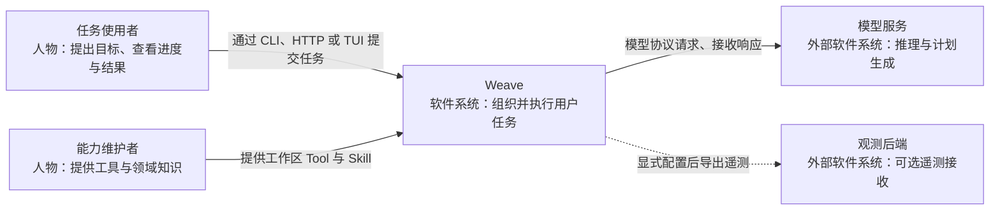
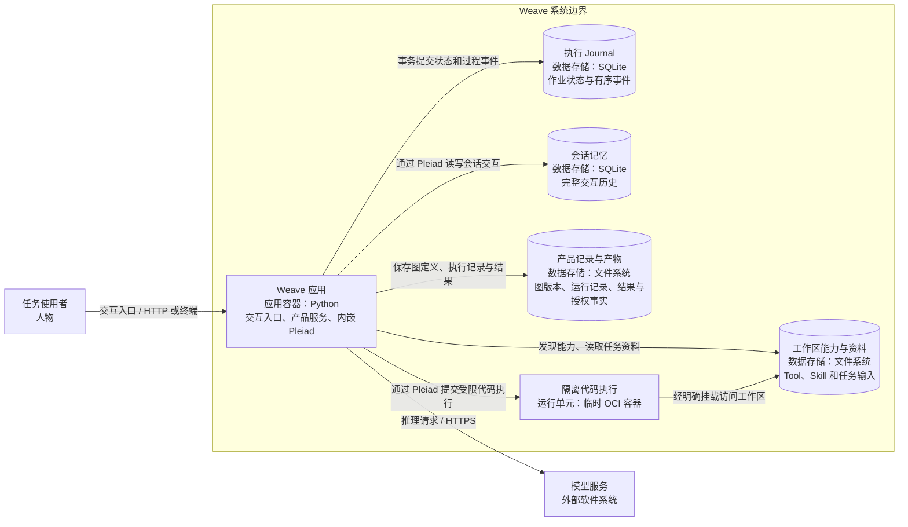
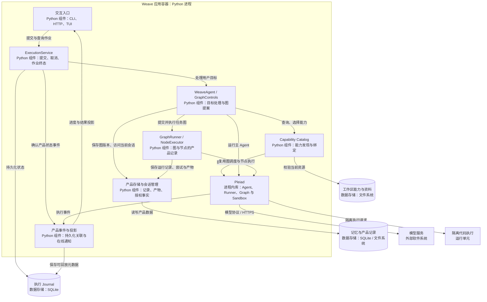

# Weave 架构设计

Weave 把用户目标、工作区能力和 [Pleiad 的运行机制](pleiad-architecture.md) 组合成可交互的 Agent 应用。简单任务由主 Agent 直接处理；需要分工和步骤依赖时，主 Agent 提出任务图，Pleiad 校验并执行，Weave 保存过程与结果并呈现给用户。

本文采用 [C4](https://c4model.com/diagrams) 的系统上下文、容器和组件视图，说明这个产品的核心思想与协作关系。

## 1. 核心设计理念

### 围绕目标组织执行

Weave 从用户目标出发选择所需能力。工作区中的 Tool 提供动作，Skill 提供知识；能力元数据用于发现，具体能力在任务节点绑定时确定。

复杂任务的分工以 Graph 表达：节点承担明确任务，边说明步骤依赖和数据传递，结构化输出供下游继续处理。Graph 将模型提出的执行计划变成可以校验、调度和检查结果的结构。任务划分可以随目标变化，执行规则保持一致。

### 产品与通用运行机制各有归属

Weave 决定产品身份、模型角色、能力授权、会话归属和结果呈现。Pleiad 负责模型调用、上下文、工具执行、图调度和资源生命周期。

这种分工让产品能够演进界面、任务策略和存储方式，同时继续使用一套通用 Runtime。图执行和节点执行的产品组件只增加记录与产物关联，实际执行仍由 Pleiad 完成。

### 一个目标对应一个持久化 Execution

Execution 是用户作业的持久化身份，负责状态、结果和过程关联。Pleiad Run 是一次框架调用，GraphRun 和节点尝试记录描述作业内部的执行过程。

这几个层次分别回答“用户任务进行到哪里”“某次调用做了什么”“计划中的节点如何执行”。界面查询和取消围绕同一个 Execution，内部调用不再形成另一套产品作业。

### 用真实执行事实驱动界面

CLI、HTTP 和 TUI 使用同一个应用服务。界面读取执行记录并消费事件，展示模型回复、工具进度和图状态。

持久化事件用于回放已经确认的过程，在线增量用于即时交互，Trace 和日志用于诊断。它们各自表达不同事实，最终任务状态由应用服务确认并保存。

## 2. 系统上下文视图（C1）

Weave 面向任务使用者，能力维护者为它提供工作区工具和领域知识。模型服务负责推理；观测后端是可选外部集成。

Pleiad 是 Weave 使用的进程内库，在下一层展开。它不作为独立外部服务出现在系统上下文中。

## 3. 容器视图（C2）

Weave 当前以单个 Python 应用进程拥有工作区。CLI、HTTP、TUI 是同一应用的不同入口，复用相同的应用服务；图节点是进程内的异步调用，执行用户脚本时才进入隔离单元。

执行 Journal、会话记忆和文件记录按责任分开。作业状态与其事件可以在同一事务提交，其他记录各自保存已经确认的事实；它们不构成跨所有存储的整体事务。

隔离单元由 Pleiad 管理创建、限制和清理。工作区脚本不在应用主进程执行，模型也不能自行选择宿主权限或运行环境。

## 4. 组件视图（C3）

展开 Weave 应用容器。核心组件围绕统一作业、目标规划、能力绑定、执行记录与界面投影组织。

| 组件 | 核心职责 | 设计意义 |
| --- | --- | --- |
| 交互入口 | 接收任务、展示进度和结果 | 交互方式变化不改变作业语义 |
| ExecutionService | 拥有作业任务，确认取消与终态 | 产品只有一条执行生命周期路径 |
| WeaveAgent / GraphControls | 基于目标和能力提出、选择并执行计划 | 模型规划通过明确的图边界进入执行 |
| Capability Catalog | 校验工作区能力，提供元数据搜索与绑定 | 能力演进与产品界面解耦 |
| GraphRunner / NodeExecutor | 关联图、节点尝试和产物 | 产品可理解内部执行过程，机制继续复用 Pleiad |
| 存储与会话管理 | 保存结果，维护会话和事实访问范围 | 历史、产物与授权具有明确归属 |
| 产品事件与投影 | 关联执行事实并供界面消费 | 在线展示与持久化回放共享事实来源 |

图表示逻辑协作，相关组件都位于同一应用进程。模型推理、Pleiad 的受控执行和 Weave 的产品记录分别承担自己的职责。

## 5. 从目标到结果

用户提交目标后，ExecutionService 先建立持久化 Execution，再由主 Agent 处理。主 Agent 可以直接回答或调用工具；当任务需要分工时，它查询能力，提出包含节点、依赖和数据映射的 Graph。

图提案经过能力绑定和 Pleiad 校验后成为一个产品版本。执行时，Pleiad 调度依赖已满足的节点，每个节点使用自己的 Agent 和入选能力。节点的结构化结果通过明确映射进入下游，Weave 同时记录节点尝试和产物。

主 Agent 根据实际返回结果形成答案，ExecutionService 确认并保存作业终态。事件让界面观察这条过程，但界面不参与底层调度，也不通过展示文案决定成功。

### 执行身份与记忆

| 概念 | 回答的问题 |
| --- | --- |
| Execution | 用户作业的状态和最终结果是什么？ |
| Run | 某次 Agent 调用发生了什么？ |
| Graph 版本与运行记录 | 执行了什么计划，这次执行结果如何？ |
| Session 与 Memory | 当前会话已经发生过哪些交互？ |

同一会话的主调用串行使用历史，图节点使用独立的单次记忆，避免节点的临时交互混入主会话。业务资料进入当前请求的 Context，用户原始输入仍作为历史事实保存。

## 6. 主要取舍与当前边界

| 选择 | 原因与边界 |
| --- | --- |
| 产品组装基于 Pleiad | 新界面和业务策略继续复用 Runtime，通用机制归 Pleiad，产品授权和记录归 Weave |
| 按目标形成任务图 | 独立步骤可以并发，有依赖的步骤通过结构化结果协作；简单任务无需强制建图 |
| 当前能力在绑定边界刷新 | 能力可以演进，已开始的调用保持自己的能力选择 |
| 一个工作区由单进程拥有 | 当前任务表和会话锁有明确拥有者，不支持多个进程共同调度同一工作区 |
| 重启不自动重放运行中作业 | 当前未保存完整恢复检查点，运行中作业会明确失败，避免重复产生副作用 |
| 事件、结果与诊断分开 | 在线增量用于交互，持久化记录用于事实，Trace 与日志用于理解调用过程 |

Pleiad 提供通用 Handoff、Worker 和检查点机制；Weave 当前没有独立 Worker 子作业与审批恢复的产品流程。文档中的任务图协作描述现有产品能力，不表示分布式 Agent 服务或自动续跑已经实现。

实现归属可从 [应用组装](../apps/weave/src/infrastructure/bootstrap.py)、[ExecutionService](../apps/weave/src/application/service.py)、[WeaveAgent](../apps/weave/src/agent/weave.py) 和 [图执行组装](../apps/weave/src/agent/graph.py) 继续追踪。
