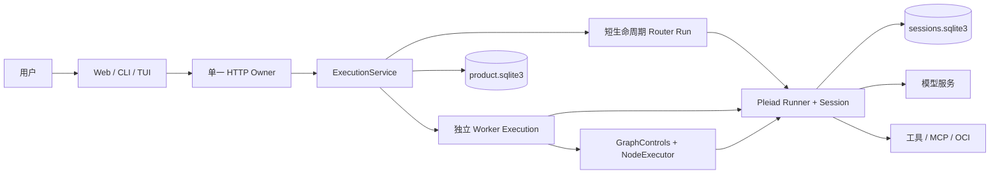

# Weave 架构

Weave 将一个永久主聊天、Space 配置和独立 Execution 组合成单所有者的本地 Agent 产品。主聊天收集用户意图并呈现正式回复，Router 负责分流和汇报，Worker 在独立 Session 中完成工作。运行机制使用 Pleiad 的公开 API。

## 系统边界

`packages/pleiad/src/` 安装为 `pleiad`，拥有 Session、ModelStep、Run、工具执行、Handoff、Subagent 和 Graph 调度。`apps/weave/src/` 安装为 `pleiad_weave`，拥有产品策略、授权、记录、内容和界面。`agent/graph.py` 把产品 GraphSpec 绑定为 SDK Graph，`agent/nodes.py` 在真实 Node.run 周围保存尝试和产物。

`pleiad serve` 拥有工作区进程锁、调度任务与恢复。CLI 和 TUI 使用 `WeaveClient` 连接正在运行的 HTTP Owner。多个客户端可以观察同一个产品状态。

## 身份与记录

| 对象 | 身份与责任 |
| --- | --- |
| Message | 永久主聊天中的正式消息，具有独立 `chat_sequence` |
| Space | 名称、用途、指令、模型角色和授权范围内的资源选择 |
| Execution | 唯一持久产品作业，使用 `execution_id` |
| Session | SDK 交互记录、输入队列、模型消息与检查点 |
| Run | 一次 SDK invocation，由稳定 `invocation_id` 接受与重试 |
| ModelStep | 一次模型协议步骤，使用 `step_id` |
| GraphRun | Execution 内的一次图调用，锁定具体 Graph revision |
| NodeAttempt | 一个 GraphRun 内的实际节点尝试及其 SDK Run/Session |
| Report | Worker 的结构化进度、结果或阻塞事实 |
| Attention | 等待用户回答或批准的持久请求 |

Handoff 继续使用当前 Run、Session 和 Execution。独立生命周期的委派创建 child Execution，并保存 `parent_execution_id`。Graph 节点的执行记录属于当前 Execution。

## 输入、路由与汇报

`ProductStore.submit_message` 在一个 SQLite 事务中校验全部目标、引用、附件和队列容量，保存 Message、稳定 origin、Inbox、Delivery 与 InputDisposition。相同客户端键和相同完整请求返回原始收据，修改请求产生冲突。一个多目标请求的接受具有原子性。

Router 批次由会唤醒的输入触发，并合并此前静默事实。每次尝试保存 invocation、读版本、候选动作和回复。提交时再次检查读版本与对象状态，并原子应用全部动作和正式回复。冲突后使用新 SDK observation 重新判断，最多三次。

歧义请求通过 `request_clarification` 原子创建全局 Attention。回答后按持久来源重新装载原请求、材料与责任，随后派发真实工作。`answer_question` 关联主聊天中已经提交的具体用户 Message。已接受问题的单次回答使用经过持久身份校验的预留额度，普通新请求仍受队列上限限制。

发给 Worker 的输入先进入持久 Delivery，再由服务投递给对应 Session。SDK 的已消费输入和产品的已处理责任分别记录。Worker 使用输入水位、结果证据与明确的 handled input IDs 提交 Report。 SDK 成功后的拒绝候选保存原因并生成有界的宿主修正观察，同一 Execution 与 Session 开启新的 Run 继续交付。先前已消费的输入继续保留责任，自动修正最多三次并共用任务累计预算。`progress` 保存到详情并保持静默。结果与需要用户参与的事实按产品策略唤醒 Router。

产品模型输入统一使用有界投影和精确来源引用。Router 按原文字节限制固定批次，Worker 按每个 Session 的未消费投影字节控制投递，并在 SDK ModelStep 边界补入下一批。query_product 与 query_work 按合法归属分页读取完整原文，模型视图压缩保留持久原文与摘要校验。

归还输入保存已完成动作和效果引用，通过 handback barrier 等待原目标集合结算。每轮重新分流具有独立身份，超过两轮升级为 Attention。显式目标消息的责任由对应 Execution 承担。

## 状态、控制与预算

Execution 状态包括 queued、running、waiting_input、waiting_approval、waiting_children、paused、blocked、cancelling、succeeded、failed、cancelled。转换和操作可用性集中在 ProductStore。SpaceView、ExecutionView 与 AttentionView 在同一读事务中计算 `available_actions`、禁用原因和计数。

暂停与继续保存实际 SDK RunCheckpoint。澄清答案和审批决定经 Attention resolve 提交，包含 expected revision、稳定请求键和精确 action digest。resolve 在一个事务中保存用户 Message 和决定。用户回答后仍需服从当前暂停与取消意图。

Execution 具有总预算。子 Execution 和 Graph 调用按实际剩余额度预留。SDK usage 按 invocation 累计结算，恢复原 Run 延续此前已计费额度。完成父任务前验证输入责任、必要子任务、检查证据和产物。未知外部效果保留为需要核实的事实。

必需验证使用 `artifact_integrity` 或 `tool_result` 的具体要求，分别绑定交付产物名称，或精确工具代码、参数与预期结果字段。宿主读取实际字节、SDK 工具结果或后台 OperationResult，独立产生 host Verification。Worker 自报的检查保持来源区分。

启动恢复先检查 Session 和调用收据。已确认结果可以继续结算，安全检查点可以恢复。缺少确认的外部动作经证据核对后进入明确状态。取消等待拥有者完成 SDK 清理和持久结算。

## 持久化与内容

默认根目录为 `workspace/runtime-v2/`。

- `product.sqlite3` 保存产品记录、请求收据、引用关系和全局事件序列。
- `sessions.sqlite3` 使用 SDK SQLite SessionStore 保存交互、输入、步骤、调用和检查点。
- `content/` 保存以 SHA-256 标识的附件和产物字节，读取时核验大小与摘要。
- `facts/` 保存带 revision、provenance 和 space/user scope 的本地事实。
- `logs/` 保存脱敏诊断日志，`scratch/` 提供工具临时内容。

附件上传使用稳定 `client_attachment_id`，限制为 25 MiB，并校验 MIME 与字节格式。临时附件具有 24 小时有效期，正式消息引用后转为持久引用。产物属于具体 Execution，可关联 GraphRun 和 NodeAttempt。

Space 删除先生成短期有效预览，展示归属对象、共享引用和阻塞原因。确认时再次核验 revision 与引用摘要，写入 cleanup generation。清理通过持久进度、回收目录和 tombstone 处理重试，共享内容按引用保留。已完成清理只发布一个终态事件。 清理预览绑定 SDK Session、任务文件与 Space facts 的数量和身份摘要。拥有者先保存完整递归 Session 清单，然后以同一代次执行 SDK、facts、工作目录、原始执行详情和产物回收，所有阶段完成后提交 Space tombstone。

Worker 的文件与命令工具把 workspace 和 scratch 绑定到 `workspace/work/{space_id}/{execution_id}/`。宿主工具脚本以独立只读 `/tools` 挂载，selected Skill roots 单独授权。Space 显式绑定 `workspace` 资源后，通过只读 `workspace_resource` 查询和 materialize 共享资料，该入口屏蔽 `runtime-v2` 与 `work`。产物与附件通过 `execution_content` 进入授权视野。宿主私有运行数据由文件检查和 OCI 私有挂载遮罩共同隔离。

## 查询与事件

`GET /v1/snapshot` 返回同一事务读取的全局水位、最近聊天、Space、Execution、Attention、计数与能力摘要。MessageView 在该读事务中把实际 Report 解析为来源工作摘要，并只暴露 ArtifactMetadata。聊天中的产物卡使用持久 artifact_id，删除或损坏后继续展示当前可用性。列表与原始内容使用有界分页。详情按当前选中对象读取，Graph 和原始 ToolResult 保留实际归属校验。

`GET /v1/events` 使用全局 sequence 回放 `product` 事件。未来游标、序列缺口或积压超过 1000 条时返回 `resync`，客户端重新取得 snapshot。`chat.message.created` 的 data 是同事务生成的 MessageView，前端按全局 sequence 去重并直接合并正式消息，派生对象使用有界节奏刷新。浏览器连接的生命周期独立于 Execution。

HTTP 绑定本地主机身份，校验同源 Origin，并要求写请求携带 snapshot 下发的 `X-Weave-CSRF`。静态 UI 与 API 同源。模型密钥、MCP 凭据和宿主绝对内容路径由服务端拥有。

产品观测复用宿主 OTel Meter。接收、路由、投递失败、控制耗时与 Worker 活跃数记录运行测量。只读 Observable 指标从产品事务采集队列、最老输入与待办年龄、责任处置、转派轮数和预算，父子工作按 scope 分开。已提交事件按类型累计，保留 handback、报告和清理事实的幂等计数，指标读取不会启动模型。

控制请求返回耗时与取消清理时长分别计量。取消清理时长从产品日志中的首次 cancel 意图到确认 cancelled 的提交时间计算，包含等待真实子工作与副作用对账的时间，只有确认终结后记录。原始 ToolMessage 和后台最终 OperationResult 使用独立引用，原文页注明产品日志或 SDK Session 的读取水位。

## 外部能力与观察源

能力目录每次绑定时读取实际 Tool、Skill 和已启用 MCP 配置。Skill 在模型请求中先提供描述，正文通过授权的 `read_file` 按需读取。MCP 允许列表、凭据来源和 OAuth 登录由宿主管理。HTTP 与 stdio 调用使用 SDK MCP 实现，OCI 执行使用 SDK Sandbox。

D6 提供宿主显式配置的本地只读目录观察源。配置、健康与已保存 observation 分别查询，`POST /v1/sources/{source_id}/observe` 显式扫描并提交带摘要的去重事实。扫描执行文件数量、单文件大小与总字节上限，拒绝符号链接越界。该阶段的调度输入由后续产品策略决定。

具体接口和操作见 [Web 使用指南](weave-web.md)，SDK 机制见 [Pleiad 架构](pleiad-architecture.md)。
